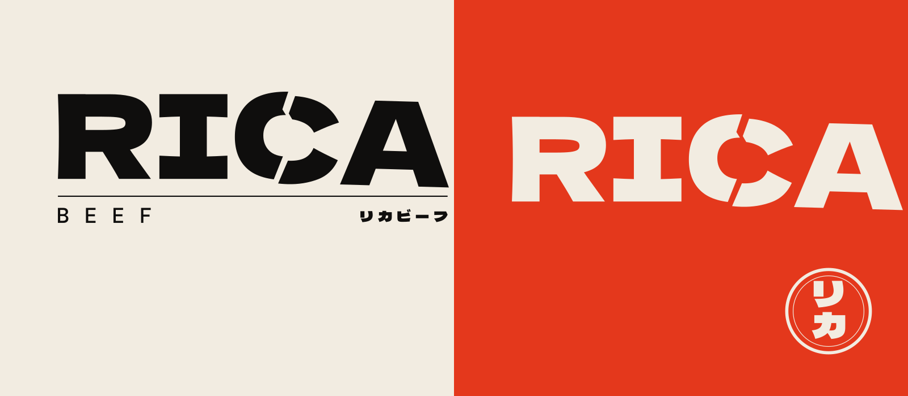
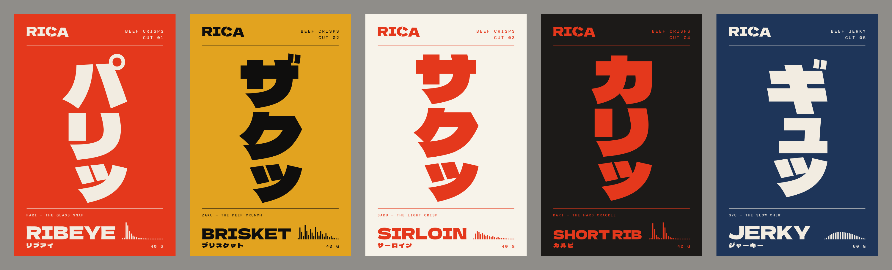
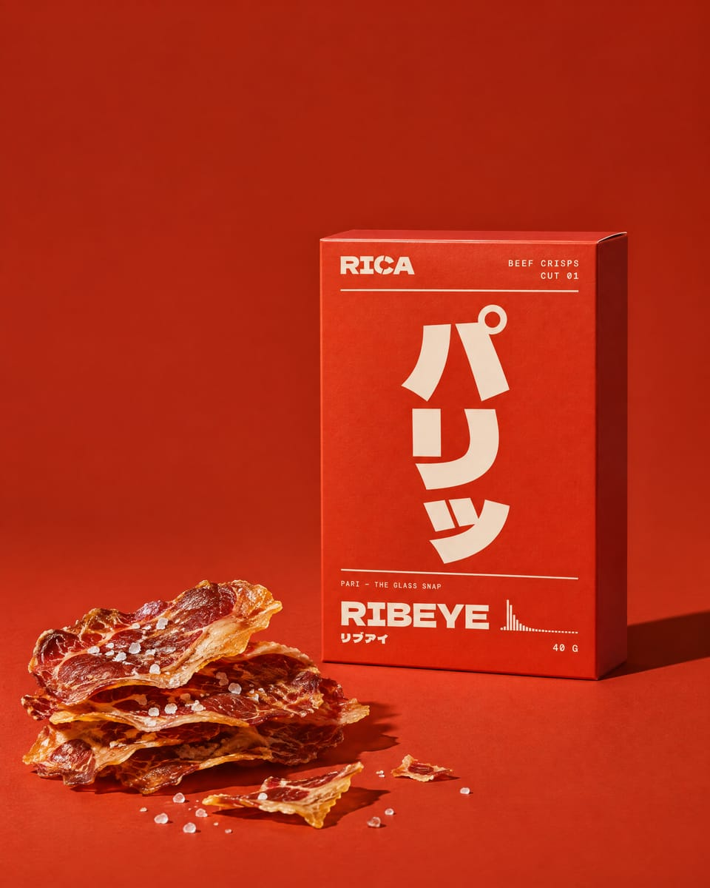
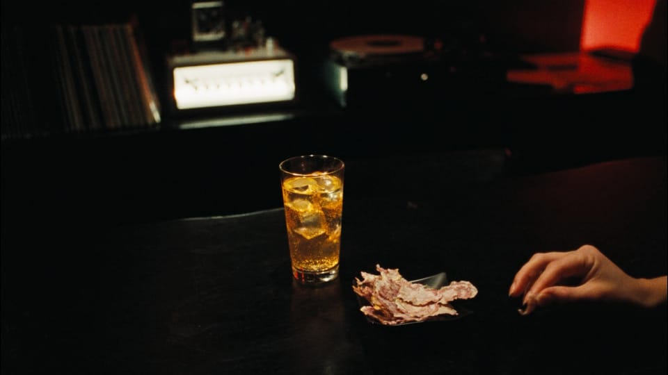
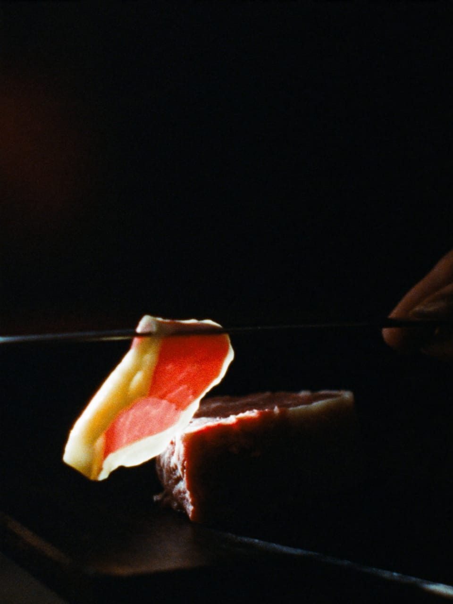

# Rica Beef — brand book

Version 1.0 · the identity, the voice and the rules behind the website, the packs and the film.

Everything here is a creative proposal built from the brief: a Japanese brand of paper-thin dried beef crisps, seasoned with a house salt, sold cut by cut, with a jerky alongside. Where this document states something about the product that the brief did not, it is marked in the last section, "Confirm before launch".

## 1. The idea in one line

**Every cut has a sound.**
部位ごとに、音がある。

Beef, sliced until light passes through it, salted, dried until it stops bending and starts breaking. Ribeye does not break the way brisket does. So we stopped describing flavours and named each cut after the noise it makes.

Two phrases carry the rest:

- **Thin & loud.** The platform. Paper-thin product, loud crunch. Every design decision is one or the other.
- **A loud snack for quiet places.** The positioning line. It tells you where Rica lives and gives the brand its sense of humour.

The feeling we are buying with every image and every word: *I need to try this right now.* Sound does that faster than description. You have already imagined the snap.

## 2. Brand story

Most beef snacks ask you to chew. Rica asks you to listen.

**Slice.** One cut at a time. We slice it until you can hold it up and read the room through it. Not thin. Paper.

**Salt.** Then one seasoning, ours: Rica Salt, うま塩. We will tell you everything about it except the ratio.

**Sound.** Then time. The beef dries until it gives up bending and learns to break. And every cut breaks differently. Ribeye, all marbling, goes off like glass: パリッ. Brisket, long in the grain, comes apart in layers: ザクッ. Sirloin is light and gone: サクッ. Short rib cracks hard at the edge: カリッ. The jerky does not break at all. It holds. ギュッ.

That is the whole range, and the whole brand. A cut, a colour, a sound.

It is a small, noisy thing to eat in a quiet place: a listening bar where nobody talks over the record, the last train, your own kitchen at two in the morning. We are sorry about the noise. Not very.

## 3. Audience

**Who.** City people between roughly their mid-twenties and forty who treat the snack as the best part of the drink. They have a favourite bar and a favourite seat in it. They buy the good version of ordinary things: the tinned fish, the single-origin chocolate, the highball made properly. They are design-literate without calling it that, and they will photograph a pack before they open it.

**What they want.** Something to put on the counter that starts a conversation. Real food, recognisably beef, not a protein product. A small luxury that fits in a coat pocket. A gift that is not wine.

**Where they are.** After work, between the office and home. In bottle shops, specialty grocers and well-edited convenience stores. On their phones with the sound on, watching things being cut, poured and broken.

**Second audience: the gift buyer.** The range is five colours in one format and lines up like a set. It is built to be bought as three or five.

These are working assumptions for the creative, not research findings.

## 4. Personality and positioning

**Personality.** Precise. Sensory. Dry. Nocturnal. A little cheeky.

Rica has a butcher's exactness and a bartender's manners. It is the quiet person at the counter who says one funny thing all night. It never shouts; the product does that.

| We are | We are not |
|---|---|
| Exact | Technical |
| Dry | Sarcastic |
| Confident | Macho |
| Japanese in craft and manners | A postcard of Japan |
| Playful about noise | Wacky |
| Premium by restraint | Luxurious by decoration |

**Positioning.** For people who think the snack is the best part of the drink, Rica is beef treated like a crisp: one cut per pack, sliced paper-thin, seasoned with one house salt, and named for the sound it makes. Jerky bends. A crisp was never a steak. Rica is the one that started as a cut of beef and breaks like glass.

**What Japan gives the brand, and what it does not.** Japan is in the craft (the slice, the patience), the language (a whole vocabulary for crunch) and the manners (apologising for the noise). The setting is the Tokyo listening bar, the after-work highball and the last train: sound culture. It is never Mount Fuji, cherry blossom, torii gates, lanterns or brush-script. If an image could be a tourism poster, it is wrong.

## 5. Voice

### Principles

1. **Sound first.** Lead with what you hear, then what you taste. The sound word does the work an adjective would do.
2. **Sentences that snap.** Short. Then shorter. A full stop is a break.
3. **Quiet copy, loud product.** We understate. The katakana is the only thing allowed to shout.
4. **Specific beats superlative.** "Thin enough to read through" instead of "ultra-thin". Never "premium", "artisan", "gourmet", "delicious".
5. **You, now.** Second person, present tense. We talk to one person at a counter.
6. **One joke, dry.** The joke is always about noise or about not sharing. One per piece of copy, at most.

### Do and do not

| Do | Do not |
|---|---|
| "One clean, high snap. Then butter." | "An explosion of rich, mouth-watering flavour!" |
| "Sliced until light passes through." | "Ultra-thin premium beef crisps." |
| "Sorry about the noise." | "Get ready to CRUNCH!!!" |
| "We'll tell you everything except the ratio." | "Our secret ancient recipe." |
| Name the cut. Name the sound. | Invent flavour names. |
| Use the Japanese word, then let the picture explain it. | Translate every word in brackets. |
| Stop when the sentence is finished. | Add a second sentence to explain the first. |

### Lines

Headlines

- Every cut has a sound.
- Thin as paper. Loud as a steakhouse.
- A loud snack for quiet places.
- Hold it up to the light. Then don't.
- Beef that breaks.

On the pack

- Pari — the glass snap.
- Zaku — the deep crunch.
- Saku — the light crisp.
- Kari — the hard crackle.
- Gyu — the slow chew.
- Back of pack: "Open quietly. That's the last quiet thing you'll do."

Social

- "Listening bar. 23:40. Sorry about the noise."
- "Last train. One pack. No witnesses. One witness."
- "Guess the cut." (over a waveform, nothing else)
- "Not a library snack."

Calls to action

- Hear the cuts
- Watch the film
- Find a pack
- Get the next one

Small moments and error states

- Sold out: "Gone. It never lasts."
- Empty basket: "Quiet in here."
- 404: "This page snapped."
- Form error: "That didn't land. Try once more."
- Loading: "Slicing."
- Sound toggle: "Sound on. It's the whole point." / "Sound off. Reading the room."

### Japanese

Japanese is used sparingly and always means something: the tagline, the five sound words, the cut names on pack, and on the website a handful of single words — the three chapter characters 薄 塩 音 (thin, salt, sound), 日本製 (made in Japan), うま塩 for the house salt, and ごちそうさま at the close. It is set properly (Shippori Mincho for sentences, Dela Gothic One for the sound words) and never used as decoration. Do not add Japanese that says nothing. Have every Japanese line checked by a native copywriter before launch.

## 6. Naming system

The brand name is two beats, ri-ka, written リカ in katakana. In Spanish and Portuguese *rica* means rich or delicious. That is a welcome accident in those markets and nothing more; do not build copy on it.

Each product is a cut, a sound word and a colour. The sound words are ordinary Japanese onomatopoeia, used the way a Japanese speaker would use them about food.

| No. | Cut | Sound word | Romaji | What the word means | Line | Colour | Pack ink |
|---|---|---|---|---|---|---|---|
| 01 | Ribeye リブアイ | パリッ | Pari | The clean snap of something thin and brittle: nori, a wafer | The glass snap | Shu, vermilion #E4381C | Bone |
| 02 | Brisket ブリスケット | ザクッ | Zaku | A coarse, hearty crunch with some depth to it | The deep crunch | Karashi, mustard #E2A31F | Sumi |
| 03 | Sirloin サーロイン | サクッ | Saku | A light, clean bite: good tempura batter | The light crisp | Shio, salt white #F7F3EA | Shu |
| 04 | Short rib カルビ | カリッ | Kari | A hard, dry crackle: something well toasted | The hard crackle | Kuro, charcoal #1C1A18 | Shu |
| 05 | Jerky ジャーキー | ギュッ | Gyu | Tight, squeezed, packed in. Also a near-pun on 牛 gyū, beef | The slow chew | Ai, indigo #1E3559 | Bone |

Rules:

- The sound word is always katakana with the small ッ at the end. The ッ is the abrupt stop; without it the word is a different word.
- In Latin text, write the romaji with a capital and no punctuation: Pari, Zaku.
- New products get a new cut, a new real sound word and a new flat colour. Never a flavour adjective ("Spicy", "Original").
- Product data lives in one file, `src/data/products.js`. Change it there and the website, the pack artwork and the image prompts all follow.

## 7. Logo

**The Snap.** The wordmark is RICA in Dela Gothic One, cut along a jagged line through the bowl of the C. The left piece stays put. The right piece has dropped a few units and turned 1.6 degrees, the way a crisp sits after it has broken. It is the product, drawn in four letters.

- Wordmark: [`rica-wordmark.svg`](../src/assets/brand/rica-wordmark.svg). Use this almost everywhere.
- Lockup: [`rica-lockup.svg`](../src/assets/brand/rica-lockup.svg). Wordmark over a hairline rule, with BEEF in tracked DM Mono on the left and リカビーフ on the right. For first impressions: site footer, pack back, letterhead.
- Seal: [`rica-seal.svg`](../src/assets/brand/rica-seal.svg). リ over カ in a double ring. For small spaces and for sign-offs: pack closure, social avatar, the end of a film.
- Favicon: [`favicon.svg`](../public/favicon.svg). A snapped R, bone on vermilion.

All four are pure outlines built from the type by `scripts/build-brand-assets.mjs`, and they take their colour from `currentColor`. They need no font installed.

**Colour.** Bone on sumi, sumi on bone, bone on vermilion. On packs the wordmark takes the pack ink. Nothing else.

**Clear space.** The width of the letter I on every side. Nothing enters it: no type, no edge, no photograph detail.

**Minimum size.** 72 px wide on screen, 18 mm in print. Below that the crack closes up; use the seal or the favicon R instead.

**Do not:**

- close the crack or straighten the right half;
- redraw, outline, stretch, rotate or add a shadow or gradient;
- set RICA in another typeface and call it the logo;
- place it over the busy part of a photograph (it sits in the negative space the image was composed with);
- animate it any way except the snap: whole, then broken, in one hard beat.

## 8. Colour

Four colours do almost all the work. The cut colours appear only as flat fields: a pack, a backdrop, a full section of the page.

| Name | Hex | Role |
|---|---|---|
| Sumi (ink black) | #0F0E0D | The night. Backgrounds of the night world, body type on light grounds |
| Bone (paper) | #F2ECE1 | The editorial ground. Type on dark and on vermilion |
| Shu (vermilion) | #E4381C | The signature. Ribeye, calls to action, the final moment. One strong use per screen |
| Amber | #D58A2A | Light, never ink: tungsten, whisky, the glow through a slice. Lives in photographs |
| Karashi (mustard) | #E2A31F | Brisket only |
| Shio (salt white) | #F7F3EA | Sirloin only. A shade lighter and cooler than Bone |
| Kuro (charcoal) | #1C1A18 | Short rib only. A shade lighter than Sumi so the pack separates from a black page |
| Ai (indigo) | #1E3559 | Jerky only. The one cool colour, because the jerky is the one that is not a crisp |

Contrast, measured (WCAG ratio):

| Pair | Ratio | Use |
|---|---|---|
| Bone on Sumi, Sumi on Bone | 16.4 : 1 | Any text |
| Bone on Kuro | 14.8 : 1 | Any text |
| Bone on Ai | 10.5 : 1 | Any text |
| Sumi on Karashi | 8.7 : 1 | Any text |
| Amber on Sumi | 6.9 : 1 | Any text, sparingly |
| Sumi on Shu | 4.5 : 1 | Body text on vermilion is set in Sumi |
| Shu on Kuro | 4.0 : 1 | Large type only |
| Shu on Shio | 3.9 : 1 | Large type only |
| Bone on Shu, Shu on Bone | 3.7 : 1 | Display type and the wordmark only, never small text |

No gradients, no tints, no transparency on brand colours. Depth comes from photography.

## 9. Typography

Five faces, each with one job. All are open-source (SIL Open Font License) and self-hosted from `src/assets/fonts/`.

| Role | Face | Used for | Guidance |
|---|---|---|---|
| Loud | Dela Gothic One | The wordmark, the katakana sound words, cut names, big numerals | As large as the format allows. All caps in Latin. Tight tracking. Never below 20 px, never for sentences |
| Quiet | Bodoni Moda Italic | Editorial display: headlines, pull lines, the tagline | 28 px and up only; the hairlines disappear below that. Sentence case. Never bold, never all caps |
| Plain | Instrument Sans | Body copy, navigation, buttons | 16 to 18 px, line-height about 1.5, 400 for text and 600 for emphasis |
| Label | DM Mono | Spec lines: "CUT 01", weights, timecodes, captions | 11 to 13 px, all caps, tracking +0.08 em. One line at a time |
| Japanese | Shippori Mincho | Japanese sentences, above all the tagline | 500 weight, generous tracking. Sound words are not set in this; they are Dela Gothic One |

**Why this pairing.** It is the idea, set in type. Dela Gothic One is heavy, blunt and unmistakably Japanese: the crunch. Bodoni's hairlines are as thin as a letter can be drawn and still print: the slice. Put them on the same page and you get thin and loud without writing the words. Instrument Sans and DM Mono stay out of the way, the second one borrowing the look of a butcher's label.

**Setting rules.**

- One loud element per view. If a sound word is on screen, the headline is in Bodoni, and the other way round.
- Sound words run vertically wherever there is height for it, small ッ tucked to the right as in proper vertical setting.
- Numerals for cut numbers are always two digits: 01 to 05.
- Left-aligned. Centred type is for the end card and nowhere else.

## 10. Graphic devices

1. **The Snap.** A jagged fracture with one side dropped. It lives in the wordmark, and it can split an image or a section edge. One snap per layout.
2. **The Sound Word.** Giant vertical katakana in the pack ink. The loudest thing in the system. It may be cropped by the edge of the format; it may never be tilted or stacked with another sound word. The one variation: as a ghost behind a night photograph it may be drawn as a hairline outline.
3. **The Waveform.** Twenty-four bars: the crunch signature of a cut. Ribeye is one spike and a fast decay; brisket is a run of peaks; sirloin is low and soft; short rib is two hard spikes; jerky is one long swell. It sits bottom-right on every pack where a barcode would, and on screen it is the product's meter. The shapes are data in `src/data/products.js`.
4. **The Seal.** リカ in a ring. A sign-off, used once.
5. **Salt.** Scattered crystals: in photographs, real salt caught in the key light; on screen, a sparse field of small bone-coloured particles. Always falling or settled, never arranged into a pattern.

Not in the system: brushstrokes, waves, circles standing in for the sun, decorative drop shadows, icons of cows. Corners are square, apart from pill-shaped buttons.

## 11. Packaging

A slim upright carton in matte uncoated board, about the proportions of a paperback, one flat colour per cut. Crisps are fragile, so the pack is rigid; it stands up on a bar counter and reads from across the room.

Front, top to bottom:

- wordmark top-left; product line and cut number top-right in DM Mono ("BEEF CRISPS / CUT 01");
- a hairline rule;
- the sound word, vertical, filling the centre;
- a hairline rule;
- the sound line in DM Mono ("PARI — THE GLASS SNAP");
- the cut name in Dela Gothic One with its katakana beneath, bottom-left; the waveform and the net weight bottom-right.

One ink per pack, on one flat colour. No photography, no window, no foil, no flavour illustration. The colour and the katakana are enough to tell five packs apart at three metres; the cut name does the rest at arm's length.

The artwork is generated, not drawn by hand: `scripts/build-brand-assets.mjs` writes one vector file per cut to `src/assets/brand/packs/` from the product data, and the same files are passed to the image model as references, so the pack in every photograph is the real artwork.

Still to design: back and side panels, closure, shipper, and the three- and five-pack gift sleeve.

## 12. Art direction and photography

There are two worlds. They share one light: **the key always comes from camera-left at about 45 degrees.**

**Night.** Where Rica is eaten and where it is made. Low-key: one warm tungsten source, soft falloff, shadows that go to true black, a faint vermilion glow far in the background. Shot like cinema: fine 35mm grain, shallow depth of field, 100mm macro for salt and snaps, 85mm for hands and faces, 50mm at the bar, 35mm for the rare wide. Subjects are small in a lot of darkness; the darkness is where the type goes.

**Studio.** Where each cut is itself. One flat colour, floor to backdrop, a shade deeper than the pack. One hard light, one clean shadow falling right. Medium format, 90mm, f/8, everything sharp. The beef goes front-left, the pack right of centre, the top quarter stays empty.

| Always | Never |
|---|---|
| Light from camera-left | Flat, shadowless or top-down beauty light (the closing frame is the one top-down exception, and it still has the left key) |
| Real texture: lace of marbling, salt crystals, broken edges | Glossy, retouched, plastic-looking food |
| The crisp held to the light at least once per set | Piles of product filling the frame |
| Negative space composed for the type | Type placed over detail after the fact |
| Hands, and faces caught mid-moment, looking off-camera | Models smiling at the lens holding a pack |
| The pack still and sharp, artwork from the vector file | Packs in motion, tilted for drama, or redrawn |
| Grain, true blacks, amber and vermilion | Teal-and-orange grades, bloom, haze, lens flare |
| Tokyo at night by implication: a counter, a carriage, a record | Landmarks, signage, anything a tourist would photograph |

People are original, fictional adults. No real person's likeness is used anywhere in the imagery.

The exact prompt language for both worlds is in `production/look.mjs` and is printed in full in [02-film-storyboard.md](02-film-storyboard.md) and [03-website-image-storyboard.md](03-website-image-storyboard.md).

## 13. Motion and sound

**Motion**

- Things break; they do not fade. The signature transition is a cut, or a move that ends in a hard stop.
- Fast in, dead stop. Around 200 ms for interface feedback, no bounce, no overshoot. Long, slow moves are reserved for photographs (a drift, a push-in), where they read as camera.
- One motion per moment. If the sound word hits, nothing else moves.
- Slow motion belongs to salt and to the snap. Nothing else gets it.
- Respect reduced-motion settings: every animation has a still state that is just as well composed.

**Sound**

- Sound is the brand's first sense, and it is always opt-in on the web. Nothing plays until someone asks for it.
- Each cut has its own snap, the audible twin of its waveform: high and glassy, deep and layered, light and airy, hard and double, and for the jerky a low, slow squeeze.
- Silence is a material. The film opens with almost none and ends on a single snap in silence.
- Music is diegetic in spirit: a record in the room, never a soundtrack laid on top. Upright bass, brushes, vinyl warmth.
- No voice-over. Rica does not explain itself out loud.

## 14. Applications

**Website.** One page, seven movements: Hero (the snap in the dark, the line), Story (Slice, Salt, Sound), Collection (the section takes the colour of the cut you choose; the pack turns in your hand; each cut shows its waveform and has its sound), Lifestyle (quiet places), Campaign (the film and its storyboard), Why Rica (the texture, the reasons), Final moment (an empty dish on vermilion). Dark for the world, paper for the reading, flat colour for the product.

**Film.** "OTO" (音), thirty seconds: silence, a salt flake, a blade, the racks, the salt, the pour, the snap, four snaps on four colours, the five packs, the wordmark breaking. Full storyboard in [02-film-storyboard.md](02-film-storyboard.md).

**Social formats.**

1. *One cut, one sound.* A six-second vertical loop. Flat cut colour, a crisp, it snaps, the sound word hits on the frame. Sound on. Five of these are the launch.
2. *Quiet places.* A night photograph and a caption in a fixed form: place, time, apology. "Listening bar. 23:40. Sorry about the noise."
3. *Hold it to the light.* One macro of a crisp against a lamp, a window, a phone screen. No copy but the cut name. Made to be imitated.
4. *Guess the cut.* A waveform, alone, in ink on bone. The answer is the next slide: the cut's colour floods in with the sound word.

**Retail and print.** The five packs in a row are the display. Shelf strips and posters use one sound word each, vertical, with the wordmark small. Never all five sound words on one surface except as five packs.

## 15. Confirm before launch

Nothing below has been verified with the people who make the product. Each item is a proposal that the creative work currently relies on. Confirm, correct or cut each one; where a fact changes, change it in `src/data/products.js` or `production/look.mjs` and the site, packs and prompts follow.

Range

- The cut list. Ribeye, brisket and jerky come from the brief. Sirloin and short rib were added to make a range of five.
- Net weights: 40 g for the crisps and 60 g for the jerky are placeholders.
- That each pack contains a single cut.

Product and process

- "Paper-thin", "sliced until light passes through": a description of the product that should be checked against the real thing.
- That the product is dried and not fried, and any wording about how slowly.
- The tasting language for each cut (notes, the one-line descriptions, the pairings) and the three meter scores per cut. They are written to character, not from a tasting.
- That each cut really does break differently enough to carry its sound word. The system depends on it; taste the range against the five words.

Rica Salt

- The name "Rica Salt" and the Japanese うま塩.
- That it is a house blend, and that the recipe is to stay undisclosed ("everything except the ratio").
- The imagery shows coarse white salt flakes with small dark specks of toasted spice. If the real seasoning looks different, change the `CRISP` description in `production/look.mjs` before generating more images.

Claims and compliance

- No ingredient list, allergen statement, nutrition panel, shelf life, certification, award, price or origin of the beef has been written, because none was supplied. The site and packs need the real ones.
- The wording and legal basis of any "Made in Japan" statement.
- Whisky and beer appear in lifestyle imagery and pairings. Check advertising rules for alcohol-adjacent content in each market.
- All people in the imagery are AI-generated fictional adults. Disclose as platform and local rules require.
- Trademark clearance for "Rica" in the food class, in every market.

Language

- Every Japanese line, checked by a native copywriter: the tagline 部位ごとに、音がある。, the five sound words as applied to these cuts, the cut names (カルビ for short rib in particular), the gyū / gyu wordplay on the jerky, and the single words used on the website (薄, 塩, 音, 日本製, うま塩, ごちそうさま).
- The brand story on the website opens "It started with a sound." That is a narrative device, not a documented founding story; replace it with the real one if there is one.

Design

- The carton format and its dimensions (about 10 × 15 × 3 cm) are a design proposal, not a packaging specification.
- Pack backs, sides and outer packaging are not designed yet.
