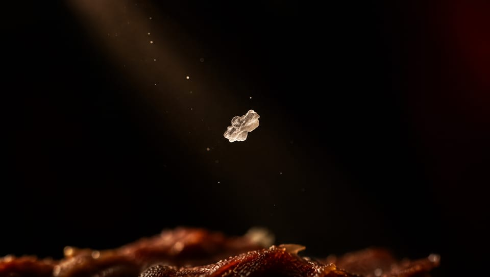
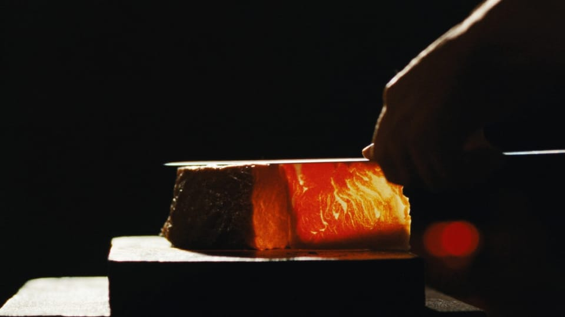
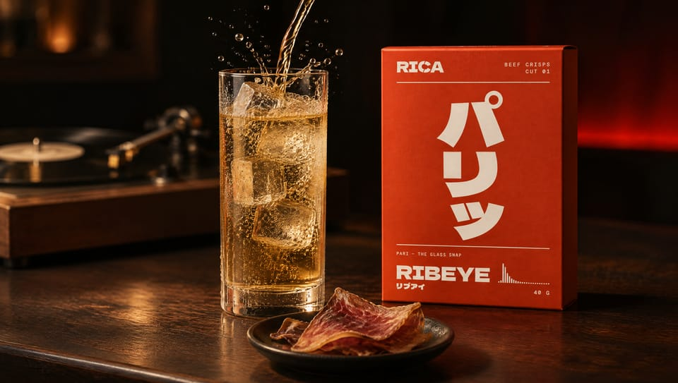
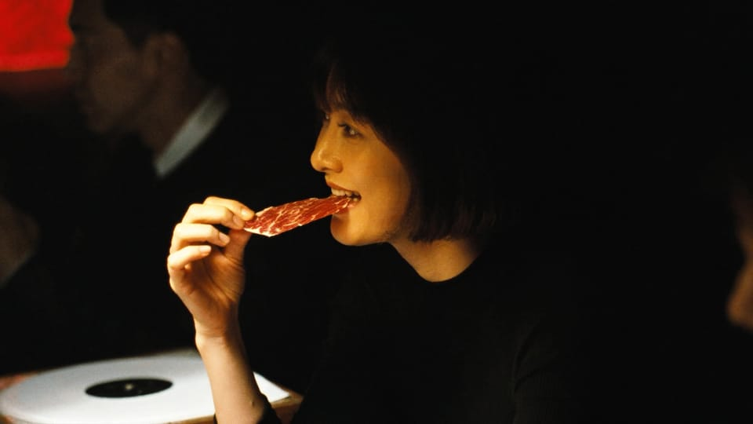

# OTO (音) — campaign film storyboard

Rica Beef · 30 s · 16:9 master · 24 fps · Seedance 2.5 at 1080p, image-to-video from approved start frames

Built from `production/film.mjs`, `production/stills.mjs` and `production/look.mjs` by `npm run docs`. Do not edit by hand: change the data and rebuild.

Status: 26 of 26 stills generated · 11 of 11 film start frames ready · 11 of 11 film takes rendered.

## 1. The film

**Title.** OTO (音, "sound").

**Line.** Every cut has a sound. / 部位ごとに、音がある。

**Idea.** A film you listen to. It opens in near silence and is built from the sounds of the product being made and eaten — a salt flake landing, a blade, a pour, a snap. The music does not start until the needle drops at the bar; from there, four snaps on four colours become the percussion.

**Structure.** Brand film / demo-first hybrid: silence → craft → the world → the snap → the range → the name.

**Music.** Sparse late-night jazz trio heard as if from a record in a listening bar: upright bass and brushed snare, one muted trumpet phrase, 92 bpm, warm vinyl crackle, dry and close. Enters at 12.5 s on a needle drop, lifts at 19.5 s, stops dead at 27.5 s for the final snap. Instrumental, no vocals.

**How it is made.**

1. Every shot starts as a still. The start frame is generated and approved first, because a still is where packaging, palette and light can be controlled, and it costs a fraction of a video take.
2. Each start frame is then animated image-to-video. The video prompt only describes change over time: one camera move, one action.
3. One video model for the whole film. Mixing models shows as a change of grain and motion between cuts.
4. No type is ever generated. The sound words over the four snaps and the end card are added in the edit from the vector artwork.
5. The pack is never asked to move. In the two shots where it appears it is told to stay still and sharp, which is what keeps the artwork from morphing.

## 2. Look bible

These strings are pasted byte-identical into every image prompt. Consistency comes from reuse: change a word in `production/look.mjs` and every prompt changes with it.

**The night world** — hero, story, lifestyle, campaign, most of the film.

```text
Photoreal premium food commercial cinematography, shot on ARRI Alexa 35, fine 35mm film grain, shallow depth of field. Low-key lighting: one warm tungsten key light from camera-left at 45 degrees with soft falloff, deep neutral-black shadows, a faint vermilion-red glow in the far background. Palette: ink black #0F0E0D, warm bone white #F2ECE1, vermilion #E4381C, amber #D58A2A. Rich, natural, appetising colour. No bloom, no haze, no lens flare.
```

**The studio world** — individual cuts, the four snaps, the closing frame.

```text
Photoreal premium product photography, medium-format camera, 90mm lens, f/8, crisp focus, fine film grain. One hard key light from camera-left at 45 degrees casting a single clean, defined shadow to the right. Seamless matte paper backdrop and floor in one flat colour. Brand palette: ink black #0F0E0D, warm bone white #F2ECE1, vermilion #E4381C. Rich, natural, appetising colour.
```

**The product**, described the same way every time.

```text
RICA beef crisps are paper-thin, irregular palm-sized shards of dried beef: deep mahogany-red with a lighter translucent amber lace where the marbling was, brittle and glassy like a very thin cracker, dusted with coarse white salt flakes and tiny dark specks of toasted spice.
```

**The pack**, always used together with the flat artwork as a reference image (`production/refs/pack-<cut>.png`).

```text
a slim upright rectangular carton in matte uncoated paperboard (about 10 cm wide, 15 cm tall, 3 cm deep) whose front panel reproduces the flat artwork in the reference image exactly — same flat colour, the RICA wordmark top-left, one huge katakana sound word set vertically down the centre, the cut name bottom-left and a small row of waveform bars bottom-right. Do not redesign, restyle or add to the artwork.
```

**Negatives.**

```text
No text, no lettering, no logos, no packaging, no watermark.
No extra text beyond the pack artwork, no other brands, no watermark.
```

**Appended to every video prompt.**

```text
Single continuous shot, no cuts. No text, no captions, no logos other than the pack artwork. Keep the lighting direction and colour of the start frame.
```

What must hold across all nine frames:

- The key light always comes from camera-left at about 45 degrees. In the night world it is warm tungsten; in the studio world it is hard and casts one clean shadow to the right.
- Four colours carry everything: ink black #0F0E0D, bone #F2ECE1, vermilion #E4381C, amber #D58A2A. The cut colours appear only as flat fields in S07 and on the packs.
- Lenses: 100mm macro for salt and snaps, 85mm for hands and faces, 50mm for the bar and the line-up, 35mm for the one wide.
- Fine 35mm grain, no bloom, no haze, no lens flare.
- The pack artwork is the vector file, passed as a reference. It is never described from memory and never redrawn.

## 3. Beat sheet

| Time | Shot | Picture | Sound |
|---|---|---|---|
| 0.0–3.0 | S01 Silence | Black. One flake of salt falls through a narrow shaft of warm light, turning slowly. It lands on the surface of a beef crisp; a few crystals bounce. | Room tone. Almost nothing. One dry "tick" on the landing. |
| 3.0–6.0 | S02 Slice | A long knife draws through marbled ribeye in one stroke. The slice that lifts away is thin enough to glow: light passes straight through the marbling. | One long, soft "shhk" of the blade. |
| 6.0–9.0 | S03 Dry | Rows of paper-thin slices hanging from steel rods, backlit so each one glows like stained glass. Warm air moves them, barely. | A low, warm hum. A faint tick of metal expanding. |
| 9.0–12.5 | S04 Salt | Fingers release the house salt. It falls as a wide, sparkling curtain and scatters over the crisps below; grains bounce. | A dry hiss of grains, then a patter as they land. |
| 12.5–15.5 | S05 Pour | The listening bar. Whisky soda streams over clear block ice; bubbles race upward. The red Ribeye pack stands beside the glass. | Needle drop — the music enters. Fizz, ice shifting, one "clink". |
| 15.5–19.5 | S06 Snap | She holds a crisp up to the light — it glows — and bites. It snaps. Shards and salt fly; she laughs; her friends turn. | THE snap — the loudest sound in the film so far. A laugh under the music. |
| 19.5–23.5 | S07 Four sounds | Four cuts, four colours, four snaps, one second each: ribeye on vermilion, brisket on mustard, sirloin on bone, short rib on charcoal. Each crisp breaks in half mid-air. | Four different snaps, on the beat: high and glassy, deep and layered, light and airy, hard and double. |
| 23.5–27.5 | S08 The range | All five packs in a row on black stone. Crisps and salt fall through the foreground and scatter at their feet. | The music resolves — then stops dead. |
| 27.5–30.0 | S09 The name | Black. The RICA wordmark, whole. On the last snap it breaks along the crack. Underneath: "Every cut has a sound." and 部位ごとに、音がある。 | Silence. One final snap as the wordmark breaks. |

Shot-size rhythm: extreme close-up, close-up, wide, macro, medium close-up, medium close-up with a face, four extreme close-ups on colour, wide product, title. No two neighbouring shots share a size and an angle.

## 4. Shot by shot

### Frame 01 — S01 "Silence"

0.0 s to 3.0 s

| | |
|---|---|
| Frame number | 01 of 09 (S01) |
| Visual description | Black. One flake of salt falls through a narrow shaft of warm light, turning slowly. It lands on the surface of a beef crisp; a few crystals bounce. |
| Camera angle and movement | Extreme close-up, 100mm macro, eye-level. Very slow tilt down following the flake. Extreme slow motion. |
| Lighting and atmosphere | A single warm shaft from camera-left in a black void; dust motes sparkle. Nothing else is lit. |
| Product placement | The crisp is only a dark, glossy plane at the bottom of frame until the flake lands on it. |
| Sound | Room tone. Almost nothing. One dry "tick" on the landing. |
| Transition to the next shot | Hard cut on the tick. The downward motion carries into the blade stroke. |
| Suggested duration | 3.0 s in the cut. Generate 5 s, so the edit has handles either side. |

**AI image-generation prompt — start frame `kf-salt-crystal`**

Generated. 

- Model: GPT Image 2.6 (`gpt_image_2_6`) · aspect 16:9 · resolution 2k, quality medium
- Reference images: none

```text
Photoreal premium food commercial cinematography, shot on ARRI Alexa 35, fine 35mm film grain, shallow depth of field. Low-key lighting: one warm tungsten key light from camera-left at 45 degrees with soft falloff, deep neutral-black shadows, a faint vermilion-red glow in the far background. Palette: ink black #0F0E0D, warm bone white #F2ECE1, vermilion #E4381C, amber #D58A2A. Rich, natural, appetising colour. No bloom, no haze, no lens flare. Extreme macro: one single small flake of coarse white salt — a flat, irregular, translucent white crystal, small in the frame — falling through a narrow diagonal shaft of warm light in pitch-black space, tack-sharp, a few tiny dust motes sparkling around it. Far below at the bottom edge, out of focus, the dark mahogany surface of a beef crisp. The flake is in the centre of the frame and everything else is black. 100mm macro lens. No text, no lettering, no logos, no packaging, no watermark.
```

```bash
node production/scripts/generate.mjs kf-salt-crystal
```

**Higgsfield video-generation prompt**

- Model: Seedance 2.5 (`seedance_2_5`) · mode `omni_reference` · 1080p · 16:9 · native audio off (sound is built in the edit)
- Start frame: `kf-salt-crystal`

```text
Extreme slow motion. The salt flake falls straight down through the shaft of warm light, rotating slowly and sparkling. The camera tilts down gently to follow it until it lands on the glossy surface of the beef crisp below, and a few tiny crystals bounce. Dust motes drift in the light. Single continuous shot, no cuts. No text, no captions, no logos other than the pack artwork. Keep the lighting direction and colour of the start frame.
```

```bash
higgsfield generate create seedance_2_5 --prompt 'Extreme slow motion. The salt flake falls straight down through the shaft of warm light, rotating slowly and sparkling. The camera tilts down gently to follow it until it lands on the glossy surface of the beef crisp below, and a few tiny crystals bounce. Dust motes drift in the light. Single continuous shot, no cuts. No text, no captions, no logos other than the pack artwork. Keep the lighting direction and colour of the start frame.' --start-image production/renders/stills/kf-salt-crystal.png --duration 5 --aspect_ratio 16:9 --mode omni_reference --resolution 1080p --generate_audio false --wait --wait-timeout 20m --json
```

Or through the project script, which also downloads the take and records it: `node production/scripts/render-film.mjs S01 --go`

### Frame 02 — S02 "Slice"

3.0 s to 6.0 s

| | |
|---|---|
| Frame number | 02 of 09 (S02) |
| Visual description | A long knife draws through marbled ribeye in one stroke. The slice that lifts away is thin enough to glow: light passes straight through the marbling. |
| Camera angle and movement | Close-up, 85mm, slightly below blade height. Slow lateral dolly right-to-left, travelling with the blade. |
| Lighting and atmosphere | Warm backlight through the slice; key from camera-left; background falls to black. |
| Product placement | The raw cut. No packaging. This is the proof of "paper-thin". |
| Sound | One long, soft "shhk" of the blade. |
| Transition to the next shot | Match cut: the glowing slice becomes the glowing sheets on the racks. |
| Suggested duration | 3.0 s in the cut. Generate 5 s, so the edit has handles either side. |

**AI image-generation prompt — start frame `kf-slice`**

Generated. 

- Model: Soul Cinematic (`soul_cinematic`) · aspect 16:9 · quality 2k
- Reference images: none

```text
Photoreal premium food commercial cinematography, shot on ARRI Alexa 35, fine 35mm film grain, shallow depth of field. Low-key lighting: one warm tungsten key light from camera-left at 45 degrees with soft falloff, deep neutral-black shadows, a faint vermilion-red glow in the far background. Palette: ink black #0F0E0D, warm bone white #F2ECE1, vermilion #E4381C, amber #D58A2A. Rich, natural, appetising colour. No bloom, no haze, no lens flare. Close-up of a craftsperson's hands, no face in frame, drawing a long thin Japanese slicing knife from right to left through a block of well-marbled raw ribeye, a slice so thin lifting away that warm backlight glows through it and shows the fat marbling like lace. Dark wooden cutting board, black background. 85mm lens. No text, no lettering, no logos, no packaging, no watermark.
```

```bash
node production/scripts/generate.mjs kf-slice
```

**Higgsfield video-generation prompt**

- Model: Seedance 2.5 (`seedance_2_5`) · mode `omni_reference` · 1080p · 16:9 · native audio off (sound is built in the edit)
- Start frame: `kf-slice`

```text
The knife glides smoothly from right to left through the beef in one long stroke. The paper-thin slice peels away and lifts, glowing translucent in the warm backlight. The camera dollies slowly left with the blade. Calm and precise. Single continuous shot, no cuts. No text, no captions, no logos other than the pack artwork. Keep the lighting direction and colour of the start frame.
```

```bash
higgsfield generate create seedance_2_5 --prompt 'The knife glides smoothly from right to left through the beef in one long stroke. The paper-thin slice peels away and lifts, glowing translucent in the warm backlight. The camera dollies slowly left with the blade. Calm and precise. Single continuous shot, no cuts. No text, no captions, no logos other than the pack artwork. Keep the lighting direction and colour of the start frame.' --start-image production/renders/stills/kf-slice.png --duration 5 --aspect_ratio 16:9 --mode omni_reference --resolution 1080p --generate_audio false --wait --wait-timeout 20m --json
```

Or through the project script, which also downloads the take and records it: `node production/scripts/render-film.mjs S02 --go`

### Frame 03 — S03 "Dry"

6.0 s to 9.0 s

| | |
|---|---|
| Frame number | 03 of 09 (S03) |
| Visual description | Rows of paper-thin slices hanging from steel rods, backlit so each one glows like stained glass. Warm air moves them, barely. |
| Camera angle and movement | Wide, 35mm, at slice height. Slow, steady dolly forward down the aisle between two rows. |
| Lighting and atmosphere | Strong amber backlight through the slices, deep shadow in the aisle and the room. |
| Product placement | The crisps in the making. No packaging. |
| Sound | A low, warm hum. A faint tick of metal expanding. |
| Transition to the next shot | Hard cut on the beat into the salt. |
| Suggested duration | 3.0 s in the cut. Generate 5 s, so the edit has handles either side. |

**AI image-generation prompt — start frame `story-dry`**

Generated. 

- Model: GPT Image 2.6 (`gpt_image_2_6`) · aspect 16:9 · resolution 2k, quality high
- Reference images: none

```text
Photoreal premium food commercial cinematography, shot on ARRI Alexa 35, fine 35mm film grain, shallow depth of field. Low-key lighting: one warm tungsten key light from camera-left at 45 degrees with soft falloff, deep neutral-black shadows, a faint vermilion-red glow in the far background. Palette: ink black #0F0E0D, warm bone white #F2ECE1, vermilion #E4381C, amber #D58A2A. Rich, natural, appetising colour. No bloom, no haze, no lens flare. A dark drying room: long rows of paper-thin slices of marbled beef hanging from thin horizontal steel rods, dozens of slices per row, the rows receding into the distance. A strong warm amber backlight shines through the slices so each one glows translucent like stained glass, the marbling visible as paler lace; the room itself stays in deep shadow. Camera at slice height looking down the aisle between two rows, 35mm lens, the nearest slices sharp, the far ones soft. No people. No text, no lettering, no logos, no packaging, no watermark.
```

```bash
node production/scripts/generate.mjs story-dry
```

**Higgsfield video-generation prompt**

- Model: Seedance 2.5 (`seedance_2_5`) · mode `omni_reference` · 1080p · 16:9 · native audio off (sound is built in the edit)
- Start frame: `story-dry`

```text
Slow, steady dolly forward down the aisle between the two rows of hanging slices. The translucent slices of beef glow amber in the backlight and sway very slightly in the warm air; a few dust motes float through the light. Single continuous shot, no cuts. No text, no captions, no logos other than the pack artwork. Keep the lighting direction and colour of the start frame.
```

```bash
higgsfield generate create seedance_2_5 --prompt 'Slow, steady dolly forward down the aisle between the two rows of hanging slices. The translucent slices of beef glow amber in the backlight and sway very slightly in the warm air; a few dust motes float through the light. Single continuous shot, no cuts. No text, no captions, no logos other than the pack artwork. Keep the lighting direction and colour of the start frame.' --start-image production/renders/stills/story-dry.png --duration 5 --aspect_ratio 16:9 --mode omni_reference --resolution 1080p --generate_audio false --wait --wait-timeout 20m --json
```

Or through the project script, which also downloads the take and records it: `node production/scripts/render-film.mjs S03 --go`

### Frame 04 — S04 "Salt"

9.0 s to 12.5 s

| | |
|---|---|
| Frame number | 04 of 09 (S04) |
| Visual description | Fingers release the house salt. It falls as a wide, sparkling curtain and scatters over the crisps below; grains bounce. |
| Camera angle and movement | Macro, 100mm, locked off, then a slow pedestal down with the fall. Extreme slow motion. |
| Lighting and atmosphere | Warm key from camera-left catches every crystal against black. |
| Product placement | The house salt blend as the hero ingredient, meeting the crisps. |
| Sound | A dry hiss of grains, then a patter as they land. |
| Transition to the next shot | Match cut on direction: falling salt becomes rising bubbles. |
| Suggested duration | 3.5 s in the cut. Generate 5 s, so the edit has handles either side. |

**AI image-generation prompt — start frame `kf-salt-rain`**

Generated. 

- Model: Soul Cinematic (`soul_cinematic`) · aspect 16:9 · quality 2k
- Reference images: none

```text
Photoreal premium food commercial cinematography, shot on ARRI Alexa 35, fine 35mm film grain, shallow depth of field. Low-key lighting: one warm tungsten key light from camera-left at 45 degrees with soft falloff, deep neutral-black shadows, a faint vermilion-red glow in the far background. Palette: ink black #0F0E0D, warm bone white #F2ECE1, vermilion #E4381C, amber #D58A2A. Rich, natural, appetising colour. No bloom, no haze, no lens flare. Macro: fingers at the top of the frame pinch and release a seasoning salt blend — coarse white salt flakes with tiny dark and amber flecks of toasted spice — the grains falling in a wide sparkling curtain, frozen in mid-air, toward paper-thin beef crisps lying on a matte black stone surface below. Every crystal catches the warm light against a black background. 100mm macro lens. No text, no lettering, no logos, no packaging, no watermark.
```

```bash
node production/scripts/generate.mjs kf-salt-rain
```

**Higgsfield video-generation prompt**

- Model: Seedance 2.5 (`seedance_2_5`) · mode `omni_reference` · 1080p · 16:9 · native audio off (sound is built in the edit)
- Start frame: `kf-salt-rain`

```text
Extreme slow motion. The fingers rub together and release the salt blend. The grains fall in a wide sparkling curtain and scatter over the beef crisps below, some bouncing. The camera pedestals down slowly with the fall. Single continuous shot, no cuts. No text, no captions, no logos other than the pack artwork. Keep the lighting direction and colour of the start frame.
```

```bash
higgsfield generate create seedance_2_5 --prompt 'Extreme slow motion. The fingers rub together and release the salt blend. The grains fall in a wide sparkling curtain and scatter over the beef crisps below, some bouncing. The camera pedestals down slowly with the fall. Single continuous shot, no cuts. No text, no captions, no logos other than the pack artwork. Keep the lighting direction and colour of the start frame.' --start-image production/renders/stills/kf-salt-rain.png --duration 5 --aspect_ratio 16:9 --mode omni_reference --resolution 1080p --generate_audio false --wait --wait-timeout 20m --json
```

Or through the project script, which also downloads the take and records it: `node production/scripts/render-film.mjs S04 --go`

### Frame 05 — S05 "Pour"

12.5 s to 15.5 s

| | |
|---|---|
| Frame number | 05 of 09 (S05) |
| Visual description | The listening bar. Whisky soda streams over clear block ice; bubbles race upward. The red Ribeye pack stands beside the glass. |
| Camera angle and movement | Medium close-up, 50mm, counter height. Slow push-in toward the glass. |
| Lighting and atmosphere | Warm tungsten key from camera-left, vermilion glow far behind, turntable out of focus. |
| Product placement | RICA Ribeye pack, right of centre, still and sharp. A dish of crisps in front. |
| Sound | Needle drop — the music enters. Fizz, ice shifting, one "clink". |
| Transition to the next shot | Cut on the clink to her hand lifting a crisp. |
| Suggested duration | 3.0 s in the cut. Generate 5 s, so the edit has handles either side. |

**AI image-generation prompt — start frame `life-highball`**

Generated. 

- Model: GPT Image 2.6 (`gpt_image_2_6`) · aspect 16:9 · resolution 2k, quality medium
- Reference images: [`pack-ribeye.png`](../production/refs/pack-ribeye.png)

```text
Photoreal premium food commercial cinematography, shot on ARRI Alexa 35, fine 35mm film grain, shallow depth of field. Low-key lighting: one warm tungsten key light from camera-left at 45 degrees with soft falloff, deep neutral-black shadows, a faint vermilion-red glow in the far background. Palette: ink black #0F0E0D, warm bone white #F2ECE1, vermilion #E4381C, amber #D58A2A. Rich, natural, appetising colour. No bloom, no haze, no lens flare. On the dark wooden counter of a dim listening bar: whisky soda being poured from above into a tall thin highball glass packed with clear block ice, the liquid splashing, fine bubbles rising, frozen in motion, condensation on the glass. Beside it, standing upright, the RICA Ribeye beef crisps box: a slim upright rectangular carton in matte uncoated paperboard (about 10 cm wide, 15 cm tall, 3 cm deep) whose front panel reproduces the flat artwork in the reference image exactly — same flat colour, the RICA wordmark top-left, one huge katakana sound word set vertically down the centre, the cut name bottom-left and a small row of waveform bars bottom-right. Do not redesign, restyle or add to the artwork. A few paper-thin beef crisps sit on a small black dish in front. A turntable is softly out of focus in the background. Glass centre-left, pack right of centre. 50mm lens. No extra text beyond the pack artwork, no other brands, no watermark.
```

```bash
node production/scripts/generate.mjs life-highball
```

**Higgsfield video-generation prompt**

- Model: Seedance 2.5 (`seedance_2_5`) · mode `omni_reference` · 1080p · 16:9 · native audio off (sound is built in the edit)
- Start frame: `life-highball`

```text
Slow motion. Whisky soda streams into the tall glass over the clear block ice; the liquid swirls and fine bubbles race upward; a bead of condensation runs down the glass. The camera pushes in slowly. The red box beside the glass stays perfectly still and sharp, and its artwork does not change. Single continuous shot, no cuts. No text, no captions, no logos other than the pack artwork. Keep the lighting direction and colour of the start frame.
```

```bash
higgsfield generate create seedance_2_5 --prompt 'Slow motion. Whisky soda streams into the tall glass over the clear block ice; the liquid swirls and fine bubbles race upward; a bead of condensation runs down the glass. The camera pushes in slowly. The red box beside the glass stays perfectly still and sharp, and its artwork does not change. Single continuous shot, no cuts. No text, no captions, no logos other than the pack artwork. Keep the lighting direction and colour of the start frame.' --start-image production/renders/stills/life-highball.png --duration 5 --aspect_ratio 16:9 --mode omni_reference --resolution 1080p --generate_audio false --wait --wait-timeout 20m --json
```

Or through the project script, which also downloads the take and records it: `node production/scripts/render-film.mjs S05 --go`

### Frame 06 — S06 "Snap"

15.5 s to 19.5 s

| | |
|---|---|
| Frame number | 06 of 09 (S06) |
| Visual description | She holds a crisp up to the light — it glows — and bites. It snaps. Shards and salt fly; she laughs; her friends turn. |
| Camera angle and movement | Medium close-up, 50mm, subtle handheld. Slow push-in. Slow motion from the moment of the snap. |
| Lighting and atmosphere | Warm key from camera-left on her face; the crisp is backlit; bar glow behind. |
| Product placement | A single crisp, held to the light, then broken. The human proof. |
| Sound | THE snap — the loudest sound in the film so far. A laugh under the music. |
| Transition to the next shot | Smash cut on the snap into flat colour. |
| Suggested duration | 4.0 s in the cut. Generate 5 s, so the edit has handles either side. |

**AI image-generation prompt — start frame `kf-bite`**

Generated. 

- Model: Soul Cinematic (`soul_cinematic`) · aspect 16:9 · quality 2k
- Reference images: none

```text
Photoreal premium food commercial cinematography, shot on ARRI Alexa 35, fine 35mm film grain, shallow depth of field. Low-key lighting: one warm tungsten key light from camera-left at 45 degrees with soft falloff, deep neutral-black shadows, a faint vermilion-red glow in the far background. Palette: ink black #0F0E0D, warm bone white #F2ECE1, vermilion #E4381C, amber #D58A2A. Rich, natural, appetising colour. No bloom, no haze, no lens flare. Medium close-up of a Japanese woman in her late twenties with a dark bob haircut and a black knit top, sitting at a dim listening-bar counter, holding a paper-thin beef crisp up to the warm light between two fingers so that it glows translucent, smiling, about to bite it. Two friends softly out of focus beside her, a turntable glowing in the background. Natural skin texture, 50mm lens. No text, no lettering, no logos, no packaging, no watermark.
```

```bash
node production/scripts/generate.mjs kf-bite
```

**Higgsfield video-generation prompt**

- Model: Seedance 2.5 (`seedance_2_5`) · mode `omni_reference` · 1080p · 16:9 · native audio off (sound is built in the edit)
- Start frame: `kf-bite`

```text
She bites the paper-thin beef crisp. It snaps cleanly in two with a sharp break, and tiny shards and salt crystals fly from the break and fall in slow motion. She laughs, her eyes closing; the friends beside her, out of focus, turn toward her. Subtle handheld camera, slow push-in. The light does not change: no flash, no flare, nothing glows or emits light. Single continuous shot, no cuts. No text, no captions, no logos other than the pack artwork. Keep the lighting direction and colour of the start frame.
```

```bash
higgsfield generate create seedance_2_5 --prompt 'She bites the paper-thin beef crisp. It snaps cleanly in two with a sharp break, and tiny shards and salt crystals fly from the break and fall in slow motion. She laughs, her eyes closing; the friends beside her, out of focus, turn toward her. Subtle handheld camera, slow push-in. The light does not change: no flash, no flare, nothing glows or emits light. Single continuous shot, no cuts. No text, no captions, no logos other than the pack artwork. Keep the lighting direction and colour of the start frame.' --start-image production/renders/stills/kf-bite.png --duration 5 --aspect_ratio 16:9 --mode omni_reference --resolution 1080p --generate_audio false --wait --wait-timeout 20m --json
```

Or through the project script, which also downloads the take and records it: `node production/scripts/render-film.mjs S06 --go`

### Frame 07 — S07 "Four sounds"

19.5 s to 23.5 s

| | |
|---|---|
| Frame number | 07 of 09 (S07) |
| Visual description | Four cuts, four colours, four snaps, one second each: ribeye on vermilion, brisket on mustard, sirloin on bone, short rib on charcoal. Each crisp breaks in half mid-air. |
| Camera angle and movement | Extreme close-up, locked off, centred. Extreme slow motion. Four separate takes. |
| Lighting and atmosphere | Studio: one hard key from camera-left, one clean shadow, flat seamless colour. |
| Product placement | Each cut as itself. In the edit the sound word hits with each snap: パリッ · ザクッ · サクッ · カリッ. |
| Sound | Four different snaps, on the beat: high and glassy, deep and layered, light and airy, hard and double. |
| Transition to the next shot | Hard cuts on the beat. The last burst of salt wipes into the line-up. |
| Suggested duration | 4.0 s in the cut: 4 takes of 1.0 s each. Generate 4 s per take (16 s in total) and cut each one on its snap. |

**AI image-generation prompts — 4 start frames**

Start frame `kf-snap-ribeye` (Ribeye, パリッ)

Generated. 

- Model: GPT Image 2.6 (`gpt_image_2_6`) · aspect 16:9 · resolution 2k, quality medium
- Reference images: none

```text
Photoreal premium product photography, medium-format camera, 90mm lens, f/8, crisp focus, fine film grain. One hard key light from camera-left at 45 degrees casting a single clean, defined shadow to the right. Seamless matte paper backdrop and floor in one flat colour. Brand palette: ink black #0F0E0D, warm bone white #F2ECE1, vermilion #E4381C. Rich, natural, appetising colour. Extreme close-up, the same framing as a matching set of four: one single piece of paper-thin ribeye crisp: mahogany-red with a generous translucent amber lace of rendered marbling, glassy and brittle, dusted with coarse white salt flakes floating in mid-air in the exact centre of the frame, filling about half its width, snapping cleanly in half down the middle — the two halves a finger-width apart, small shards and salt crystals bursting from the break, frozen tack-sharp. The whole background is deep vermilion red (#C92F16): one flat seamless colour edge to edge, no floor line, no horizon, no surface. No text, no lettering, no logos, no packaging, no watermark. No hands.
```

```bash
node production/scripts/generate.mjs kf-snap-ribeye
```

Start frame `kf-snap-brisket` (Brisket, ザクッ)

Generated. 

- Model: GPT Image 2.6 (`gpt_image_2_6`) · aspect 16:9 · resolution 2k, quality medium
- Reference images: none

```text
Photoreal premium product photography, medium-format camera, 90mm lens, f/8, crisp focus, fine film grain. One hard key light from camera-left at 45 degrees casting a single clean, defined shadow to the right. Seamless matte paper backdrop and floor in one flat colour. Brand palette: ink black #0F0E0D, warm bone white #F2ECE1, vermilion #E4381C. Rich, natural, appetising colour. Extreme close-up, the same framing as a matching set of four: one single piece of paper-thin brisket crisp: darker brown-red with long visible grain lines running the length of each shard, a little more rugged, dusted with coarse white salt flakes floating in mid-air in the exact centre of the frame, filling about half its width, snapping cleanly in half down the middle — the two halves a finger-width apart, small shards and salt crystals bursting from the break, frozen tack-sharp. The whole background is warm mustard yellow (#D2931A): one flat seamless colour edge to edge, no floor line, no horizon, no surface. No text, no lettering, no logos, no packaging, no watermark. No hands.
```

```bash
node production/scripts/generate.mjs kf-snap-brisket
```

Start frame `kf-snap-sirloin` (Sirloin, サクッ)

Generated. 

- Model: GPT Image 2.6 (`gpt_image_2_6`) · aspect 16:9 · resolution 2k, quality medium
- Reference images: none

```text
Photoreal premium product photography, medium-format camera, 90mm lens, f/8, crisp focus, fine film grain. One hard key light from camera-left at 45 degrees casting a single clean, defined shadow to the right. Seamless matte paper backdrop and floor in one flat colour. Brand palette: ink black #0F0E0D, warm bone white #F2ECE1, vermilion #E4381C. Rich, natural, appetising colour. Extreme close-up, the same framing as a matching set of four: one single piece of paper-thin sirloin crisp: lean, even rosy-brown, very fine and airy, almost translucent at the edges, dusted with coarse white salt flakes floating in mid-air in the exact centre of the frame, filling about half its width, snapping cleanly in half down the middle — the two halves a finger-width apart, small shards and salt crystals bursting from the break, frozen tack-sharp. The whole background is warm off-white bone (#EDE6D8): one flat seamless colour edge to edge, no floor line, no horizon, no surface. No text, no lettering, no logos, no packaging, no watermark. No hands.
```

```bash
node production/scripts/generate.mjs kf-snap-sirloin
```

Start frame `kf-snap-shortrib` (Short Rib, カリッ)

Generated. 

- Model: GPT Image 2.6 (`gpt_image_2_6`) · aspect 16:9 · resolution 2k, quality medium
- Reference images: none

```text
Photoreal premium product photography, medium-format camera, 90mm lens, f/8, crisp focus, fine film grain. One hard key light from camera-left at 45 degrees casting a single clean, defined shadow to the right. Seamless matte paper backdrop and floor in one flat colour. Brand palette: ink black #0F0E0D, warm bone white #F2ECE1, vermilion #E4381C. Rich, natural, appetising colour. Extreme close-up, the same framing as a matching set of four: one single piece of paper-thin short-rib crisp: deep dark caramel-brown with glossy caramelised edges and fine striped marbling, dusted with coarse white salt flakes floating in mid-air in the exact centre of the frame, filling about half its width, snapping cleanly in half down the middle — the two halves a finger-width apart, small shards and salt crystals bursting from the break, frozen tack-sharp. The whole background is charcoal black (#171614): one flat seamless colour edge to edge, no floor line, no horizon, no surface. No text, no lettering, no logos, no packaging, no watermark. No hands.
```

```bash
node production/scripts/generate.mjs kf-snap-shortrib
```

**Higgsfield video-generation prompt**

- Model: Seedance 2.5 (`seedance_2_5`) · mode `omni_reference` · 1080p · 16:9 · native audio off (sound is built in the edit)
- Start frames: `kf-snap-ribeye`, `kf-snap-brisket`, `kf-snap-sirloin`, `kf-snap-shortrib` — the same prompt is run once per start frame

```text
Extreme slow motion. The crisp snaps cleanly in half; the two halves drift apart; small shards and salt crystals burst outward from the break and hang in the air. The flat coloured background does not change. Locked-off camera. Single continuous shot, no cuts. No text, no captions, no logos other than the pack artwork. Keep the lighting direction and colour of the start frame.
```

```bash
higgsfield generate create seedance_2_5 --prompt 'Extreme slow motion. The crisp snaps cleanly in half; the two halves drift apart; small shards and salt crystals burst outward from the break and hang in the air. The flat coloured background does not change. Locked-off camera. Single continuous shot, no cuts. No text, no captions, no logos other than the pack artwork. Keep the lighting direction and colour of the start frame.' --start-image production/renders/stills/kf-snap-ribeye.png --duration 4 --aspect_ratio 16:9 --mode omni_reference --resolution 1080p --generate_audio false --wait --wait-timeout 20m --json

higgsfield generate create seedance_2_5 --prompt 'Extreme slow motion. The crisp snaps cleanly in half; the two halves drift apart; small shards and salt crystals burst outward from the break and hang in the air. The flat coloured background does not change. Locked-off camera. Single continuous shot, no cuts. No text, no captions, no logos other than the pack artwork. Keep the lighting direction and colour of the start frame.' --start-image production/renders/stills/kf-snap-brisket.png --duration 4 --aspect_ratio 16:9 --mode omni_reference --resolution 1080p --generate_audio false --wait --wait-timeout 20m --json

higgsfield generate create seedance_2_5 --prompt 'Extreme slow motion. The crisp snaps cleanly in half; the two halves drift apart; small shards and salt crystals burst outward from the break and hang in the air. The flat coloured background does not change. Locked-off camera. Single continuous shot, no cuts. No text, no captions, no logos other than the pack artwork. Keep the lighting direction and colour of the start frame.' --start-image production/renders/stills/kf-snap-sirloin.png --duration 4 --aspect_ratio 16:9 --mode omni_reference --resolution 1080p --generate_audio false --wait --wait-timeout 20m --json

higgsfield generate create seedance_2_5 --prompt 'Extreme slow motion. The crisp snaps cleanly in half; the two halves drift apart; small shards and salt crystals burst outward from the break and hang in the air. The flat coloured background does not change. Locked-off camera. Single continuous shot, no cuts. No text, no captions, no logos other than the pack artwork. Keep the lighting direction and colour of the start frame.' --start-image production/renders/stills/kf-snap-shortrib.png --duration 4 --aspect_ratio 16:9 --mode omni_reference --resolution 1080p --generate_audio false --wait --wait-timeout 20m --json
```

Or through the project script, which also downloads the take and records it: `node production/scripts/render-film.mjs S07 --go`

### Frame 08 — S08 "The range"

23.5 s to 27.5 s

| | |
|---|---|
| Frame number | 08 of 09 (S08) |
| Visual description | All five packs in a row on black stone. Crisps and salt fall through the foreground and scatter at their feet. |
| Camera angle and movement | Wide product shot, 50mm, slightly low. Slow push-in with a small crane down. |
| Lighting and atmosphere | Warm key from camera-left rakes across the cartons; vermilion glow behind; black background. |
| Product placement | The hero shot. All five fronts readable, still and sharp. |
| Sound | The music resolves — then stops dead. |
| Transition to the next shot | Cut to black. |
| Suggested duration | 4.0 s in the cut. Generate 5 s, so the edit has handles either side. |

**AI image-generation prompt — start frame `pack-lineup`**

Generated. 

- Model: GPT Image 2.6 (`gpt_image_2_6`) · aspect 16:9 · resolution 2k, quality high
- Reference images: [`pack-sheet.png`](../production/refs/pack-sheet.png)

```text
Photoreal premium food commercial cinematography, shot on ARRI Alexa 35, fine 35mm film grain, shallow depth of field. Low-key lighting: one warm tungsten key light from camera-left at 45 degrees with soft falloff, deep neutral-black shadows, a faint vermilion-red glow in the far background. Palette: ink black #0F0E0D, warm bone white #F2ECE1, vermilion #E4381C, amber #D58A2A. Rich, natural, appetising colour. No bloom, no haze, no lens flare. Five slim upright rectangular cartons in matte uncoated paperboard (each about 10 cm wide, 15 cm tall, 3 cm deep) standing side by side in a slightly staggered row on a matte black stone surface against a black background, fronts turned a little toward camera. Each carton's front reproduces exactly the corresponding flat artwork from the reference sheet, left to right: vermilion red RIBEYE with white パリッ, mustard yellow BRISKET with black ザクッ, off-white SIRLOIN with red サクッ, black SHORT RIB with red カリッ, indigo blue JERKY with white ギュッ. Keep every artwork faithful: RICA wordmark top-left, one huge vertical katakana word, cut name bottom-left, small waveform bars bottom-right. Do not redesign or add to the artwork. In front of the cartons, scattered paper-thin beef crisps and coarse white salt flakes. 50mm lens. No extra text beyond the pack artwork, no other brands, no watermark.
```

```bash
node production/scripts/generate.mjs pack-lineup
```

**Higgsfield video-generation prompt**

- Model: Seedance 2.5 (`seedance_2_5`) · mode `omni_reference` · 1080p · 16:9 · native audio off (sound is built in the edit)
- Start frame: `pack-lineup`

```text
Slow, steady push-in toward the row of five boxes. A few beef crisps and salt flakes fall through the foreground in slow motion and scatter on the black stone. The five boxes stay perfectly still and sharp, and their artwork does not change. Single continuous shot, no cuts. No text, no captions, no logos other than the pack artwork. Keep the lighting direction and colour of the start frame.
```

```bash
higgsfield generate create seedance_2_5 --prompt 'Slow, steady push-in toward the row of five boxes. A few beef crisps and salt flakes fall through the foreground in slow motion and scatter on the black stone. The five boxes stay perfectly still and sharp, and their artwork does not change. Single continuous shot, no cuts. No text, no captions, no logos other than the pack artwork. Keep the lighting direction and colour of the start frame.' --start-image production/renders/stills/pack-lineup.png --duration 5 --aspect_ratio 16:9 --mode omni_reference --resolution 1080p --generate_audio false --wait --wait-timeout 20m --json
```

Or through the project script, which also downloads the take and records it: `node production/scripts/render-film.mjs S08 --go`

### Frame 09 — S09 "The name"

27.5 s to 30.0 s

| | |
|---|---|
| Frame number | 09 of 09 (S09) |
| Visual description | Black. The RICA wordmark, whole. On the last snap it breaks along the crack. Underneath: "Every cut has a sound." and 部位ごとに、音がある。 |
| Camera angle and movement | Static title card. Rendered in code from the vector logo — never generated. |
| Lighting and atmosphere | Bone on ink black. No effects. |
| Product placement | The brand. |
| Sound | Silence. One final snap as the wordmark breaks. |
| Transition to the next shot | End. |
| Suggested duration | 2.5 s in the cut. Nothing is generated. |

**How this frame is made.** The end card is not generated by a model. `production/scripts/edit-film.mjs` renders it in code from the vector logo (`src/assets/brand/rica-wordmark.svg`), bone on ink black: the wordmark appears whole for 0.9 s, breaks along its crack on the final snap, and 0.3 s later the line "Every cut has a sound." and 部位ごとに、音がある。 appear beneath it. The type is outlined from the brand fonts, so the film's last frame is identical to the logo everywhere else. There is no image prompt and no video prompt for this frame, by design: generated video cannot be trusted with a logo.

## 5. Sound

The film is cut to sound, so the sound is planned like the picture.

**Music** — one track, 20 s generated, 15 s used (12.5 s to 27.5 s in the film). The prompt describes the track from its own start, so the lift lands 7 s in, where S07 begins. Generate it with `node production/scripts/generate-audio.mjs music`; it is saved as `production/renders/audio/music.*`.

```text
Sparse late-night jazz trio heard as if from a record in a listening bar: upright bass and brushed snare, one muted trumpet phrase, 92 bpm, warm vinyl crackle, dry and close. Starts straight away on a soft needle-drop thump with no intro, lifts at 7 seconds, and ends on a clean, hard stop at 15 seconds. Instrumental, no vocals.
```

```bash
higgsfield generate create sonilo_music --prompt 'Sparse late-night jazz trio heard as if from a record in a listening bar: upright bass and brushed snare, one muted trumpet phrase, 92 bpm, warm vinyl crackle, dry and close. Starts straight away on a soft needle-drop thump with no intro, lifts at 7 seconds, and ends on a clean, hard stop at 15 seconds. Instrumental, no vocals.' --duration 20 --wait
```

**Effects** — one short file each, generated with `seed_audio` (0.1 credits each) or recorded for real, which will always sound better for the snaps. Save them in `production/renders/audio/sfx/` under the names below; the number is the time in seconds at which `edit-film.mjs` lays the file in. Times are a starting point: move them to the picture.

| File | At | Prompt |
|---|---|---|
| `2.8_tick.mp3` | 2.8 s | One single dry tick of a salt crystal landing on a brittle surface. Close mic, no reverb. |
| `3_blade.mp3` | 3.0 s | One long, soft stroke of a very sharp knife slicing through meat. Close mic, dry. |
| `6_room.mp3` | 6.0 s | A low, warm room hum with one faint tick of metal expanding. Three seconds. |
| `9.2_salt.mp3` | 9.2 s | A dry hiss of coarse salt grains falling, then a light patter as they land on a hard surface. |
| `12.5_needle.mp3` | 12.5 s | A turntable needle dropping onto a record: a soft thump, then warm vinyl crackle. |
| `12.8_pour.mp3` | 12.8 s | Soda poured over ice in a tall glass: fizz, ice shifting, one glassy clink at the end. |
| `16.6_snap.mp3` | 16.6 s | One loud, clean snap of a very thin, brittle crisp breaking. Close mic, dry, no reverb. |
| `19.6_pari.mp3` | 19.6 s | A high, glassy snap of a paper-thin crisp. One transient, fast decay. |
| `20.6_zaku.mp3` | 20.6 s | A deep, layered crunch: several coarse cracks in quick succession. |
| `21.6_saku.mp3` | 21.6 s | A light, airy crisp bite, soft and short. |
| `22.6_kari.mp3` | 22.6 s | A hard double crackle, two sharp cracks close together. |
| `28.4_endcard-snap.mp3` | 28.4 s | One final clean snap of a brittle crisp in total silence. Close mic, dry. |

Mix: the snap at 16.6 s is the loudest moment before the end card. Music enters on the needle drop and stops dead at 27.5 s. Integrated loudness −14 LUFS, true peak under −1 dB (the edit script does both).

## 6. Budget

Prices are the quotes returned by `higgsfield generate cost` on 2026-11-13. The film needs 11 takes and 51 s of generated footage for a 30 s cut. Every route allows ×1.3 for re-rolls: roughly one take in three gets redone.

| Route | Model | Rate | Footage | Takes | With re-rolls | Stills still to buy | Sound | Total |
|---|---|---|---|---|---|---|---|---|
| Reference | Seedance 2.5, 1080p | 16 cr/s | 51 s | 816 | 1,061 | 0 | 2.45 | **1,063 credits** |
| Smart | Kling 4.0, 1080p | 3.25 cr/s | 51 s | 166 | 215 | 0 | 2.45 | **218 credits** |
| 4K master | Seedance 2.0, 4k | 22 cr/s | 51 s | 1,122 | 1,459 | 0 | 2.45 | **1,461 credits** |

- **Reference.** The route this storyboard is written for: strongest motion and the best hold on a start frame.
- **Smart.** About a fifth of the price. Right for a first full cut; keep it as the final if the pack artwork holds in S05 and S08.
- **4K master.** Only if a 4K deliverable is required (cinema, retail screens). Same start frames.
- Seedance 2.5 also quotes a 4K tier at 28 cr/s (1,428 credits, 1,856 with re-rolls). It is dearer than the Seedance 2.0 4K route above and is listed only so the option is known.

What is in the other columns:

- Stills still to buy: 0 images — 0 on Soul Cinematic at 0.12 each and 0 on GPT Image 2.6 (pack shots) at  — 0 credits, or 0 with re-rolls. 0 of them are film start frames; the rest are for the website.
- Optional quality pass on the 15 pack images: all at high / 2k is 41.25 credits; all at xhigh / 4k is 105.
- Sound: one 20 s music track (1.25) and 12 effects (1.2).
- Spent on this project: 1020.43 credits, read from the account's transaction log on 2026-11-13 (Seedance 2.5 video 992 for 13 takes (the 11 film takes, one re-roll of S06, the 6 s hero loop); GPT Image 2.6 stills 18.5; Soul Cinematic stills 2.28; sound effects 6.4; music 1.25). Every still, every film take and the sound are generated, and the film is assembled.

Ways to bring the Reference route down without changing the film:

- Generate 4 s takes instead of 5 s (the Seedance minimum). That is 44 s of footage: 704 credits, 915 with re-rolls. The handles get tight, so approve start frames carefully.
- Cut the whole film on the Smart route first (215 credits), lock the edit, then re-render on the Reference route only the takes that carry the pack or a face: S05, S06 and S08.
- Seedance 2.5 at 720p is 7 cr/s: 357 credits, 464 with re-rolls. Acceptable for a social-only master, not for the website's full-width player.

Run order once there are credits:

```bash
node production/scripts/generate.mjs all                       # the remaining stills, start frames included
node production/scripts/render-film.mjs all                       # dry run: prints every command and the estimate
node production/scripts/render-film.mjs all --go                  # render (add --model kling4_0 for the Smart route)
node production/scripts/edit-film.mjs                             # assemble → public/videos/rica-oto-film.mp4
npm run docs                                                      # refresh these documents
```

## 7. Cut-downs: 9:16 and 1:1

The 16:9 film is the master. The vertical and square versions are re-edits, hook first, not crops of the whole thing.

**9:16, 15 s — Reels, TikTok, Shorts.** Open on the snap; the product is on screen inside the first second.

| Time | Shot | Note |
|---|---|---|
| 0.0–2.5 | S06 Snap | Start half a second before the bite. The first frame must work as a still with the sound off. |
| 2.5–6.5 | S07 Four sounds | One second each, sound word large and centred in the upper third. |
| 6.5–8.5 | S04 Salt | The curtain of salt reads well upright. |
| 8.5–10.5 | S05 Pour | Pack visible by 9 s. |
| 10.5–13.0 | S08 The range | Stack the five packs as two rows if the row does not fit. |
| 13.0–15.0 | S09 The name | Wordmark, line, and the call to action inside the platform safe zone. |

**1:1, 15 s — feed.** Same order as the vertical cut.

**6 s bumper.** S06 snap (2 s), two snaps from S07 (2 s), end card (2 s).

How each shot gets to the new shape:

| Shot | 9:16 | 1:1 |
|---|---|---|
| S01 Silence, S02 Slice, S03 Dry | Not in the cut-downs | Not in the cut-downs |
| S04 Salt | Re-render from a 9:16 start frame | Centre crop of the master |
| S05 Pour | Re-render from a 9:16 start frame (glass above, pack below) | Centre crop: glass and pack sit in the central third by design |
| S06 Snap | Re-render from a 9:16 start frame; `life-bite` is already a portrait of this moment | Centre crop on the face |
| S07 Four sounds | Re-render from 9:16 start frames; the composition is a centred object on flat colour, so only the aspect changes | Centre crop of the master |
| S08 The range | Re-render from a 9:16 start frame with the packs in two rows | Centre crop loses the outer packs: re-render or pan across the row |
| S09 The name | Re-run the end card at 1080×1920 | Re-run at 1080×1080 |

A centre crop of the 1080p master is only 608 px wide at 9:16, which is a draft, not a deliverable. For delivery, change `aspect` to `9:16` on the start frames in `production/stills.mjs`, regenerate them and re-render those takes: 5 shots, 36 s of footage, 749 credits on the Reference route with re-rolls, or 152 on the Smart route. Burn in captions for the vertical cut: at most two lines, 32 characters per line, inside the platform safe zones.

## 8. QA checklist

Run through this on a contact sheet and then on the full cut, with sound.

- [ ] The first frame works as a still, and the first sound lands inside 3 s.
- [ ] Pack artwork in S05 and S08 matches the reference exactly: wordmark with its crack, every stroke of the katakana including the small ッ, cut name, waveform bars. If a label drifts, slow the camera move or composite the approved still over the take.
- [ ] Light comes from camera-left in every shot; the vermilion glow stays in the background, never on the product.
- [ ] Beef looks like beef in every frame: mahogany red, amber lace, white salt. No plastic sheen, no grey.
- [ ] Hands and faces in S02, S04 and S06: five fingers, steady identity, natural eyes. S06 uses the same woman as `life-bite`.
- [ ] No generated text anywhere. The only type is the four sound words and the end card.
- [ ] Every cut is motivated; nothing is shorter than a second.
- [ ] The snap at 16.6 s is the loudest moment before the end card. Music enters at 12.5 s and stops dead at 27.5 s.
- [ ] Loudness −14 LUFS integrated, true peak under −1 dB, no clipping, no silent gap that is not intended.
- [ ] End card holds for at least 2 s; wordmark and line are legible on a phone.
- [ ] Exactly 30.00 s, 1920×1080, 24 fps, H.264, plays from the first byte (`+faststart`).
- [ ] No claim appears in picture or sound beyond the line itself.

Fix the weakest shot first and check again. Do not re-roll the whole film.
