# OTO (音) — campaign film storyboard

Rica Beef · 45 s · 16:9 master · 24 fps · Seedance 2.5 at 1080p, image-to-video from approved start frames

Built from `production/film.mjs`, `production/stills.mjs` and `production/look.mjs` by `npm run docs`. Do not edit by hand: change the data and rebuild.

Status: 40 of 40 stills generated · 18 of 18 film start frames ready · 19 of 19 film takes rendered.

## 1. The film

**Title.** OTO (音, "sound").

**Line.** Every cut has a sound. A loud snack for quiet places. / 部位ごとに、音がある。

**Idea.** A film you listen to. A listening bar, late: six people, one record, nobody speaking. A woman bites a Rica crisp and the snap stops the room. One by one the others cannot resist, until the whole bar is snapping in time and even the bartender gives in.

**Structure.** Story in four beats: the hush → the snap → everyone → the range and the name.

**Music.** Two cues, both heard as if from the record in the bar. First a hushed, slow jazz ballad that plays from the first frame and stops dead on the snap. Then silence. Then, as the others join in, an up-tempo swinging trio at 120 bpm whose backbeat the four snaps land on; it stops dead for the final snap.

**How it is made.**

1. Every shot starts as a still. The start frame is generated and approved first, because a still is where packaging, palette and light can be controlled, and it costs a fraction of a video take.
2. Each start frame is then animated image-to-video. The video prompt only describes change over time: one camera move, one action.
3. One video model for the whole film. Mixing models shows as a change of grain and motion between cuts.
4. No type is ever generated. The sound words over the four snaps and the end card are added in the edit from the vector artwork.
5. The pack is never asked to move. Wherever it appears it is told to stay still and sharp, which is what keeps the artwork from morphing.
6. The cast is locked the way the pack is. Three portraits (`cast-heroine`, `cast-man`, `cast-bartender`) were generated first and are passed as reference images to every bar frame, and each person is described in the same words every time. Nobody in the film is a real person.
7. The film is lit to be seen. The first cut (30 s, in the Git history) was made of dark macro shots and could not be read on an ordinary screen; every scene with people in it now uses the bright bar look below, and the master is checked with a brightness readout after each edit.

## 2. Look bible

These strings are pasted byte-identical into every image prompt. Consistency comes from reuse: change a word in `production/look.mjs` and every prompt changes with it.

**The bar** — every scene with people in it. Written to be bright.

```text
Photoreal cinematic film still, shot on ARRI Alexa 35 with anamorphic lenses, fine 35mm film grain, shallow depth of field. A small Tokyo listening bar at night, lit so that everything is clearly readable: warm tungsten pendant lamps pool light on a long light-oak counter, amber-lit wooden shelves of vinyl records and a glowing tube amplifier behind the bar, one vermilion-red lamp on the far wall. Faces, hands and objects are well exposed by a soft warm key light from camera-left; the shadows are deep brown and never crushed to black. Palette: warm amber, oak, bone white, vermilion #E4381C accents. Natural skin, natural colour.
```

**The cast** — the same words in every frame a person appears in.

```text
heroine: a Japanese woman in her late twenties with a chin-length dark bob and a black knit top
man: a Japanese man in his early thirties with round wire glasses, short dark hair and a grey crew-neck sweater
bartender: a Japanese bartender in his fifties with swept-back grey hair, a white shirt and a black waistcoat, deadpan and dignified
```

**The night world** — the website's hero, story and lifestyle pictures, and the three making-of takes in the film (A11).

```text
Photoreal premium food commercial cinematography, shot on ARRI Alexa 35, fine 35mm film grain, shallow depth of field. Low-key lighting: one warm tungsten key light from camera-left at 45 degrees with soft falloff, deep neutral-black shadows, a faint vermilion-red glow in the far background. Palette: ink black #0F0E0D, warm bone white #F2ECE1, vermilion #E4381C, amber #D58A2A. Rich, natural, appetising colour. No bloom, no haze, no lens flare.
```

**The studio world** — individual cuts, the four snaps, the closing frame.

```text
Photoreal premium product photography, medium-format camera, 90mm lens, f/8, crisp focus, fine film grain. One hard key light from camera-left at 45 degrees casting a single clean, defined shadow to the right. Seamless matte paper backdrop and floor in one flat colour. Brand palette: ink black #0F0E0D, warm bone white #F2ECE1, vermilion #E4381C. Rich, natural, appetising colour.
```

**The product**, described the same way every time.

```text
RICA beef crisps are paper-thin, irregular palm-sized shards of dried beef: deep mahogany-red with a lighter translucent amber lace where the marbling was, brittle and glassy like a very thin cracker, dusted with coarse white salt flakes and tiny dark specks of toasted spice.
```

**The pack**, always used together with the flat artwork as a reference image (`production/refs/pack-<cut>.png`).

```text
a slim upright rectangular carton in matte uncoated paperboard (about 10 cm wide, 15 cm tall, 3 cm deep) whose front panel reproduces the flat artwork in the reference image exactly — same flat colour, the RICA wordmark top-left, one huge katakana sound word set vertically down the centre, the cut name bottom-left and a small row of waveform bars bottom-right. Do not redesign, restyle or add to the artwork.
```

**Negatives.**

```text
No text, no lettering, no logos, no packaging, no watermark.
No extra text beyond the pack artwork, no other brands, no watermark.
```

**Appended to every video prompt.**

```text
Single continuous shot, no cuts. No text, no captions, no logos other than the pack artwork. Keep the lighting, exposure and colour of the start frame: the scene stays bright and clearly readable. No flash, no flare, nothing glows or emits light.
```

What must hold across all 15 frames:

- The key light always comes from camera-left at about 45 degrees. In the bar it is warm light from the pendant lamps, bright enough that every face reads; in the night world it is warm tungsten; in the studio world it is hard and casts one clean shadow to the right.
- Brightness is a rule, not a taste. The bar scenes average 65 to 85 on a 0–255 scale; the first cut opened at 24. Nothing with a face in it may fall under 60.
- Four colours carry everything: ink black #0F0E0D, bone #F2ECE1, vermilion #E4381C, amber #D58A2A. The cut colours appear only as flat fields in A09 and on the packs.
- Lenses: 100mm macro for salt and snaps, 85mm for hands and faces, 50mm for the bar and the line-up, 35mm for the one wide.
- Fine 35mm grain, no bloom, no haze, no lens flare.
- The pack artwork is the vector file, passed as a reference. It is never described from memory and never redrawn.

## 3. Beat sheet

| Time | Shot | Picture | Sound |
|---|---|---|---|
| 0.0–3.5 | A01 The hush | A listening bar, late. Six people in a row at the counter, eyes closed, listening to a record. The bartender polishes a glass. A red Rica box stands by one woman’s highball. | A slow jazz ballad from the record. Room hush. A glass being polished. |
| 3.5–6.0 | A02 The keeper | The bartender, fifties, grey hair, waistcoat. He polishes, glances up to check the room is behaving, looks back down. | The ballad continues. Cloth on glass. |
| 6.0–9.5 | A03 To the light | She holds one crisp up to the lamp. Light comes straight through it. The red pack stands sharp on the counter beside her. | The ballad, quieter. Her small breath in. |
| 9.5–12.0 | A04 The snap | She bites. It snaps — shards and salt fly — and her eyes open wide at how loud it was. She freezes. | THE SNAP. The music stops dead on it. |
| 12.0–14.5 | A05 Everyone looks | The whole counter turns to look at her at once. The bartender lowers his glass. She sits frozen, cheeks full. | Silence. One stool creaks. |
| 14.5–17.0 | A06 The eyebrow | The bartender stares. Nothing. Then one eyebrow, slowly. | Silence. The glass set down, gently. |
| 17.0–19.5 | A07 The offer | Sheepish, she slides the dish along the counter to the man beside her. He looks at it. He looks at her. He takes one. | The dish sliding on oak. |
| 19.5–21.5 | A08 Second snap | He bites. It snaps. He grins with his mouth full. | A second snap, deeper. Then the needle drops on a faster record. |
| 21.5–25.5 | A09 Four sounds | Four cuts, four colours, four snaps, one second each, on the beat: ribeye on vermilion, brisket on mustard, sirloin on bone, short rib on charcoal. | Four different snaps on the backbeat of the new record. |
| 25.5–29.0 | A10 The whole bar | The bar has come alive. Everyone is snapping, biting, laughing; boxes in five colours pass along the counter. | The swing record, loud. Laughter and crunching. |
| 29.0–32.0 | A11 What you are hearing | One second each: the blade lifting a slice thin enough to glow; the drying room, rows of slices like stained glass; the house salt falling. | Blade, a breath of warm air, salt — each on the beat. |
| 32.0–35.0 | A12 He gives in | The bartender examines a crisp with deep suspicion. He bites. It snaps. He tries not to smile, and fails. | One more snap. A small laugh under the music. |
| 35.0–38.0 | A13 The pairing | Whisky soda streams over clear block ice; bubbles race upward. The red Ribeye pack stands beside the glass. | Fizz, ice, one clink, on top of the music. |
| 38.0–42.0 | A14 The range | All five packs in a row on black stone. Crisps and salt fall through the foreground and scatter at their feet. | The record plays out — then stops dead. |
| 42.0–45.0 | A15 The name | Black. The RICA wordmark, whole. On the last snap it breaks along the crack. Underneath: “Every cut has a sound.” and “A loud snack for quiet places.” | Silence. One final snap as the wordmark breaks. |

Shot-size rhythm: the room, a face, a face, a mouth, the room, a face, two people, a face, four extreme close-ups on colour, the room, three macros, a face, the product, the range, the title. The film keeps cutting between the room and one face, so every action is followed by a reaction.

## 4. Shot by shot

### Frame 01 — A01 "The hush"

0.0 s to 3.5 s

| | |
|---|---|
| Frame number | 01 of 15 (A01) |
| Visual description | A listening bar, late. Six people in a row at the counter, eyes closed, listening to a record. The bartender polishes a glass. A red Rica box stands by one woman’s highball. |
| Camera angle and movement | Wide, 35mm, from the end of the counter looking along it. Slow dolly forward. |
| Lighting and atmosphere | Warm tungsten pendants on light oak; amber shelves of vinyl; everything readable. |
| Product placement | The Ribeye pack on the counter, small but red, by the heroine’s glass. |
| Sound | A slow jazz ballad from the record. Room hush. A glass being polished. |
| Transition to the next shot | Cut to the bartender. |
| Suggested duration | 3.5 s in the cut. Generate 5 s, so the edit has handles either side. |

**AI image-generation prompt — start frame `f-hush`**

Generated. 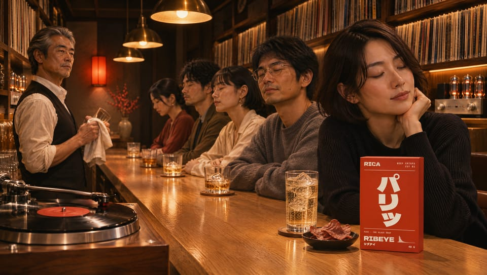

- Model: GPT Image 2.6 (`gpt_image_2_6`) · aspect 16:9 · resolution 2k, quality high
- Reference images: [`cast-heroine.png`](../production/renders/stills/cast-heroine.png), [`cast-man.png`](../production/renders/stills/cast-man.png), [`cast-bartender.png`](../production/renders/stills/cast-bartender.png), [`pack-ribeye.png`](../production/refs/pack-ribeye.png)

```text
Photoreal cinematic film still, shot on ARRI Alexa 35 with anamorphic lenses, fine 35mm film grain, shallow depth of field. A small Tokyo listening bar at night, lit so that everything is clearly readable: warm tungsten pendant lamps pool light on a long light-oak counter, amber-lit wooden shelves of vinyl records and a glowing tube amplifier behind the bar, one vermilion-red lamp on the far wall. Faces, hands and objects are well exposed by a soft warm key light from camera-left; the shadows are deep brown and never crushed to black. Palette: warm amber, oak, bone white, vermilion #E4381C accents. Natural skin, natural colour. Wide shot from one end of the counter, looking along it. Six people sit in a row at the counter in silence, eyes closed or lowered, listening to a record, drinks in front of them. Nearest to camera on the right sits a Japanese woman in her late twenties with a chin-length dark bob and a black knit top (the woman in the first reference), and beside her a Japanese man in his early thirties with round wire glasses, short dark hair and a grey crew-neck sweater (the second reference). Behind the counter on the left stands a Japanese bartender in his fifties with swept-back grey hair, a white shirt and a black waistcoat, deadpan and dignified (the third reference), polishing a glass. In the left foreground a turntable spins a record. On the counter in front of the woman: a tall whisky highball with clear ice, a small black dish of paper-thin beef crisps, and the red RICA Ribeye box standing upright, which is a slim upright rectangular carton in matte uncoated paperboard (about 10 cm wide, 15 cm tall, 3 cm deep) whose front panel reproduces the flat artwork in the reference image exactly — same flat colour, the RICA wordmark top-left, one huge katakana sound word set vertically down the centre, the cut name bottom-left and a small row of waveform bars bottom-right. Do not redesign, restyle or add to the artwork. Calm, still, hushed. 35mm lens. No extra text beyond the pack artwork, no other brands, no watermark.
```

```bash
node production/scripts/generate.mjs f-hush
```

**Higgsfield video-generation prompt**

- Model: Seedance 2.5 (`seedance_2_5`) · mode `omni_reference` · 1080p · 16:9 · native audio off (sound is built in the edit)
- Start frame: `f-hush`

```text
Slow dolly forward along the counter. Everyone listens in stillness with their eyes closed; a foot taps faintly; the record spins on the turntable; behind the counter the bartender polishes a glass with slow circular motions. The red box on the counter stays still and its artwork does not change. Single continuous shot, no cuts. No text, no captions, no logos other than the pack artwork. Keep the lighting, exposure and colour of the start frame: the scene stays bright and clearly readable. No flash, no flare, nothing glows or emits light.
```

```bash
higgsfield generate create seedance_2_5 --prompt 'Slow dolly forward along the counter. Everyone listens in stillness with their eyes closed; a foot taps faintly; the record spins on the turntable; behind the counter the bartender polishes a glass with slow circular motions. The red box on the counter stays still and its artwork does not change. Single continuous shot, no cuts. No text, no captions, no logos other than the pack artwork. Keep the lighting, exposure and colour of the start frame: the scene stays bright and clearly readable. No flash, no flare, nothing glows or emits light.' --start-image production/renders/stills/f-hush.png --duration 5 --aspect_ratio 16:9 --mode omni_reference --resolution 1080p --bitrate_mode high --generate_audio false --wait --wait-timeout 20m --json
```

Or through the project script, which also downloads the take and records it: `node production/scripts/render-film.mjs A01 --go`

### Frame 02 — A02 "The keeper"

3.5 s to 6.0 s

| | |
|---|---|
| Frame number | 02 of 15 (A02) |
| Visual description | The bartender, fifties, grey hair, waistcoat. He polishes, glances up to check the room is behaving, looks back down. |
| Camera angle and movement | Close-up, 85mm. Locked off, very slow push-in. |
| Lighting and atmosphere | Soft warm key from camera-left on his face; shelves glowing behind. |
| Product placement | None. He is the rule the crisp is about to break. |
| Sound | The ballad continues. Cloth on glass. |
| Transition to the next shot | Cut to her. |
| Suggested duration | 2.5 s in the cut. Generate 5 s, so the edit has handles either side. |

**AI image-generation prompt — start frame `f-bartender`**

Generated. 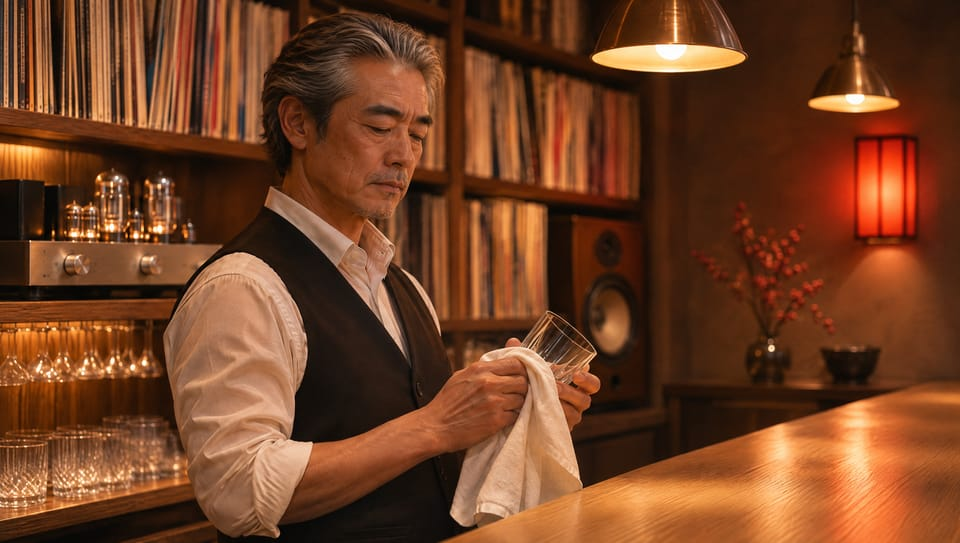

- Model: GPT Image 2.6 (`gpt_image_2_6`) · aspect 16:9 · resolution 2k, quality high
- Reference images: [`cast-bartender.png`](../production/renders/stills/cast-bartender.png)

```text
Photoreal cinematic film still, shot on ARRI Alexa 35 with anamorphic lenses, fine 35mm film grain, shallow depth of field. A small Tokyo listening bar at night, lit so that everything is clearly readable: warm tungsten pendant lamps pool light on a long light-oak counter, amber-lit wooden shelves of vinyl records and a glowing tube amplifier behind the bar, one vermilion-red lamp on the far wall. Faces, hands and objects are well exposed by a soft warm key light from camera-left; the shadows are deep brown and never crushed to black. Palette: warm amber, oak, bone white, vermilion #E4381C accents. Natural skin, natural colour. Close-up of a Japanese bartender in his fifties with swept-back grey hair, a white shirt and a black waistcoat, deadpan and dignified (the man in the reference) behind the counter, polishing a tall glass with a white cloth, eyes lowered to his work, dignified and unhurried. Shelves of vinyl records softly out of focus behind him. He is left of centre, facing slightly toward camera-right. 85mm lens. No text, no lettering, no logos, no packaging, no watermark.
```

```bash
node production/scripts/generate.mjs f-bartender
```

**Higgsfield video-generation prompt**

- Model: Seedance 2.5 (`seedance_2_5`) · mode `omni_reference` · 1080p · 16:9 · native audio off (sound is built in the edit)
- Start frame: `f-bartender`

```text
The bartender polishes the tall glass with slow circular motions of the white cloth, then glances up over it for a moment, checking the room, and looks back down at his work. Locked-off camera with a very slow push-in. Single continuous shot, no cuts. No text, no captions, no logos other than the pack artwork. Keep the lighting, exposure and colour of the start frame: the scene stays bright and clearly readable. No flash, no flare, nothing glows or emits light.
```

```bash
higgsfield generate create seedance_2_5 --prompt 'The bartender polishes the tall glass with slow circular motions of the white cloth, then glances up over it for a moment, checking the room, and looks back down at his work. Locked-off camera with a very slow push-in. Single continuous shot, no cuts. No text, no captions, no logos other than the pack artwork. Keep the lighting, exposure and colour of the start frame: the scene stays bright and clearly readable. No flash, no flare, nothing glows or emits light.' --start-image production/renders/stills/f-bartender.png --duration 5 --aspect_ratio 16:9 --mode omni_reference --resolution 1080p --bitrate_mode high --generate_audio false --wait --wait-timeout 20m --json
```

Or through the project script, which also downloads the take and records it: `node production/scripts/render-film.mjs A02 --go`

### Frame 03 — A03 "To the light"

6.0 s to 9.5 s

| | |
|---|---|
| Frame number | 03 of 15 (A03) |
| Visual description | She holds one crisp up to the lamp. Light comes straight through it. The red pack stands sharp on the counter beside her. |
| Camera angle and movement | Medium close-up, 50mm, three-quarter front. Slow push-in. |
| Lighting and atmosphere | The pendant lamp behind the crisp; warm key on her face. |
| Product placement | The crisp, proven paper-thin by the light; the Ribeye pack, sharp, in the same frame. |
| Sound | The ballad, quieter. Her small breath in. |
| Transition to the next shot | Cut on the crisp reaching her mouth. |
| Suggested duration | 3.5 s in the cut. Generate 5 s, so the edit has handles either side. |

**AI image-generation prompt — start frame `f-open`**

Generated. 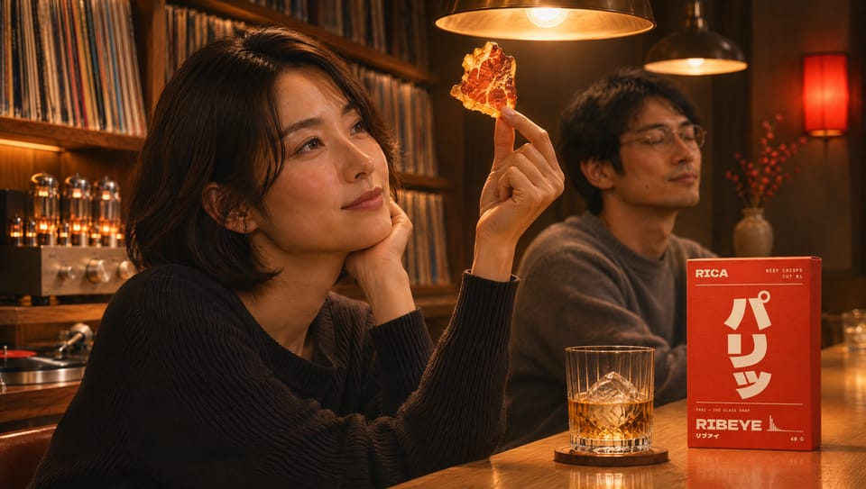

- Model: GPT Image 2.6 (`gpt_image_2_6`) · aspect 16:9 · resolution 2k, quality high
- Reference images: [`cast-heroine.png`](../production/renders/stills/cast-heroine.png), [`cast-man.png`](../production/renders/stills/cast-man.png), [`pack-ribeye.png`](../production/refs/pack-ribeye.png)

```text
Photoreal cinematic film still, shot on ARRI Alexa 35 with anamorphic lenses, fine 35mm film grain, shallow depth of field. A small Tokyo listening bar at night, lit so that everything is clearly readable: warm tungsten pendant lamps pool light on a long light-oak counter, amber-lit wooden shelves of vinyl records and a glowing tube amplifier behind the bar, one vermilion-red lamp on the far wall. Faces, hands and objects are well exposed by a soft warm key light from camera-left; the shadows are deep brown and never crushed to black. Palette: warm amber, oak, bone white, vermilion #E4381C accents. Natural skin, natural colour. Medium close-up of a Japanese woman in her late twenties with a chin-length dark bob and a black knit top (the woman in the first reference) at the counter, three-quarter front view. She holds a single paper-thin beef crisp up between two fingers toward a warm pendant lamp so that the light passes through it and it glows translucent amber and red; she looks at it with quiet delight. On the counter beside her highball stands the red RICA Ribeye box, sharp, which is a slim upright rectangular carton in matte uncoated paperboard (about 10 cm wide, 15 cm tall, 3 cm deep) whose front panel reproduces the flat artwork in the reference image exactly — same flat colour, the RICA wordmark top-left, one huge katakana sound word set vertically down the centre, the cut name bottom-left and a small row of waveform bars bottom-right. Do not redesign, restyle or add to the artwork. Beside her, softly out of focus, a Japanese man in his early thirties with round wire glasses, short dark hair and a grey crew-neck sweater (the second reference) listens with his eyes closed. 50mm lens. No extra text beyond the pack artwork, no other brands, no watermark.
```

```bash
node production/scripts/generate.mjs f-open
```

**Higgsfield video-generation prompt**

- Model: Seedance 2.5 (`seedance_2_5`) · mode `omni_reference` · 1080p · 16:9 · native audio off (sound is built in the edit)
- Start frame: `f-open`

```text
She turns the paper-thin beef crisp between her fingers under the warm lamp, admiring how the light passes through it, and smiles; then she brings it slowly toward her mouth. Slow push-in. The red box on the counter stays perfectly still and its artwork does not change. Single continuous shot, no cuts. No text, no captions, no logos other than the pack artwork. Keep the lighting, exposure and colour of the start frame: the scene stays bright and clearly readable. No flash, no flare, nothing glows or emits light.
```

```bash
higgsfield generate create seedance_2_5 --prompt 'She turns the paper-thin beef crisp between her fingers under the warm lamp, admiring how the light passes through it, and smiles; then she brings it slowly toward her mouth. Slow push-in. The red box on the counter stays perfectly still and its artwork does not change. Single continuous shot, no cuts. No text, no captions, no logos other than the pack artwork. Keep the lighting, exposure and colour of the start frame: the scene stays bright and clearly readable. No flash, no flare, nothing glows or emits light.' --start-image production/renders/stills/f-open.png --duration 5 --aspect_ratio 16:9 --mode omni_reference --resolution 1080p --bitrate_mode high --generate_audio false --wait --wait-timeout 20m --json
```

Or through the project script, which also downloads the take and records it: `node production/scripts/render-film.mjs A03 --go`

### Frame 04 — A04 "The snap"

9.5 s to 12.0 s

| | |
|---|---|
| Frame number | 04 of 15 (A04) |
| Visual description | She bites. It snaps — shards and salt fly — and her eyes open wide at how loud it was. She freezes. |
| Camera angle and movement | Close-up in profile, 100mm, subtle handheld. Slow motion from the bite. |
| Lighting and atmosphere | Warm key from camera-left; the shards catch it. |
| Product placement | The snap itself: the product doing the one thing it is named for. |
| Sound | THE SNAP. The music stops dead on it. |
| Transition to the next shot | Smash cut to the wide. |
| Suggested duration | 2.5 s in the cut. Generate 5 s, so the edit has handles either side. |

**AI image-generation prompt — start frame `f-snap`**

Generated. 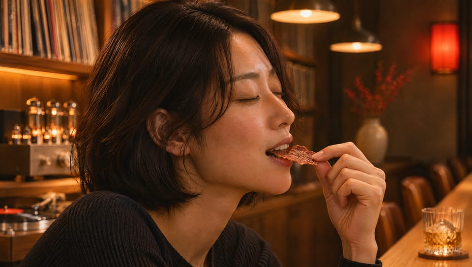

- Model: GPT Image 2.6 (`gpt_image_2_6`) · aspect 16:9 · resolution 2k, quality high
- Reference images: [`cast-heroine.png`](../production/renders/stills/cast-heroine.png)

```text
Photoreal cinematic film still, shot on ARRI Alexa 35 with anamorphic lenses, fine 35mm film grain, shallow depth of field. A small Tokyo listening bar at night, lit so that everything is clearly readable: warm tungsten pendant lamps pool light on a long light-oak counter, amber-lit wooden shelves of vinyl records and a glowing tube amplifier behind the bar, one vermilion-red lamp on the far wall. Faces, hands and objects are well exposed by a soft warm key light from camera-left; the shadows are deep brown and never crushed to black. Palette: warm amber, oak, bone white, vermilion #E4381C accents. Natural skin, natural colour. Close-up in profile of a Japanese woman in her late twenties with a chin-length dark bob and a black knit top (the woman in the reference), a paper-thin beef crisp held between her front teeth and her fingers at the instant before she bites it, eyes closed in anticipation. The crisp is lit warm and clearly visible. The bar softly out of focus behind her. 100mm lens. No text, no lettering, no logos, no packaging, no watermark.
```

```bash
node production/scripts/generate.mjs f-snap
```

**Higgsfield video-generation prompt**

- Model: Seedance 2.5 (`seedance_2_5`) · mode `omni_reference` · 1080p · 16:9 · native audio off (sound is built in the edit)
- Start frame: `f-snap`

```text
She bites: the paper-thin crisp snaps cleanly in two with a sharp break, and tiny shards and salt crystals fly from the break and fall in slow motion. Her eyes open wide in surprise at how loud it was, and she freezes, not chewing. Subtle handheld camera, slow push-in. Single continuous shot, no cuts. No text, no captions, no logos other than the pack artwork. Keep the lighting, exposure and colour of the start frame: the scene stays bright and clearly readable. No flash, no flare, nothing glows or emits light.
```

```bash
higgsfield generate create seedance_2_5 --prompt 'She bites: the paper-thin crisp snaps cleanly in two with a sharp break, and tiny shards and salt crystals fly from the break and fall in slow motion. Her eyes open wide in surprise at how loud it was, and she freezes, not chewing. Subtle handheld camera, slow push-in. Single continuous shot, no cuts. No text, no captions, no logos other than the pack artwork. Keep the lighting, exposure and colour of the start frame: the scene stays bright and clearly readable. No flash, no flare, nothing glows or emits light.' --start-image production/renders/stills/f-snap.png --duration 5 --aspect_ratio 16:9 --mode omni_reference --resolution 1080p --bitrate_mode high --generate_audio false --wait --wait-timeout 20m --json
```

Or through the project script, which also downloads the take and records it: `node production/scripts/render-film.mjs A04 --go`

### Frame 05 — A05 "Everyone looks"

12.0 s to 14.5 s

| | |
|---|---|
| Frame number | 05 of 15 (A05) |
| Visual description | The whole counter turns to look at her at once. The bartender lowers his glass. She sits frozen, cheeks full. |
| Camera angle and movement | The same wide as the opening. Locked off. |
| Lighting and atmosphere | As the opening. |
| Product placement | The broken half crisp in her hand; the pack beside her. |
| Sound | Silence. One stool creaks. |
| Transition to the next shot | Cut to the bartender. |
| Suggested duration | 2.5 s in the cut. Generate 5 s, so the edit has handles either side. |

**AI image-generation prompt — start frame `f-heads`**

Generated. 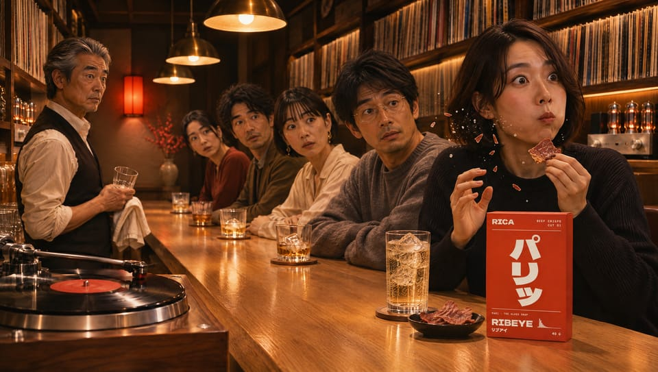

- Model: GPT Image 2.6 (`gpt_image_2_6`) · aspect 16:9 · resolution 2k, quality high
- Reference images: [`f-hush.png`](../production/renders/stills/f-hush.png), [`cast-heroine.png`](../production/renders/stills/cast-heroine.png), [`cast-bartender.png`](../production/renders/stills/cast-bartender.png)

```text
Photoreal cinematic film still, shot on ARRI Alexa 35 with anamorphic lenses, fine 35mm film grain, shallow depth of field. A small Tokyo listening bar at night, lit so that everything is clearly readable: warm tungsten pendant lamps pool light on a long light-oak counter, amber-lit wooden shelves of vinyl records and a glowing tube amplifier behind the bar, one vermilion-red lamp on the far wall. Faces, hands and objects are well exposed by a soft warm key light from camera-left; the shadows are deep brown and never crushed to black. Palette: warm amber, oak, bone white, vermilion #E4381C accents. Natural skin, natural colour. The same bar, the same people and the same wide framing as the first reference image, one second later: the woman with the dark bob nearest to camera sits frozen with wide eyes, cheeks full, holding the broken half of a beef crisp; everyone else at the counter is in the middle of turning their head toward her, eyes opening; behind the counter the bartender has lowered his glass. Tiny shards and salt crystals hang in the air in front of her. Comic stillness. 35mm lens. No extra text beyond the pack artwork, no other brands, no watermark.
```

```bash
node production/scripts/generate.mjs f-heads
```

**Higgsfield video-generation prompt**

- Model: Seedance 2.5 (`seedance_2_5`) · mode `omni_reference` · 1080p · 16:9 · native audio off (sound is built in the edit)
- Start frame: `f-heads`

```text
All at once, everyone at the counter finishes turning their head to look at the woman nearest the camera; behind the counter the bartender slowly lowers his glass and stares. She sits completely frozen with wide eyes and full cheeks, holding the broken half of the crisp. A long beat of total stillness. Locked-off camera. Single continuous shot, no cuts. No text, no captions, no logos other than the pack artwork. Keep the lighting, exposure and colour of the start frame: the scene stays bright and clearly readable. No flash, no flare, nothing glows or emits light.
```

```bash
higgsfield generate create seedance_2_5 --prompt 'All at once, everyone at the counter finishes turning their head to look at the woman nearest the camera; behind the counter the bartender slowly lowers his glass and stares. She sits completely frozen with wide eyes and full cheeks, holding the broken half of the crisp. A long beat of total stillness. Locked-off camera. Single continuous shot, no cuts. No text, no captions, no logos other than the pack artwork. Keep the lighting, exposure and colour of the start frame: the scene stays bright and clearly readable. No flash, no flare, nothing glows or emits light.' --start-image production/renders/stills/f-heads.png --duration 5 --aspect_ratio 16:9 --mode omni_reference --resolution 1080p --bitrate_mode high --generate_audio false --wait --wait-timeout 20m --json
```

Or through the project script, which also downloads the take and records it: `node production/scripts/render-film.mjs A05 --go`

### Frame 06 — A06 "The eyebrow"

14.5 s to 17.0 s

| | |
|---|---|
| Frame number | 06 of 15 (A06) |
| Visual description | The bartender stares. Nothing. Then one eyebrow, slowly. |
| Camera angle and movement | Close-up, 85mm. Locked off, very slow push-in. |
| Lighting and atmosphere | As frame 2. |
| Product placement | None. |
| Sound | Silence. The glass set down, gently. |
| Transition to the next shot | Cut to the two-shot. |
| Suggested duration | 2.5 s in the cut. Generate 5 s, so the edit has handles either side. |

**AI image-generation prompt — start frame `f-bartender`**

Generated. 

- Model: GPT Image 2.6 (`gpt_image_2_6`) · aspect 16:9 · resolution 2k, quality high
- Reference images: [`cast-bartender.png`](../production/renders/stills/cast-bartender.png)

```text
Photoreal cinematic film still, shot on ARRI Alexa 35 with anamorphic lenses, fine 35mm film grain, shallow depth of field. A small Tokyo listening bar at night, lit so that everything is clearly readable: warm tungsten pendant lamps pool light on a long light-oak counter, amber-lit wooden shelves of vinyl records and a glowing tube amplifier behind the bar, one vermilion-red lamp on the far wall. Faces, hands and objects are well exposed by a soft warm key light from camera-left; the shadows are deep brown and never crushed to black. Palette: warm amber, oak, bone white, vermilion #E4381C accents. Natural skin, natural colour. Close-up of a Japanese bartender in his fifties with swept-back grey hair, a white shirt and a black waistcoat, deadpan and dignified (the man in the reference) behind the counter, polishing a tall glass with a white cloth, eyes lowered to his work, dignified and unhurried. Shelves of vinyl records softly out of focus behind him. He is left of centre, facing slightly toward camera-right. 85mm lens. No text, no lettering, no logos, no packaging, no watermark.
```

```bash
node production/scripts/generate.mjs f-bartender
```

**Higgsfield video-generation prompt**

- Model: Seedance 2.5 (`seedance_2_5`) · mode `omni_reference` · 1080p · 16:9 · native audio off (sound is built in the edit)
- Start frame: `f-bartender`

```text
The bartender slowly raises his eyes from the glass and stares straight toward camera-right, deadpan, without blinking, holding the glass perfectly still. After a long beat, one eyebrow slowly rises. Nothing else moves. Locked-off camera, very slow push-in. Single continuous shot, no cuts. No text, no captions, no logos other than the pack artwork. Keep the lighting, exposure and colour of the start frame: the scene stays bright and clearly readable. No flash, no flare, nothing glows or emits light.
```

```bash
higgsfield generate create seedance_2_5 --prompt 'The bartender slowly raises his eyes from the glass and stares straight toward camera-right, deadpan, without blinking, holding the glass perfectly still. After a long beat, one eyebrow slowly rises. Nothing else moves. Locked-off camera, very slow push-in. Single continuous shot, no cuts. No text, no captions, no logos other than the pack artwork. Keep the lighting, exposure and colour of the start frame: the scene stays bright and clearly readable. No flash, no flare, nothing glows or emits light.' --start-image production/renders/stills/f-bartender.png --duration 5 --aspect_ratio 16:9 --mode omni_reference --resolution 1080p --bitrate_mode high --generate_audio false --wait --wait-timeout 20m --json
```

Or through the project script, which also downloads the take and records it: `node production/scripts/render-film.mjs A06 --go`

### Frame 07 — A07 "The offer"

17.0 s to 19.5 s

| | |
|---|---|
| Frame number | 07 of 15 (A07) |
| Visual description | Sheepish, she slides the dish along the counter to the man beside her. He looks at it. He looks at her. He takes one. |
| Camera angle and movement | Medium two-shot, 50mm. Slow dolly right. |
| Lighting and atmosphere | Warm key from camera-left on both faces. |
| Product placement | The dish of crisps, centre frame, changing hands. |
| Sound | The dish sliding on oak. |
| Transition to the next shot | Cut in to him. |
| Suggested duration | 2.5 s in the cut. Generate 5 s, so the edit has handles either side. |

**AI image-generation prompt — start frame `f-offer`**

Generated. 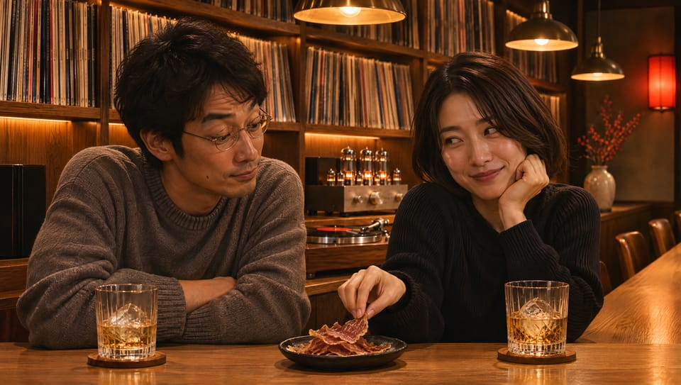

- Model: GPT Image 2.6 (`gpt_image_2_6`) · aspect 16:9 · resolution 2k, quality high
- Reference images: [`cast-heroine.png`](../production/renders/stills/cast-heroine.png), [`cast-man.png`](../production/renders/stills/cast-man.png)

```text
Photoreal cinematic film still, shot on ARRI Alexa 35 with anamorphic lenses, fine 35mm film grain, shallow depth of field. A small Tokyo listening bar at night, lit so that everything is clearly readable: warm tungsten pendant lamps pool light on a long light-oak counter, amber-lit wooden shelves of vinyl records and a glowing tube amplifier behind the bar, one vermilion-red lamp on the far wall. Faces, hands and objects are well exposed by a soft warm key light from camera-left; the shadows are deep brown and never crushed to black. Palette: warm amber, oak, bone white, vermilion #E4381C accents. Natural skin, natural colour. Medium two-shot at the counter: a Japanese woman in her late twenties with a chin-length dark bob and a black knit top (first reference) on the right, sheepish, one hand on a small black dish of paper-thin beef crisps that sits on the counter between them; a Japanese man in his early thirties with round wire glasses, short dark hair and a grey crew-neck sweater (second reference) on the left looks down at the dish, tempted, one eyebrow up. Highball glasses on the counter. 50mm lens. No text, no lettering, no logos, no packaging, no watermark.
```

```bash
node production/scripts/generate.mjs f-offer
```

**Higgsfield video-generation prompt**

- Model: Seedance 2.5 (`seedance_2_5`) · mode `omni_reference` · 1080p · 16:9 · native audio off (sound is built in the edit)
- Start frame: `f-offer`

```text
Sheepishly, she slides the small black dish of crisps along the counter toward the man in glasses. He looks down at it, glances at her, then picks up one crisp between two fingers. Slow dolly right. Single continuous shot, no cuts. No text, no captions, no logos other than the pack artwork. Keep the lighting, exposure and colour of the start frame: the scene stays bright and clearly readable. No flash, no flare, nothing glows or emits light.
```

```bash
higgsfield generate create seedance_2_5 --prompt 'Sheepishly, she slides the small black dish of crisps along the counter toward the man in glasses. He looks down at it, glances at her, then picks up one crisp between two fingers. Slow dolly right. Single continuous shot, no cuts. No text, no captions, no logos other than the pack artwork. Keep the lighting, exposure and colour of the start frame: the scene stays bright and clearly readable. No flash, no flare, nothing glows or emits light.' --start-image production/renders/stills/f-offer.png --duration 5 --aspect_ratio 16:9 --mode omni_reference --resolution 1080p --bitrate_mode high --generate_audio false --wait --wait-timeout 20m --json
```

Or through the project script, which also downloads the take and records it: `node production/scripts/render-film.mjs A07 --go`

### Frame 08 — A08 "Second snap"

19.5 s to 21.5 s

| | |
|---|---|
| Frame number | 08 of 15 (A08) |
| Visual description | He bites. It snaps. He grins with his mouth full. |
| Camera angle and movement | Close-up, 85mm. Slow push-in. |
| Lighting and atmosphere | Warm key from camera-left. |
| Product placement | A second crisp, a second snap: it is not her, it is the crisp. |
| Sound | A second snap, deeper. Then the needle drops on a faster record. |
| Transition to the next shot | Cut on the downbeat into colour. |
| Suggested duration | 2.0 s in the cut. Generate 5 s, so the edit has handles either side. |

**AI image-generation prompt — start frame `f-second`**

Generated. 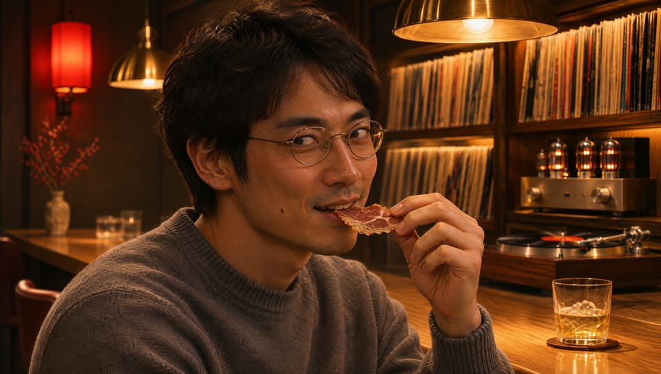

- Model: GPT Image 2.6 (`gpt_image_2_6`) · aspect 16:9 · resolution 2k, quality high
- Reference images: [`cast-man.png`](../production/renders/stills/cast-man.png)

```text
Photoreal cinematic film still, shot on ARRI Alexa 35 with anamorphic lenses, fine 35mm film grain, shallow depth of field. A small Tokyo listening bar at night, lit so that everything is clearly readable: warm tungsten pendant lamps pool light on a long light-oak counter, amber-lit wooden shelves of vinyl records and a glowing tube amplifier behind the bar, one vermilion-red lamp on the far wall. Faces, hands and objects are well exposed by a soft warm key light from camera-left; the shadows are deep brown and never crushed to black. Palette: warm amber, oak, bone white, vermilion #E4381C accents. Natural skin, natural colour. Close-up of a Japanese man in his early thirties with round wire glasses, short dark hair and a grey crew-neck sweater (the man in the reference) holding a paper-thin beef crisp just in front of his mouth, about to bite, eyes glancing sideways toward camera-right with a mischievous look. The crisp is lit warm and clearly visible. 85mm lens. No text, no lettering, no logos, no packaging, no watermark.
```

```bash
node production/scripts/generate.mjs f-second
```

**Higgsfield video-generation prompt**

- Model: Seedance 2.5 (`seedance_2_5`) · mode `omni_reference` · 1080p · 16:9 · native audio off (sound is built in the edit)
- Start frame: `f-second`

```text
He bites the paper-thin crisp: it snaps cleanly with a sharp break and small shards fly; he chews, then grins widely with his mouth closed and nods. Slow push-in. Single continuous shot, no cuts. No text, no captions, no logos other than the pack artwork. Keep the lighting, exposure and colour of the start frame: the scene stays bright and clearly readable. No flash, no flare, nothing glows or emits light.
```

```bash
higgsfield generate create seedance_2_5 --prompt 'He bites the paper-thin crisp: it snaps cleanly with a sharp break and small shards fly; he chews, then grins widely with his mouth closed and nods. Slow push-in. Single continuous shot, no cuts. No text, no captions, no logos other than the pack artwork. Keep the lighting, exposure and colour of the start frame: the scene stays bright and clearly readable. No flash, no flare, nothing glows or emits light.' --start-image production/renders/stills/f-second.png --duration 5 --aspect_ratio 16:9 --mode omni_reference --resolution 1080p --bitrate_mode high --generate_audio false --wait --wait-timeout 20m --json
```

Or through the project script, which also downloads the take and records it: `node production/scripts/render-film.mjs A08 --go`

### Frame 09 — A09 "Four sounds"

21.5 s to 25.5 s

| | |
|---|---|
| Frame number | 09 of 15 (A09) |
| Visual description | Four cuts, four colours, four snaps, one second each, on the beat: ribeye on vermilion, brisket on mustard, sirloin on bone, short rib on charcoal. |
| Camera angle and movement | Extreme close-up, locked off, centred. Extreme slow motion. Four separate takes. |
| Lighting and atmosphere | Studio: one hard key from camera-left, flat seamless colour. |
| Product placement | Each cut as itself. The sound word hits with each snap: パリッ · ザクッ · サクッ · カリッ. |
| Sound | Four different snaps on the backbeat of the new record. |
| Transition to the next shot | Hard cuts on the beat, then back to the bar. |
| Suggested duration | 4.0 s in the cut: 4 takes of 1.0 s each. Generate 4 s per take (16 s in total) and cut each one on its action. |

**AI image-generation prompts — 4 start frames**

Start frame `kf-snap-ribeye` (Ribeye, パリッ)

Generated. 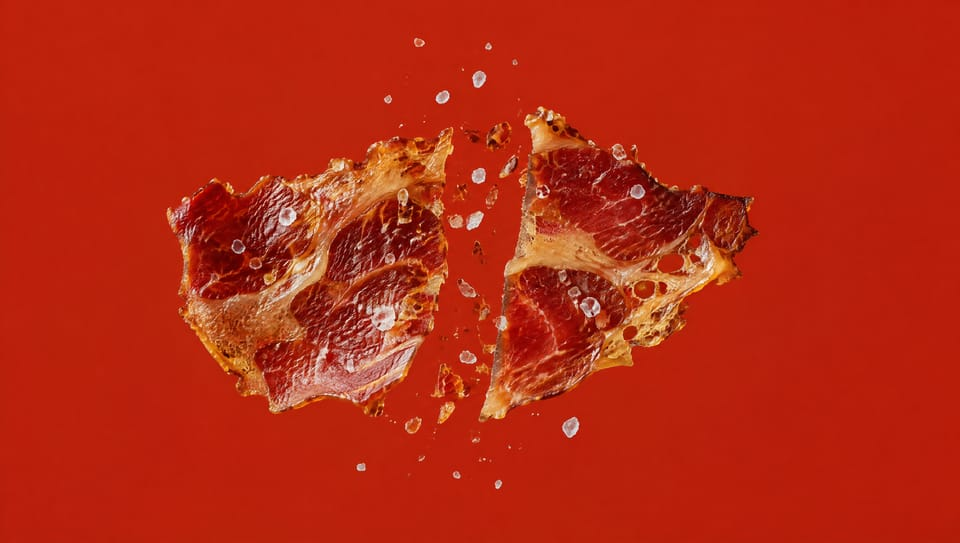

- Model: GPT Image 2.6 (`gpt_image_2_6`) · aspect 16:9 · resolution 2k, quality medium
- Reference images: none

```text
Photoreal premium product photography, medium-format camera, 90mm lens, f/8, crisp focus, fine film grain. One hard key light from camera-left at 45 degrees casting a single clean, defined shadow to the right. Seamless matte paper backdrop and floor in one flat colour. Brand palette: ink black #0F0E0D, warm bone white #F2ECE1, vermilion #E4381C. Rich, natural, appetising colour. Extreme close-up, the same framing as a matching set of four: one single piece of paper-thin ribeye crisp: mahogany-red with a generous translucent amber lace of rendered marbling, glassy and brittle, dusted with coarse white salt flakes floating in mid-air in the exact centre of the frame, filling about half its width, snapping cleanly in half down the middle — the two halves a finger-width apart, small shards and salt crystals bursting from the break, frozen tack-sharp. The whole background is deep vermilion red (#C92F16): one flat seamless colour edge to edge, no floor line, no horizon, no surface. No text, no lettering, no logos, no packaging, no watermark. No hands.
```

```bash
node production/scripts/generate.mjs kf-snap-ribeye
```

Start frame `kf-snap-brisket` (Brisket, ザクッ)

Generated. 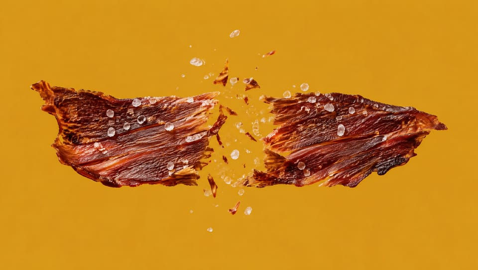

- Model: GPT Image 2.6 (`gpt_image_2_6`) · aspect 16:9 · resolution 2k, quality medium
- Reference images: none

```text
Photoreal premium product photography, medium-format camera, 90mm lens, f/8, crisp focus, fine film grain. One hard key light from camera-left at 45 degrees casting a single clean, defined shadow to the right. Seamless matte paper backdrop and floor in one flat colour. Brand palette: ink black #0F0E0D, warm bone white #F2ECE1, vermilion #E4381C. Rich, natural, appetising colour. Extreme close-up, the same framing as a matching set of four: one single piece of paper-thin brisket crisp: darker brown-red with long visible grain lines running the length of each shard, a little more rugged, dusted with coarse white salt flakes floating in mid-air in the exact centre of the frame, filling about half its width, snapping cleanly in half down the middle — the two halves a finger-width apart, small shards and salt crystals bursting from the break, frozen tack-sharp. The whole background is warm mustard yellow (#D2931A): one flat seamless colour edge to edge, no floor line, no horizon, no surface. No text, no lettering, no logos, no packaging, no watermark. No hands.
```

```bash
node production/scripts/generate.mjs kf-snap-brisket
```

Start frame `kf-snap-sirloin` (Sirloin, サクッ)

Generated. 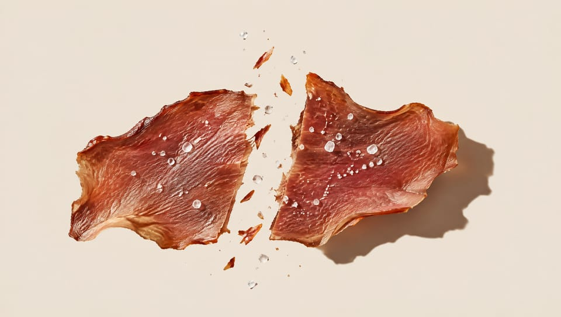

- Model: GPT Image 2.6 (`gpt_image_2_6`) · aspect 16:9 · resolution 2k, quality medium
- Reference images: none

```text
Photoreal premium product photography, medium-format camera, 90mm lens, f/8, crisp focus, fine film grain. One hard key light from camera-left at 45 degrees casting a single clean, defined shadow to the right. Seamless matte paper backdrop and floor in one flat colour. Brand palette: ink black #0F0E0D, warm bone white #F2ECE1, vermilion #E4381C. Rich, natural, appetising colour. Extreme close-up, the same framing as a matching set of four: one single piece of paper-thin sirloin crisp: lean, even rosy-brown, very fine and airy, almost translucent at the edges, dusted with coarse white salt flakes floating in mid-air in the exact centre of the frame, filling about half its width, snapping cleanly in half down the middle — the two halves a finger-width apart, small shards and salt crystals bursting from the break, frozen tack-sharp. The whole background is warm off-white bone (#EDE6D8): one flat seamless colour edge to edge, no floor line, no horizon, no surface. No text, no lettering, no logos, no packaging, no watermark. No hands.
```

```bash
node production/scripts/generate.mjs kf-snap-sirloin
```

Start frame `kf-snap-shortrib` (Short Rib, カリッ)

Generated. 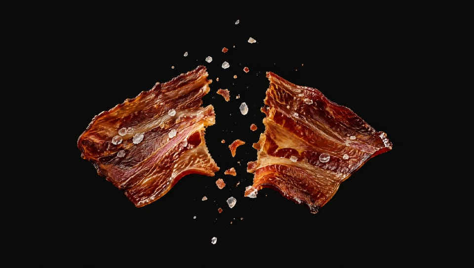

- Model: GPT Image 2.6 (`gpt_image_2_6`) · aspect 16:9 · resolution 2k, quality medium
- Reference images: none

```text
Photoreal premium product photography, medium-format camera, 90mm lens, f/8, crisp focus, fine film grain. One hard key light from camera-left at 45 degrees casting a single clean, defined shadow to the right. Seamless matte paper backdrop and floor in one flat colour. Brand palette: ink black #0F0E0D, warm bone white #F2ECE1, vermilion #E4381C. Rich, natural, appetising colour. Extreme close-up, the same framing as a matching set of four: one single piece of paper-thin short-rib crisp: deep dark caramel-brown with glossy caramelised edges and fine striped marbling, dusted with coarse white salt flakes floating in mid-air in the exact centre of the frame, filling about half its width, snapping cleanly in half down the middle — the two halves a finger-width apart, small shards and salt crystals bursting from the break, frozen tack-sharp. The whole background is charcoal black (#171614): one flat seamless colour edge to edge, no floor line, no horizon, no surface. No text, no lettering, no logos, no packaging, no watermark. No hands.
```

```bash
node production/scripts/generate.mjs kf-snap-shortrib
```

**Higgsfield video-generation prompt**

- Model: Seedance 2.5 (`seedance_2_5`) · mode `omni_reference` · 1080p · 16:9 · native audio off (sound is built in the edit)
- Start frames: `kf-snap-ribeye`, `kf-snap-brisket`, `kf-snap-sirloin`, `kf-snap-shortrib` — the same prompt is run once per start frame

```text
Extreme slow motion. The crisp snaps cleanly in half; the two halves drift apart; small shards and salt crystals burst outward from the break and hang in the air. The flat coloured background does not change. Locked-off camera. Single continuous shot, no cuts. No text, no captions, no logos other than the pack artwork. Keep the lighting, exposure and colour of the start frame: the scene stays bright and clearly readable. No flash, no flare, nothing glows or emits light.
```

```bash
higgsfield generate create seedance_2_5 --prompt 'Extreme slow motion. The crisp snaps cleanly in half; the two halves drift apart; small shards and salt crystals burst outward from the break and hang in the air. The flat coloured background does not change. Locked-off camera. Single continuous shot, no cuts. No text, no captions, no logos other than the pack artwork. Keep the lighting, exposure and colour of the start frame: the scene stays bright and clearly readable. No flash, no flare, nothing glows or emits light.' --start-image production/renders/stills/kf-snap-ribeye.png --duration 4 --aspect_ratio 16:9 --mode omni_reference --resolution 1080p --bitrate_mode high --generate_audio false --wait --wait-timeout 20m --json

higgsfield generate create seedance_2_5 --prompt 'Extreme slow motion. The crisp snaps cleanly in half; the two halves drift apart; small shards and salt crystals burst outward from the break and hang in the air. The flat coloured background does not change. Locked-off camera. Single continuous shot, no cuts. No text, no captions, no logos other than the pack artwork. Keep the lighting, exposure and colour of the start frame: the scene stays bright and clearly readable. No flash, no flare, nothing glows or emits light.' --start-image production/renders/stills/kf-snap-brisket.png --duration 4 --aspect_ratio 16:9 --mode omni_reference --resolution 1080p --bitrate_mode high --generate_audio false --wait --wait-timeout 20m --json

higgsfield generate create seedance_2_5 --prompt 'Extreme slow motion. The crisp snaps cleanly in half; the two halves drift apart; small shards and salt crystals burst outward from the break and hang in the air. The flat coloured background does not change. Locked-off camera. Single continuous shot, no cuts. No text, no captions, no logos other than the pack artwork. Keep the lighting, exposure and colour of the start frame: the scene stays bright and clearly readable. No flash, no flare, nothing glows or emits light.' --start-image production/renders/stills/kf-snap-sirloin.png --duration 4 --aspect_ratio 16:9 --mode omni_reference --resolution 1080p --bitrate_mode high --generate_audio false --wait --wait-timeout 20m --json

higgsfield generate create seedance_2_5 --prompt 'Extreme slow motion. The crisp snaps cleanly in half; the two halves drift apart; small shards and salt crystals burst outward from the break and hang in the air. The flat coloured background does not change. Locked-off camera. Single continuous shot, no cuts. No text, no captions, no logos other than the pack artwork. Keep the lighting, exposure and colour of the start frame: the scene stays bright and clearly readable. No flash, no flare, nothing glows or emits light.' --start-image production/renders/stills/kf-snap-shortrib.png --duration 4 --aspect_ratio 16:9 --mode omni_reference --resolution 1080p --bitrate_mode high --generate_audio false --wait --wait-timeout 20m --json
```

Or through the project script, which also downloads the take and records it: `node production/scripts/render-film.mjs A09 --go`

This cut reuses the takes rendered for the first cut (`S07_ribeye`, `S07_brisket`, `S07_sirloin`, `S07_shortrib`); `migrate-takes.mjs` copies them to the new names. Rendering from nothing produces the same shot from the prompt above.

### Frame 10 — A10 "The whole bar"

25.5 s to 29.0 s

| | |
|---|---|
| Frame number | 10 of 15 (A10) |
| Visual description | The bar has come alive. Everyone is snapping, biting, laughing; boxes in five colours pass along the counter. |
| Camera angle and movement | The opening wide. Slow dolly back along the counter. |
| Lighting and atmosphere | As the opening, warmer. |
| Product placement | All five packs on the counter, in use. |
| Sound | The swing record, loud. Laughter and crunching. |
| Transition to the next shot | Three flash cuts. |
| Suggested duration | 3.5 s in the cut. Generate 5 s, so the edit has handles either side. |

**AI image-generation prompt — start frame `f-everyone`**

Generated. 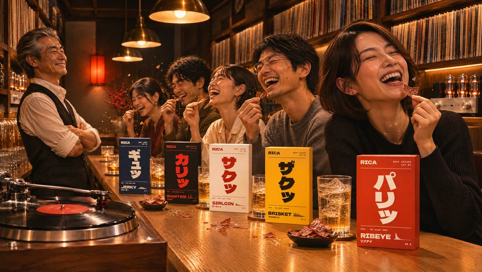

- Model: GPT Image 2.6 (`gpt_image_2_6`) · aspect 16:9 · resolution 2k, quality high
- Reference images: [`f-hush.png`](../production/renders/stills/f-hush.png), [`pack-sheet.png`](../production/refs/pack-sheet.png)

```text
Photoreal cinematic film still, shot on ARRI Alexa 35 with anamorphic lenses, fine 35mm film grain, shallow depth of field. A small Tokyo listening bar at night, lit so that everything is clearly readable: warm tungsten pendant lamps pool light on a long light-oak counter, amber-lit wooden shelves of vinyl records and a glowing tube amplifier behind the bar, one vermilion-red lamp on the far wall. Faces, hands and objects are well exposed by a soft warm key light from camera-left; the shadows are deep brown and never crushed to black. Palette: warm amber, oak, bone white, vermilion #E4381C accents. Natural skin, natural colour. The same bar, the same people and the same wide framing as the first reference image, now come alive: everyone at the counter is laughing, each holding or biting a paper-thin beef crisp, shards and salt crystals flying in the warm light; behind the counter the bartender watches with his arms folded. Along the counter stand five RICA boxes in five colours — vermilion red, mustard yellow, off-white, black and indigo blue — with the artwork of the second reference sheet. Joyful, warm, lively. 35mm lens. No extra text beyond the pack artwork, no other brands, no watermark.
```

```bash
node production/scripts/generate.mjs f-everyone
```

**Higgsfield video-generation prompt**

- Model: Seedance 2.5 (`seedance_2_5`) · mode `omni_reference` · 1080p · 16:9 · native audio off (sound is built in the edit)
- Start frame: `f-everyone`

```text
The whole bar has come alive: everyone at the counter is biting and snapping crisps and laughing, heads nodding to the music, a hand passing a box along the counter; shards and salt crystals fly in the warm light. Slow dolly back along the counter. The boxes’ artwork does not change. Single continuous shot, no cuts. No text, no captions, no logos other than the pack artwork. Keep the lighting, exposure and colour of the start frame: the scene stays bright and clearly readable. No flash, no flare, nothing glows or emits light.
```

```bash
higgsfield generate create seedance_2_5 --prompt 'The whole bar has come alive: everyone at the counter is biting and snapping crisps and laughing, heads nodding to the music, a hand passing a box along the counter; shards and salt crystals fly in the warm light. Slow dolly back along the counter. The boxes’ artwork does not change. Single continuous shot, no cuts. No text, no captions, no logos other than the pack artwork. Keep the lighting, exposure and colour of the start frame: the scene stays bright and clearly readable. No flash, no flare, nothing glows or emits light.' --start-image production/renders/stills/f-everyone.png --duration 5 --aspect_ratio 16:9 --mode omni_reference --resolution 1080p --bitrate_mode high --generate_audio false --wait --wait-timeout 20m --json
```

Or through the project script, which also downloads the take and records it: `node production/scripts/render-film.mjs A10 --go`

### Frame 11 — A11 "What you are hearing"

29.0 s to 32.0 s

| | |
|---|---|
| Frame number | 11 of 15 (A11) |
| Visual description | One second each: the blade lifting a slice thin enough to glow; the drying room, rows of slices like stained glass; the house salt falling. |
| Camera angle and movement | Three macro takes: a lateral move with the blade, a dolly down the aisle, a locked-off salt fall. |
| Lighting and atmosphere | Backlit amber against dark; lifted in the grade so it reads. |
| Product placement | How it is made, in three seconds: slice, dry, salt. |
| Sound | Blade, a breath of warm air, salt — each on the beat. |
| Transition to the next shot | Cut back to the bartender. |
| Suggested duration | 3.0 s in the cut: 3 takes of 1.0 s each. Generate 5 s per take (15 s in total) and cut each one on its action. |

**AI image-generation prompts — 3 start frames**

Start frame `kf-slice`

Generated. 

- Model: Soul Cinematic (`soul_cinematic`) · aspect 16:9 · quality 2k
- Reference images: none

```text
Photoreal premium food commercial cinematography, shot on ARRI Alexa 35, fine 35mm film grain, shallow depth of field. Low-key lighting: one warm tungsten key light from camera-left at 45 degrees with soft falloff, deep neutral-black shadows, a faint vermilion-red glow in the far background. Palette: ink black #0F0E0D, warm bone white #F2ECE1, vermilion #E4381C, amber #D58A2A. Rich, natural, appetising colour. No bloom, no haze, no lens flare. Close-up of a craftsperson's hands, no face in frame, drawing a long thin Japanese slicing knife from right to left through a block of well-marbled raw ribeye, a slice so thin lifting away that warm backlight glows through it and shows the fat marbling like lace. Dark wooden cutting board, black background. 85mm lens. No text, no lettering, no logos, no packaging, no watermark.
```

```bash
node production/scripts/generate.mjs kf-slice
```

Start frame `story-dry`

Generated. 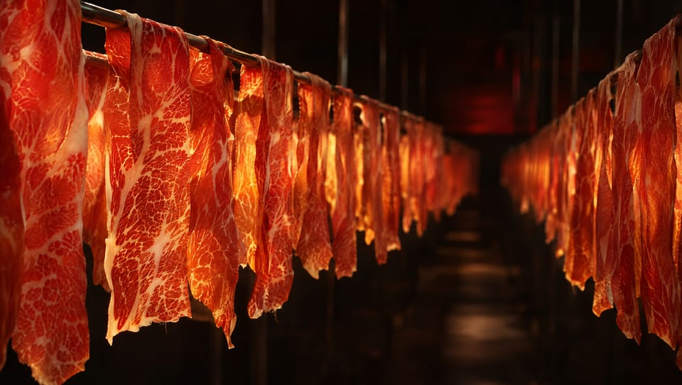

- Model: GPT Image 2.6 (`gpt_image_2_6`) · aspect 16:9 · resolution 2k, quality high
- Reference images: none

```text
Photoreal premium food commercial cinematography, shot on ARRI Alexa 35, fine 35mm film grain, shallow depth of field. Low-key lighting: one warm tungsten key light from camera-left at 45 degrees with soft falloff, deep neutral-black shadows, a faint vermilion-red glow in the far background. Palette: ink black #0F0E0D, warm bone white #F2ECE1, vermilion #E4381C, amber #D58A2A. Rich, natural, appetising colour. No bloom, no haze, no lens flare. A dark drying room: long rows of paper-thin slices of marbled beef hanging from thin horizontal steel rods, dozens of slices per row, the rows receding into the distance. A strong warm amber backlight shines through the slices so each one glows translucent like stained glass, the marbling visible as paler lace; the room itself stays in deep shadow. Camera at slice height looking down the aisle between two rows, 35mm lens, the nearest slices sharp, the far ones soft. No people. No text, no lettering, no logos, no packaging, no watermark.
```

```bash
node production/scripts/generate.mjs story-dry
```

Start frame `kf-salt-rain`

Generated. 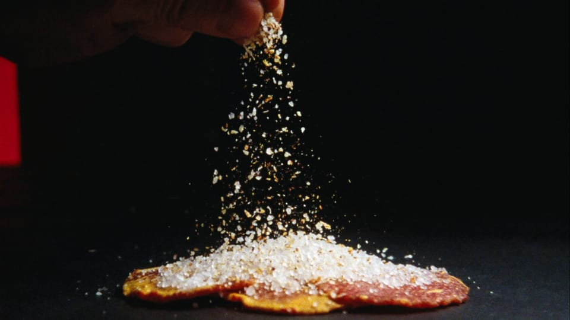

- Model: Soul Cinematic (`soul_cinematic`) · aspect 16:9 · quality 2k
- Reference images: none

```text
Photoreal premium food commercial cinematography, shot on ARRI Alexa 35, fine 35mm film grain, shallow depth of field. Low-key lighting: one warm tungsten key light from camera-left at 45 degrees with soft falloff, deep neutral-black shadows, a faint vermilion-red glow in the far background. Palette: ink black #0F0E0D, warm bone white #F2ECE1, vermilion #E4381C, amber #D58A2A. Rich, natural, appetising colour. No bloom, no haze, no lens flare. Macro: fingers at the top of the frame pinch and release a seasoning salt blend — coarse white salt flakes with tiny dark and amber flecks of toasted spice — the grains falling in a wide sparkling curtain, frozen in mid-air, toward paper-thin beef crisps lying on a matte black stone surface below. Every crystal catches the warm light against a black background. 100mm macro lens. No text, no lettering, no logos, no packaging, no watermark.
```

```bash
node production/scripts/generate.mjs kf-salt-rain
```

**Higgsfield video-generation prompt**

- Model: Seedance 2.5 (`seedance_2_5`) · mode `omni_reference` · 1080p · 16:9 · native audio off (sound is built in the edit)
- Start frames: `kf-slice`, `story-dry`, `kf-salt-rain` — each with its own prompt

For `kf-slice`:

```text
The knife glides smoothly from right to left through the beef in one long stroke. The paper-thin slice peels away and lifts, glowing translucent in the warm backlight. The camera dollies slowly left with the blade. Calm and precise. Single continuous shot, no cuts. No text, no captions, no logos other than the pack artwork. Keep the lighting, exposure and colour of the start frame: the scene stays bright and clearly readable. No flash, no flare, nothing glows or emits light.
```

For `story-dry`:

```text
Slow, steady dolly forward down the aisle between the two rows of hanging slices. The translucent slices of beef glow amber in the backlight and sway very slightly in the warm air; a few dust motes float through the light. Single continuous shot, no cuts. No text, no captions, no logos other than the pack artwork. Keep the lighting, exposure and colour of the start frame: the scene stays bright and clearly readable. No flash, no flare, nothing glows or emits light.
```

For `kf-salt-rain`:

```text
Extreme slow motion. The fingers rub together and release the salt blend. The grains fall in a wide sparkling curtain and scatter over the beef crisps below, some bouncing. The camera pedestals down slowly with the fall. Single continuous shot, no cuts. No text, no captions, no logos other than the pack artwork. Keep the lighting, exposure and colour of the start frame: the scene stays bright and clearly readable. No flash, no flare, nothing glows or emits light.
```

```bash
higgsfield generate create seedance_2_5 --prompt 'The knife glides smoothly from right to left through the beef in one long stroke. The paper-thin slice peels away and lifts, glowing translucent in the warm backlight. The camera dollies slowly left with the blade. Calm and precise. Single continuous shot, no cuts. No text, no captions, no logos other than the pack artwork. Keep the lighting, exposure and colour of the start frame: the scene stays bright and clearly readable. No flash, no flare, nothing glows or emits light.' --start-image production/renders/stills/kf-slice.png --duration 5 --aspect_ratio 16:9 --mode omni_reference --resolution 1080p --bitrate_mode high --generate_audio false --wait --wait-timeout 20m --json

higgsfield generate create seedance_2_5 --prompt 'Slow, steady dolly forward down the aisle between the two rows of hanging slices. The translucent slices of beef glow amber in the backlight and sway very slightly in the warm air; a few dust motes float through the light. Single continuous shot, no cuts. No text, no captions, no logos other than the pack artwork. Keep the lighting, exposure and colour of the start frame: the scene stays bright and clearly readable. No flash, no flare, nothing glows or emits light.' --start-image production/renders/stills/story-dry.png --duration 5 --aspect_ratio 16:9 --mode omni_reference --resolution 1080p --bitrate_mode high --generate_audio false --wait --wait-timeout 20m --json

higgsfield generate create seedance_2_5 --prompt 'Extreme slow motion. The fingers rub together and release the salt blend. The grains fall in a wide sparkling curtain and scatter over the beef crisps below, some bouncing. The camera pedestals down slowly with the fall. Single continuous shot, no cuts. No text, no captions, no logos other than the pack artwork. Keep the lighting, exposure and colour of the start frame: the scene stays bright and clearly readable. No flash, no flare, nothing glows or emits light.' --start-image production/renders/stills/kf-salt-rain.png --duration 5 --aspect_ratio 16:9 --mode omni_reference --resolution 1080p --bitrate_mode high --generate_audio false --wait --wait-timeout 20m --json
```

Or through the project script, which also downloads the take and records it: `node production/scripts/render-film.mjs A11 --go`

This cut reuses the takes rendered for the first cut (`S02`, `S03`, `S04`); `migrate-takes.mjs` copies them to the new names. Rendering from nothing produces the same shot from the prompt above.

In the edit this shot is lifted with `eq=gamma=1.22:saturation=1.06`, so it sits with the brighter scenes around it.

### Frame 12 — A12 "He gives in"

32.0 s to 35.0 s

| | |
|---|---|
| Frame number | 12 of 15 (A12) |
| Visual description | The bartender examines a crisp with deep suspicion. He bites. It snaps. He tries not to smile, and fails. |
| Camera angle and movement | Close-up, 85mm. Locked off, slow push-in. |
| Lighting and atmosphere | Warm key from camera-left. |
| Product placement | The last hold-out, converted. |
| Sound | One more snap. A small laugh under the music. |
| Transition to the next shot | Cut to the pour. |
| Suggested duration | 3.0 s in the cut. Generate 5 s, so the edit has handles either side. |

**AI image-generation prompt — start frame `f-bartender-bite`**

Generated. 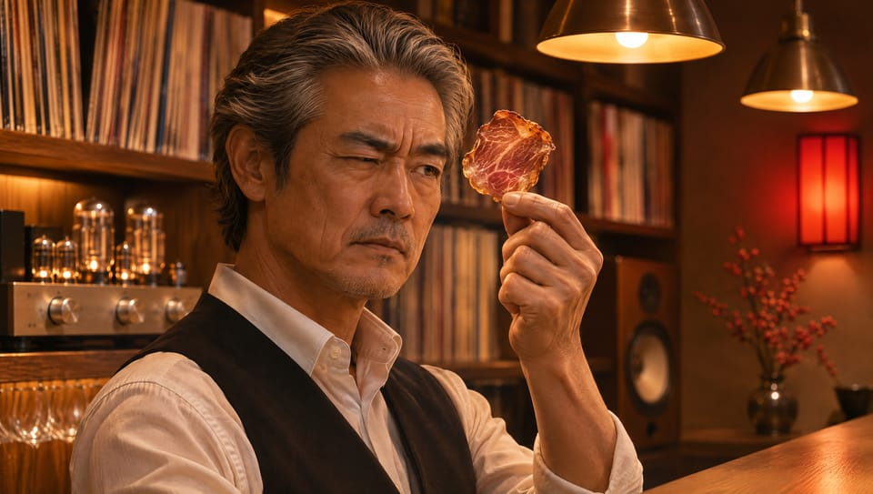

- Model: GPT Image 2.6 (`gpt_image_2_6`) · aspect 16:9 · resolution 2k, quality high
- Reference images: [`cast-bartender.png`](../production/renders/stills/cast-bartender.png)

```text
Photoreal cinematic film still, shot on ARRI Alexa 35 with anamorphic lenses, fine 35mm film grain, shallow depth of field. A small Tokyo listening bar at night, lit so that everything is clearly readable: warm tungsten pendant lamps pool light on a long light-oak counter, amber-lit wooden shelves of vinyl records and a glowing tube amplifier behind the bar, one vermilion-red lamp on the far wall. Faces, hands and objects are well exposed by a soft warm key light from camera-left; the shadows are deep brown and never crushed to black. Palette: warm amber, oak, bone white, vermilion #E4381C accents. Natural skin, natural colour. Close-up of a Japanese bartender in his fifties with swept-back grey hair, a white shirt and a black waistcoat, deadpan and dignified (the man in the reference) behind the counter, holding a single paper-thin beef crisp up in front of his face and examining it with deep suspicion, one eye narrowed. The crisp is lit warm and clearly visible. Shelves of vinyl softly out of focus behind him. 85mm lens. No text, no lettering, no logos, no packaging, no watermark.
```

```bash
node production/scripts/generate.mjs f-bartender-bite
```

**Higgsfield video-generation prompt**

- Model: Seedance 2.5 (`seedance_2_5`) · mode `omni_reference` · 1080p · 16:9 · native audio off (sound is built in the edit)
- Start frame: `f-bartender-bite`

```text
The bartender examines the crisp with suspicion, then bites it: it snaps cleanly and small shards fly. He chews sternly; then, slowly, his face breaks into a smile that he tries to hide. Locked-off camera, slow push-in. Single continuous shot, no cuts. No text, no captions, no logos other than the pack artwork. Keep the lighting, exposure and colour of the start frame: the scene stays bright and clearly readable. No flash, no flare, nothing glows or emits light.
```

```bash
higgsfield generate create seedance_2_5 --prompt 'The bartender examines the crisp with suspicion, then bites it: it snaps cleanly and small shards fly. He chews sternly; then, slowly, his face breaks into a smile that he tries to hide. Locked-off camera, slow push-in. Single continuous shot, no cuts. No text, no captions, no logos other than the pack artwork. Keep the lighting, exposure and colour of the start frame: the scene stays bright and clearly readable. No flash, no flare, nothing glows or emits light.' --start-image production/renders/stills/f-bartender-bite.png --duration 5 --aspect_ratio 16:9 --mode omni_reference --resolution 1080p --bitrate_mode high --generate_audio false --wait --wait-timeout 20m --json
```

Or through the project script, which also downloads the take and records it: `node production/scripts/render-film.mjs A12 --go`

### Frame 13 — A13 "The pairing"

35.0 s to 38.0 s

| | |
|---|---|
| Frame number | 13 of 15 (A13) |
| Visual description | Whisky soda streams over clear block ice; bubbles race upward. The red Ribeye pack stands beside the glass. |
| Camera angle and movement | Medium close-up, 50mm, counter height. Slow push-in toward the glass. |
| Lighting and atmosphere | Warm tungsten key from camera-left, vermilion glow behind, turntable out of focus. |
| Product placement | Ribeye pack, right of centre, still and sharp. |
| Sound | Fizz, ice, one clink, on top of the music. |
| Transition to the next shot | Cut to the range. |
| Suggested duration | 3.0 s in the cut. Generate 5 s, so the edit has handles either side. |

**AI image-generation prompt — start frame `life-highball`**

Generated. 

- Model: GPT Image 2.6 (`gpt_image_2_6`) · aspect 16:9 · resolution 2k, quality medium
- Reference images: [`pack-ribeye.png`](../production/refs/pack-ribeye.png)

```text
Photoreal premium food commercial cinematography, shot on ARRI Alexa 35, fine 35mm film grain, shallow depth of field. Low-key lighting: one warm tungsten key light from camera-left at 45 degrees with soft falloff, deep neutral-black shadows, a faint vermilion-red glow in the far background. Palette: ink black #0F0E0D, warm bone white #F2ECE1, vermilion #E4381C, amber #D58A2A. Rich, natural, appetising colour. No bloom, no haze, no lens flare. On the dark wooden counter of a dim listening bar: whisky soda being poured from above into a tall thin highball glass packed with clear block ice, the liquid splashing, fine bubbles rising, frozen in motion, condensation on the glass. Beside it, standing upright, the RICA Ribeye beef crisps box: a slim upright rectangular carton in matte uncoated paperboard (about 10 cm wide, 15 cm tall, 3 cm deep) whose front panel reproduces the flat artwork in the reference image exactly — same flat colour, the RICA wordmark top-left, one huge katakana sound word set vertically down the centre, the cut name bottom-left and a small row of waveform bars bottom-right. Do not redesign, restyle or add to the artwork. A few paper-thin beef crisps sit on a small black dish in front. A turntable is softly out of focus in the background. Glass centre-left, pack right of centre. 50mm lens. No extra text beyond the pack artwork, no other brands, no watermark.
```

```bash
node production/scripts/generate.mjs life-highball
```

**Higgsfield video-generation prompt**

- Model: Seedance 2.5 (`seedance_2_5`) · mode `omni_reference` · 1080p · 16:9 · native audio off (sound is built in the edit)
- Start frame: `life-highball`

```text
Slow motion. Whisky soda streams into the tall glass over the clear block ice; the liquid swirls and fine bubbles race upward; a bead of condensation runs down the glass. The camera pushes in slowly. The red box beside the glass stays perfectly still and sharp, and its artwork does not change. Single continuous shot, no cuts. No text, no captions, no logos other than the pack artwork. Keep the lighting, exposure and colour of the start frame: the scene stays bright and clearly readable. No flash, no flare, nothing glows or emits light.
```

```bash
higgsfield generate create seedance_2_5 --prompt 'Slow motion. Whisky soda streams into the tall glass over the clear block ice; the liquid swirls and fine bubbles race upward; a bead of condensation runs down the glass. The camera pushes in slowly. The red box beside the glass stays perfectly still and sharp, and its artwork does not change. Single continuous shot, no cuts. No text, no captions, no logos other than the pack artwork. Keep the lighting, exposure and colour of the start frame: the scene stays bright and clearly readable. No flash, no flare, nothing glows or emits light.' --start-image production/renders/stills/life-highball.png --duration 5 --aspect_ratio 16:9 --mode omni_reference --resolution 1080p --bitrate_mode high --generate_audio false --wait --wait-timeout 20m --json
```

Or through the project script, which also downloads the take and records it: `node production/scripts/render-film.mjs A13 --go`

This cut reuses the take rendered for the first cut (`S05`); `migrate-takes.mjs` copies it to the new name. Rendering from nothing produces the same shot from the prompt above.

### Frame 14 — A14 "The range"

38.0 s to 42.0 s

| | |
|---|---|
| Frame number | 14 of 15 (A14) |
| Visual description | All five packs in a row on black stone. Crisps and salt fall through the foreground and scatter at their feet. |
| Camera angle and movement | Wide product shot, 50mm, slightly low. Slow push-in. |
| Lighting and atmosphere | Warm key from camera-left rakes across the cartons; vermilion glow behind. |
| Product placement | The hero shot. All five fronts readable, still and sharp. |
| Sound | The record plays out — then stops dead. |
| Transition to the next shot | Cut to black. |
| Suggested duration | 4.0 s in the cut. Generate 5 s, so the edit has handles either side. |

**AI image-generation prompt — start frame `pack-lineup`**

Generated. 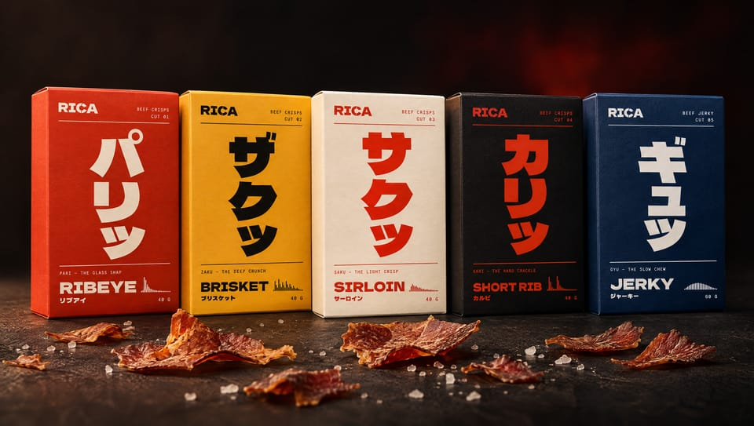

- Model: GPT Image 2.6 (`gpt_image_2_6`) · aspect 16:9 · resolution 2k, quality high
- Reference images: [`pack-sheet.png`](../production/refs/pack-sheet.png)

```text
Photoreal premium food commercial cinematography, shot on ARRI Alexa 35, fine 35mm film grain, shallow depth of field. Low-key lighting: one warm tungsten key light from camera-left at 45 degrees with soft falloff, deep neutral-black shadows, a faint vermilion-red glow in the far background. Palette: ink black #0F0E0D, warm bone white #F2ECE1, vermilion #E4381C, amber #D58A2A. Rich, natural, appetising colour. No bloom, no haze, no lens flare. Five slim upright rectangular cartons in matte uncoated paperboard (each about 10 cm wide, 15 cm tall, 3 cm deep) standing side by side in a slightly staggered row on a matte black stone surface against a black background, fronts turned a little toward camera. Each carton's front reproduces exactly the corresponding flat artwork from the reference sheet, left to right: vermilion red RIBEYE with white パリッ, mustard yellow BRISKET with black ザクッ, off-white SIRLOIN with red サクッ, black SHORT RIB with red カリッ, indigo blue JERKY with white ギュッ. Keep every artwork faithful: RICA wordmark top-left, one huge vertical katakana word, cut name bottom-left, small waveform bars bottom-right. Do not redesign or add to the artwork. In front of the cartons, scattered paper-thin beef crisps and coarse white salt flakes. 50mm lens. No extra text beyond the pack artwork, no other brands, no watermark.
```

```bash
node production/scripts/generate.mjs pack-lineup
```

**Higgsfield video-generation prompt**

- Model: Seedance 2.5 (`seedance_2_5`) · mode `omni_reference` · 1080p · 16:9 · native audio off (sound is built in the edit)
- Start frame: `pack-lineup`

```text
Slow, steady push-in toward the row of five boxes. A few beef crisps and salt flakes fall through the foreground in slow motion and scatter on the black stone. The five boxes stay perfectly still and sharp, and their artwork does not change. Single continuous shot, no cuts. No text, no captions, no logos other than the pack artwork. Keep the lighting, exposure and colour of the start frame: the scene stays bright and clearly readable. No flash, no flare, nothing glows or emits light.
```

```bash
higgsfield generate create seedance_2_5 --prompt 'Slow, steady push-in toward the row of five boxes. A few beef crisps and salt flakes fall through the foreground in slow motion and scatter on the black stone. The five boxes stay perfectly still and sharp, and their artwork does not change. Single continuous shot, no cuts. No text, no captions, no logos other than the pack artwork. Keep the lighting, exposure and colour of the start frame: the scene stays bright and clearly readable. No flash, no flare, nothing glows or emits light.' --start-image production/renders/stills/pack-lineup.png --duration 5 --aspect_ratio 16:9 --mode omni_reference --resolution 1080p --bitrate_mode high --generate_audio false --wait --wait-timeout 20m --json
```

Or through the project script, which also downloads the take and records it: `node production/scripts/render-film.mjs A14 --go`

This cut reuses the take rendered for the first cut (`S08`); `migrate-takes.mjs` copies it to the new name. Rendering from nothing produces the same shot from the prompt above.

### Frame 15 — A15 "The name"

42.0 s to 45.0 s

| | |
|---|---|
| Frame number | 15 of 15 (A15) |
| Visual description | Black. The RICA wordmark, whole. On the last snap it breaks along the crack. Underneath: “Every cut has a sound.” and “A loud snack for quiet places.” |
| Camera angle and movement | Static title card. Rendered in code from the vector logo — never generated. |
| Lighting and atmosphere | Bone on ink black. No effects. |
| Product placement | The brand. |
| Sound | Silence. One final snap as the wordmark breaks. |
| Transition to the next shot | End. |
| Suggested duration | 3.0 s in the cut. Nothing is generated. |

**How this frame is made.** The end card is not generated by a model. `production/scripts/edit-film.mjs` renders it in code from the vector logo (`src/assets/brand/rica-wordmark.svg`), bone on ink black: the wordmark appears whole for 0.9 s, breaks along its crack on the final snap, and 0.3 s later the lines "Every cut has a sound.", "A loud snack for quiet places." and 部位ごとに、音がある。 appear beneath it. The type is outlined from the brand fonts, so the film's last frame is identical to the logo everywhere else. There is no image prompt and no video prompt for this frame, by design: generated video cannot be trusted with a logo.

## 5. Sound

The film is cut to sound, so the sound is planned like the picture.

**Music** — Two cues, both heard as if from the record in the bar. First a hushed, slow jazz ballad that plays from the first frame and stops dead on the snap. Then silence. Then, as the others join in, an up-tempo swinging trio at 120 bpm whose backbeat the four snaps land on; it stops dead for the final snap. Generate both cues with `node production/scripts/generate-audio.mjs music`; they are saved as `production/renders/audio/<cue>.*`.

`music-a` — 14 s generated; in the film from 0 s to 10.3 s.

```text
A slow, hushed late-night jazz ballad heard from a vinyl record in a small listening bar: soft upright bass, brushed snare, a few sparse piano notes, 70 bpm, warm vinyl crackle, intimate, quiet and unhurried. It starts immediately with no intro and stays calm throughout. Instrumental, no vocals.
```

```bash
higgsfield generate create sonilo_music --prompt 'A slow, hushed late-night jazz ballad heard from a vinyl record in a small listening bar: soft upright bass, brushed snare, a few sparse piano notes, 70 bpm, warm vinyl crackle, intimate, quiet and unhurried. It starts immediately with no intro and stays calm throughout. Instrumental, no vocals.' --duration 14 --wait
```

`music-b` — 24 s generated; in the film from 21.5 s to 42 s.

```text
An up-tempo swinging jazz trio at exactly 120 bpm heard from a vinyl record: walking upright bass, a crisp ride cymbal, sharp rimshots on beats two and four, playful piano stabs; joyful, tight and danceable, with vinyl warmth. It starts immediately on the downbeat with no intro and keeps one steady groove with no breaks. Instrumental, no vocals.
```

```bash
higgsfield generate create sonilo_music --prompt 'An up-tempo swinging jazz trio at exactly 120 bpm heard from a vinyl record: walking upright bass, a crisp ride cymbal, sharp rimshots on beats two and four, playful piano stabs; joyful, tight and danceable, with vinyl warmth. It starts immediately on the downbeat with no intro and keeps one steady groove with no breaks. Instrumental, no vocals.' --duration 24 --wait
```

**Effects** — one short file each, generated with `seed_audio` (0.1 credits each) or recorded for real, which will always sound better for the snaps. They are saved in `production/renders/audio/sfx/` as `<time>_<name>.wav`. The edit finds each file by its name; the time below is the plan, and the final time, trim and level of every effect are in `production/edit/sound.json`.

| Effect | Planned at | Prompt |
|---|---|---|
| `cloth` | 3.6 s | A soft cotton cloth polishing a wine glass in slow circles, a faint squeak. Close mic, dry, quiet room. |
| `snap` | 10.3 s | One loud, clean snap of a very thin, brittle crisp breaking. Close mic, dry, no reverb. |
| `room` | 10.3 s | A low, warm room hum with one faint tick of metal expanding. Three seconds. |
| `stool` | 12.4 s | One wooden bar stool creaking once in a silent room. Close mic, dry. |
| `glass-down` | 15.9 s | A glass set down gently on a wooden counter: one soft knock. Close mic, dry. |
| `slide` | 17.6 s | A small ceramic dish sliding a short way across a wooden counter. Close mic, dry. |
| `snap2` | 20.2 s | One clean, slightly deeper snap of a thin brittle crisp breaking, then a single quiet crunch. Close mic, dry, no reverb. |
| `pari` | 21.6 s | A high, glassy snap of a paper-thin crisp. One transient, fast decay. |
| `zaku` | 22.6 s | A deep, layered crunch: several coarse cracks in quick succession. |
| `saku` | 23.6 s | A light, airy crisp bite, soft and short. |
| `kari` | 24.6 s | A hard double crackle, two sharp cracks close together. |
| `crowd` | 25.6 s | A small group of six people in a bar laughing warmly and crunching crisps, lively and happy, no words. Four seconds. |
| `blade` | 29.0 s | One long, soft stroke of a very sharp knife slicing through meat. Close mic, dry. |
| `salt` | 31.0 s | A dry hiss of coarse salt grains falling, then a light patter as they land on a hard surface. |
| `snap3` | 33.4 s | One crisp, clean snap of a thin brittle cracker, then a short low chuckle from an older man. Close mic, dry. |
| `pour` | 35.2 s | Soda poured over ice in a tall glass: fizz, ice shifting, one glassy clink at the end. |
| `endcard-snap` | 42.9 s | One final clean snap of a brittle crisp in total silence. Close mic, dry. |

Mix: the first record stops dead on the first snap (10.2 s). The eleven seconds after it are the joke, so they carry only room tone, a stool, a glass and a dish. The second record comes in at 21.5 s with the four snaps on its backbeat and stops dead at 42 s for the last snap. The edit script measures the mix, applies one fixed gain to reach −14 LUFS integrated and limits peaks at −2.5 dBFS. It does not compress: a quiet passage stays quiet.

## 6. Budget

Prices are the quotes returned by `higgsfield generate cost` on 2026-11-13. The film needs 19 takes and 91 s of generated footage for a 45 s cut. Every route allows ×1.3 for re-rolls: roughly one take in three gets redone.

| Route | Model | Rate | Footage | Takes | With re-rolls | Stills still to buy | Sound | Total |
|---|---|---|---|---|---|---|---|---|
| Reference | Seedance 2.5, 1080p | 16 cr/s | 91 s | 1,456 | 1,893 | 0 | 4.08 | **1,897 credits** |
| Smart | Kling 4.0, 1080p | 3.25 cr/s | 91 s | 296 | 384 | 0 | 4.08 | **389 credits** |
| 4K master | Seedance 2.0, 4k | 22 cr/s | 91 s | 2,002 | 2,603 | 0 | 4.08 | **2,607 credits** |

- **Reference.** The route this storyboard is written for: strongest motion and the best hold on a start frame.
- **Smart.** About a fifth of the price. Right for a first full cut; keep it as the final if the faces and the pack artwork hold.
- **4K master.** Only if a 4K deliverable is required (cinema, retail screens). Same start frames.
- Seedance 2.5 also quotes a 4K tier at 28 cr/s (2,548 credits, 3,312 with re-rolls). It is dearer than the Seedance 2.0 4K route above and is listed only so the option is known.

What is in the other columns:

- Stills still to buy: 0 images — 0 on Soul Cinematic at 0.12 each and 0 on GPT Image 2.6 (pack shots) at  — 0 credits, or 0 with re-rolls. 0 of them are film start frames; the rest are for the website.
- Optional quality pass on the 29 pack images: all at high / 2k is 79.75 credits; all at xhigh / 4k is 203.
- Sound: 2 music cues, 14 s and 24 s (2.38), and 17 effects (1.7).
- Spent on this project: 2095.86 credits, read from the account's transaction log on 2026-11-13 (first cut of the film, stills and hero loop 1,020.43; second cut and scroll hero 1,075.43 — Seedance 2.5 video 800 for the ten new film takes and 12 for a test, Seedance 2.0 4K 220 for the scroll hero shot, GPT Image 2.6 stills 36.25, sound effects 4.8, music 2.38). Every still, every film take and the sound are generated, and the film is assembled.

Ways to bring the Reference route down without changing the film:

- Generate 4 s takes instead of 5 s (the Seedance minimum). That is 76 s of footage: 1,216 credits, 1,581 with re-rolls. The handles get tight, so approve start frames carefully.
- Cut the whole film on the Smart route first (384 credits), lock the edit, then re-render on the Reference route only the takes that carry a face in close-up or the pack: A03, A04, A08, A12, A13 and A14.
- Seedance 2.5 at 720p is 7 cr/s: 637 credits, 828 with re-rolls. Acceptable for a social-only master, not for the website's full-width player.

Run order once there are credits:

```bash
node production/scripts/generate.mjs all                       # the remaining stills, start frames included
node production/scripts/render-film.mjs all                       # dry run: prints every command and the estimate
node production/scripts/render-film.mjs all --go                  # render (add --model kling4_0 for the Smart route)
node production/scripts/edit-film.mjs                             # assemble → public/videos/rica-oto-film.mp4
npm run docs                                                      # refresh these documents
```

## 7. Cut-downs: 9:16 and 1:1

The 16:9 film is the master. The vertical and square versions are re-edits, hook first, not crops of the whole thing.

**9:16, 15 s — Reels, TikTok, Shorts.** Open on the snap; the product is on screen inside the first second.

| Time | Shot | Note |
|---|---|---|
| 0.0–2.5 | A04 The snap | Start with the crisp at her lips; the snap lands inside the first second. The first frame must work as a still with the sound off. |
| 2.5–4.5 | A05 Everyone looks | The whole counter turns. Silence. |
| 4.5–8.5 | A09 Four sounds | One second each, sound word large and centred in the upper third. |
| 8.5–10.5 | A12 He gives in | The bartender bites. |
| 10.5–13.0 | A14 The range | Stack the five packs as two rows if the row does not fit. |
| 13.0–15.0 | A15 The name | Wordmark, lines, and the call to action inside the platform safe zone. |

**1:1, 15 s — feed.** Same order as the vertical cut.

**6 s bumper.** A04 snap (2 s), two snaps from A09 (2 s), end card (2 s).

How each shot gets to the new shape:

| Shot | 9:16 | 1:1 |
|---|---|---|
| A01–A03, A06–A08, A10, A11, A13 | Not in the cut-downs | Not in the cut-downs |
| A04 The snap | Re-render from a 9:16 start frame, face centred, same cast reference | Centre crop on the face |
| A05 Everyone looks | Re-render from a 9:16 start frame: the counter seen along its length, the heroine nearest the camera | Centre crop keeps her and the two nearest heads |
| A09 Four sounds | Re-render from 9:16 start frames; the composition is a centred object on flat colour, so only the aspect changes | Centre crop of the master |
| A12 He gives in | Re-render from a 9:16 start frame | Centre crop on the face |
| A14 The range | Re-render from a 9:16 start frame with the packs in two rows | Centre crop loses the outer packs: re-render or pan across the row |
| A15 The name | Re-run the end card at 1080×1920 | Re-run at 1080×1080 |

A centre crop of the 1080p master is only 608 px wide at 9:16, which is a draft, not a deliverable. For delivery, change `aspect` to `9:16` on the start frames in `production/stills.mjs`, regenerate them and re-render those takes: 5 shots, 36 s of footage, 749 credits on the Reference route with re-rolls, or 152 on the Smart route. Burn in captions for the vertical cut: at most two lines, 32 characters per line, inside the platform safe zones.

## 8. QA checklist

Run through this on a contact sheet and then on the full cut, with sound.

- [ ] The first frame works as a still, and the first sound lands inside 3 s.
- [ ] It can be seen. Read the average brightness of the master second by second: the bar scenes sit between 65 and 85 on a 0–255 scale, and nothing with a face in it falls under 60.
- [ ] Pack artwork matches the reference exactly wherever a pack is in frame (the counter in the bar, A13, A14): wordmark with its crack, every stroke of the katakana including the small ッ, cut name, waveform bars. If a label drifts, slow the camera move or composite the approved still over the take.
- [ ] Light comes from camera-left in every shot; the vermilion glow stays in the background, never on the product.
- [ ] Beef looks like beef in every frame: mahogany red, amber lace, white salt. No plastic sheen, no grey.
- [ ] The same three people in every bar shot: her chin-length bob and black knit, his round glasses and grey sweater, the bartender's grey hair and waistcoat. Five fingers, natural eyes.
- [ ] No generated text anywhere. The only type is the pack artwork, the four sound words and the end card.
- [ ] Every cut is motivated; nothing is shorter than a second.
- [ ] The first record stops dead on the first snap. The room stays quiet until 21.5 s. The second record stops dead at 42 s.
- [ ] Loudness −14 LUFS integrated, true peak under −1 dB, no clipping, no silent gap that is not intended.
- [ ] End card holds for at least 2 s; wordmark and line are legible on a phone.
- [ ] Exactly 45.00 s, 1920×1080, 24 fps, H.264, plays from the first byte (`+faststart`).
- [ ] No claim appears in picture or sound beyond the line itself.

Fix the weakest shot first and check again. Do not re-roll the whole film.
