# Website image storyboard

Rica Beef · 18 images for the homepage, each with one job · 18 generated, 0 pending

Built from `production/film.mjs`, `production/stills.mjs` and `production/look.mjs` by `npm run docs`. Do not edit by hand: change the data and rebuild.

Every image on the site is planned before it is generated: which section it sits in, what it has to do there, where the type goes, and therefore where the subject may not go. The prompts below are the exact text sent to the model.

## Shared look

All 18 frames belong to one of two worlds, and the two worlds share a light.

**Night** — hero, story, texture, lifestyle, campaign.

```text
Photoreal premium food commercial cinematography, shot on ARRI Alexa 35, fine 35mm film grain, shallow depth of field. Low-key lighting: one warm tungsten key light from camera-left at 45 degrees with soft falloff, deep neutral-black shadows, a faint vermilion-red glow in the far background. Palette: ink black #0F0E0D, warm bone white #F2ECE1, vermilion #E4381C, amber #D58A2A. Rich, natural, appetising colour. No bloom, no haze, no lens flare.
```

**Studio** — the individual cuts and the closing frame.

```text
Photoreal premium product photography, medium-format camera, 90mm lens, f/8, crisp focus, fine film grain. One hard key light from camera-left at 45 degrees casting a single clean, defined shadow to the right. Seamless matte paper backdrop and floor in one flat colour. Brand palette: ink black #0F0E0D, warm bone white #F2ECE1, vermilion #E4381C. Rich, natural, appetising colour.
```

The rules that make them one set:

- Light direction. The key is always camera-left at about 45 degrees: warm and soft at night, hard in the studio with a single clean shadow falling right.
- Colour. Ink black #0F0E0D, bone #F2ECE1, vermilion #E4381C, amber #D58A2A. The cut colours only ever appear as flat fields.
- Lens and grain. Macro or short telephoto, shallow depth of field at night, f/8 in the studio, fine 35mm grain in both. No bloom, haze or flare.
- The product is described in the same words every time:

```text
RICA beef crisps are paper-thin, irregular palm-sized shards of dried beef: deep mahogany-red with a lighter translucent amber lace where the marbling was, brittle and glassy like a very thin cracker, dusted with coarse white salt flakes and tiny dark specks of toasted spice.
```

- The pack is never described from memory. The flat vector artwork is passed as a reference image and this text goes with it:

```text
a slim upright rectangular carton in matte uncoated paperboard (about 10 cm wide, 15 cm tall, 3 cm deep) whose front panel reproduces the flat artwork in the reference image exactly — same flat colour, the RICA wordmark top-left, one huge katakana sound word set vertically down the centre, the cut name bottom-left and a small row of waveform bars bottom-right. Do not redesign, restyle or add to the artwork.
```

- Negative space is written into each prompt. The slot decides the composition, not the other way round.
- People are original, fictional and adult. No real person's likeness is used.

## Sequence

| # | Image | Section | Aspect | Model | Status |
|---|---|---|---|---|---|
| 01 | `hero` | 01 Hero | 16:9 | Soul Cinematic | Generated |
| 02 | `hero-mobile` | 01 Hero (mobile) | 9:16 | Soul Cinematic | Generated |
| 03 | `story-slice` | 02 Story — Slice | 3:4 | Soul Cinematic | Generated |
| 04 | `story-salt` | 02 Story — Salt | 3:4 | GPT Image 2.6 | Generated |
| 05 | `story-dry` | 02 Story — Sound | 16:9 | GPT Image 2.6 | Generated |
| 06 | `pack-lineup` | 03 Collection | 16:9 | GPT Image 2.6 | Generated |
| 07 | `cut-ribeye` | 03 Collection | 4:5 | GPT Image 2.6 | Generated |
| 08 | `cut-brisket` | 03 Collection | 4:5 | GPT Image 2.6 | Generated |
| 09 | `cut-sirloin` | 03 Collection | 4:5 | GPT Image 2.6 | Generated |
| 10 | `cut-shortrib` | 03 Collection | 4:5 | GPT Image 2.6 | Generated |
| 11 | `cut-jerky` | 03 Collection | 4:5 | GPT Image 2.6 | Generated |
| 12 | `life-listening-bar` | 04 Lifestyle | 16:9 | Soul Cinematic | Generated |
| 13 | `life-bite` | 04 Lifestyle | 3:4 | Soul Cinematic | Generated |
| 14 | `life-train` | 04 Lifestyle | 3:4 | Soul Cinematic | Generated |
| 15 | `life-highball` | 04 Lifestyle | 16:9 | GPT Image 2.6 | Generated |
| 16 | `campaign-key` | 05 Campaign | 16:9 | GPT Image 2.6 | Generated |
| 17 | `texture-macro` | 06 Why Rica | 21:9 | Soul Cinematic | Generated |
| 18 | `closing-gone` | 07 Final moment | 16:9 | Soul Cinematic | Generated |

Required imagery, and where it is covered: homepage hero (`hero`, `hero-mobile`) · brand lifestyle (`life-listening-bar`, `life-bite`, `life-train`, `life-highball`) · product collection (`pack-lineup`) · individual flavours (`cut-ribeye`, `cut-brisket`, `cut-sirloin`, `cut-shortrib`, `cut-jerky`) · ingredients and texture (`story-slice`, `story-salt`, `story-dry`, `texture-macro`) · campaign photography (`campaign-key`) · final closing image (`closing-gone`).

## Frames

### 01 · `hero` — 01 Hero

Generated and on the site.

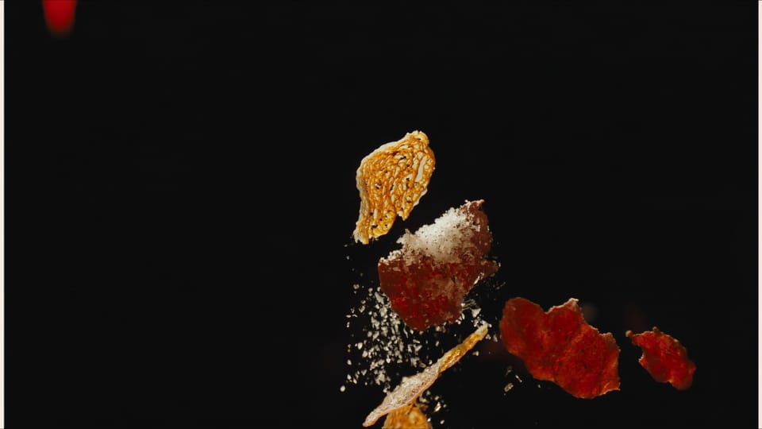

| | |
|---|---|
| Purpose | Full-screen opening image and video poster. Subject sits right; the left third stays black for the headline and nav. |
| What the picture is | Paper-thin beef crisps tumbling through black space, one snapping in half, salt crystals hanging in warm light. The subject sits on the right; the left third is empty black. |
| Composition and negative space | Subject low in the right two-thirds. The left third is pure black: headline, navigation and the ghosted sound word live there. The first take has a faint light edge and a soft red shape top-left; trim about 2% from every side on export. |
| Aspect ratio | 16:9 |
| Model and settings | Soul Cinematic (`soul_cinematic`) · quality 2k |
| Reference images | none |
| Source file | `production/renders/stills/hero.png` |
| On the site | `src/assets/images/hero-640.webp`, `src/assets/images/hero-1024.webp`, `src/assets/images/hero-1600.webp`, `src/assets/images/hero-1958.webp` |
| Also the film start frame for | S08 (alt) |

```text
Photoreal premium food commercial cinematography, shot on ARRI Alexa 35, fine 35mm film grain, shallow depth of field. Low-key lighting: one warm tungsten key light from camera-left at 45 degrees with soft falloff, deep neutral-black shadows, a faint vermilion-red glow in the far background. Palette: ink black #0F0E0D, warm bone white #F2ECE1, vermilion #E4381C, amber #D58A2A. Rich, natural, appetising colour. No bloom, no haze, no lens flare. Extreme close-up, frozen slow motion: several paper-thin beef crisps tumbling through the air in the right two-thirds of the frame, one of them snapping cleanly in half, shards and coarse white salt crystals bursting outward and hanging in the air, every crystal catching the warm key light. Pure black background. The left third of the frame is empty deep black negative space. RICA beef crisps are paper-thin, irregular palm-sized shards of dried beef: deep mahogany-red with a lighter translucent amber lace where the marbling was, brittle and glassy like a very thin cracker, dusted with coarse white salt flakes and tiny dark specks of toasted spice. 100mm macro lens. No text, no lettering, no logos, no packaging, no watermark. No hands.
```

```bash
node production/scripts/generate.mjs hero --force   # re-roll; the current take is kept as _v1
```

### 02 · `hero-mobile` — 01 Hero (mobile)

Generated and on the site.

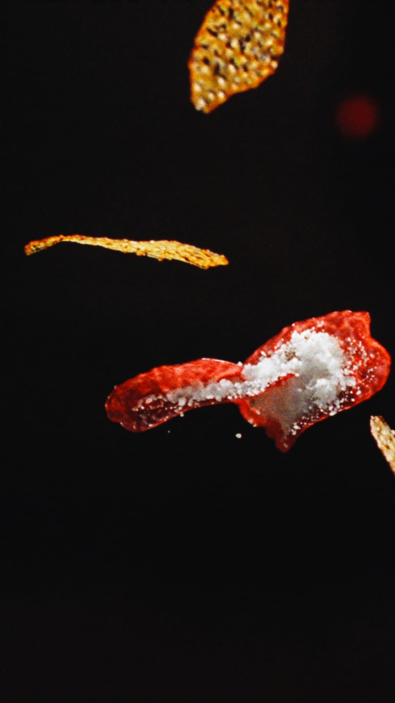

| | |
|---|---|
| Purpose | Portrait crop of the hero. Subject in the upper half; the lower half stays black for the headline. |
| What the picture is | The hero moment composed upright: crisps and salt burst in the upper half of the frame, and the lower half is empty black for the headline. |
| Composition and negative space | Subject in the upper half. The lower half is pure black for the stacked headline and the call to action. |
| Aspect ratio | 9:16 |
| Model and settings | Soul Cinematic (`soul_cinematic`) · quality 2k |
| Reference images | none |
| Source file | `production/renders/stills/hero-mobile.png` |
| On the site | `src/assets/images/hero-mobile-640.webp`, `src/assets/images/hero-mobile-1024.webp`, `src/assets/images/hero-mobile-1102.webp` |

```text
Photoreal premium food commercial cinematography, shot on ARRI Alexa 35, fine 35mm film grain, shallow depth of field. Low-key lighting: one warm tungsten key light from camera-left at 45 degrees with soft falloff, deep neutral-black shadows, a faint vermilion-red glow in the far background. Palette: ink black #0F0E0D, warm bone white #F2ECE1, vermilion #E4381C, amber #D58A2A. Rich, natural, appetising colour. No bloom, no haze, no lens flare. Extreme close-up, frozen slow motion: several paper-thin beef crisps tumbling through the air in the upper half of the frame, one of them snapping cleanly in half, shards and coarse white salt crystals bursting outward and hanging in the air, every crystal catching the warm key light. Pure black background. The lower half of the frame is empty deep black negative space. RICA beef crisps are paper-thin, irregular palm-sized shards of dried beef: deep mahogany-red with a lighter translucent amber lace where the marbling was, brittle and glassy like a very thin cracker, dusted with coarse white salt flakes and tiny dark specks of toasted spice. 100mm macro lens. No text, no lettering, no logos, no packaging, no watermark. No hands.
```

```bash
node production/scripts/generate.mjs hero-mobile --force   # re-roll; the current take is kept as _v1
```

### 03 · `story-slice` — 02 Story — Slice

Generated and on the site.

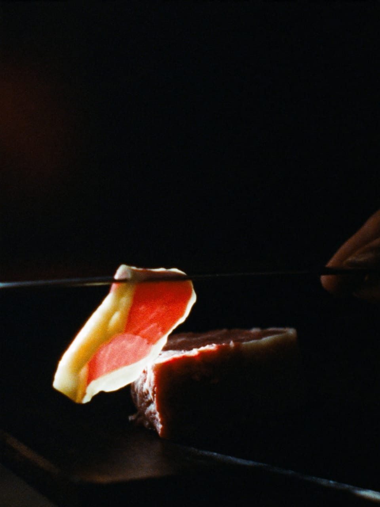

| | |
|---|---|
| Purpose | Chapter one. The thinness, proven by light passing through the slice. |
| What the picture is | Hands, no face, drawing a long knife through marbled ribeye. The slice lifting away is thin enough for the backlight to glow through it. |
| Composition and negative space | Portrait. The action sits in the lower half; the top third is dark and empty, so the chapter numeral can overlap the picture. |
| Aspect ratio | 3:4 |
| Model and settings | Soul Cinematic (`soul_cinematic`) · quality 2k |
| Reference images | none |
| Source file | `production/renders/stills/story-slice.png` |
| On the site | `src/assets/images/story-slice-640.webp`, `src/assets/images/story-slice-1024.webp`, `src/assets/images/story-slice-1536.webp` |

```text
Photoreal premium food commercial cinematography, shot on ARRI Alexa 35, fine 35mm film grain, shallow depth of field. Low-key lighting: one warm tungsten key light from camera-left at 45 degrees with soft falloff, deep neutral-black shadows, a faint vermilion-red glow in the far background. Palette: ink black #0F0E0D, warm bone white #F2ECE1, vermilion #E4381C, amber #D58A2A. Rich, natural, appetising colour. No bloom, no haze, no lens flare. Close-up of a craftsperson's hands, no face in frame, drawing a long thin Japanese slicing knife through a block of well-marbled raw ribeye and lifting away a slice so thin that warm backlight glows through it, showing the fat marbling like lace. Dark wooden cutting board, black background. The top third of the frame is dark and empty. 85mm lens. No text, no lettering, no logos, no packaging, no watermark.
```

```bash
node production/scripts/generate.mjs story-slice --force   # re-roll; the current take is kept as _v1
```

### 04 · `story-salt` — 02 Story — Salt

Generated and on the site.

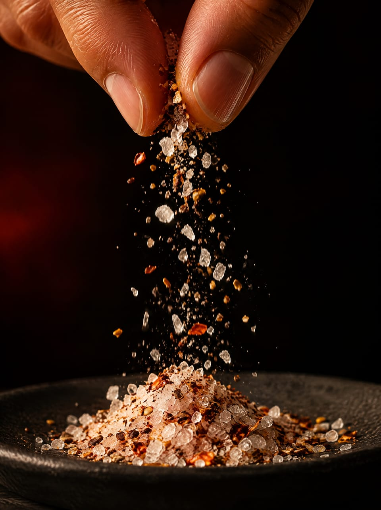

| | |
|---|---|
| Purpose | Chapter two. The house salt blend as the hero ingredient. |
| What the picture is | Fingers releasing the house salt blend: a sparkling stream of white flakes and dark specks frozen in mid-air above a small mound on black stone. |
| Composition and negative space | Portrait. The hand enters from the top edge, the stream falls down the centre line and lands at the bottom; black on both sides. |
| Aspect ratio | 3:4 |
| Model and settings | GPT Image 2.6 (`gpt_image_2_6`) · resolution 2k, quality medium |
| Reference images | none |
| Source file | `production/renders/stills/story-salt.png` |
| On the site | `src/assets/images/story-salt-640.webp`, `src/assets/images/story-salt-1024.webp`, `src/assets/images/story-salt-1600.webp`, `src/assets/images/story-salt-1744.webp` |

```text
Photoreal premium food commercial cinematography, shot on ARRI Alexa 35, fine 35mm film grain, shallow depth of field. Low-key lighting: one warm tungsten key light from camera-left at 45 degrees with soft falloff, deep neutral-black shadows, a faint vermilion-red glow in the far background. Palette: ink black #0F0E0D, warm bone white #F2ECE1, vermilion #E4381C, amber #D58A2A. Rich, natural, appetising colour. No bloom, no haze, no lens flare. Macro: the fingertips of a hand in natural, warm-lit skin tone (not red) enter from the top of the frame and pinch and release a seasoning salt blend — coarse white salt flakes mixed with tiny dark and amber flecks of toasted spice — the grains falling in a sparkling stream, frozen in mid-air, onto a small mound on a matte black stone plate. Every crystal catches the warm light against a black background. 100mm macro lens. No text, no lettering, no logos, no packaging, no watermark.
```

```bash
node production/scripts/generate.mjs story-salt --force   # re-roll; the current take is kept as _v1
```

### 05 · `story-dry` — 02 Story — Sound

Generated and on the site.

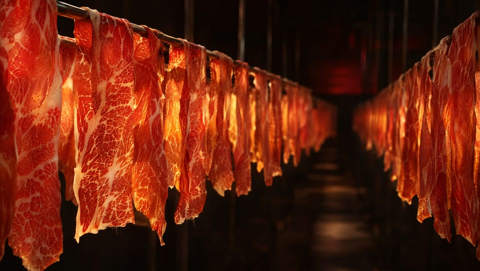

| | |
|---|---|
| Purpose | Chapter three. Slow drying; sheets glowing like stained glass. Wide, calm, full-bleed. |
| What the picture is | Rows of beef sheets on steel drying racks receding into the dark, backlit amber so that each sheet glows like stained glass. |
| Composition and negative space | Wide and calm, one-point perspective along the racks. There is no single focal subject, so it can run full-bleed behind one short line of type. |
| Aspect ratio | 16:9 |
| Model and settings | GPT Image 2.6 (`gpt_image_2_6`) · resolution 2k, quality high |
| Reference images | none |
| Source file | `production/renders/stills/story-dry.png` |
| On the site | `src/assets/images/story-dry-640.webp`, `src/assets/images/story-dry-1024.webp`, `src/assets/images/story-dry-1600.webp`, `src/assets/images/story-dry-2048.webp` |
| Also the film start frame for | S03 |

```text
Photoreal premium food commercial cinematography, shot on ARRI Alexa 35, fine 35mm film grain, shallow depth of field. Low-key lighting: one warm tungsten key light from camera-left at 45 degrees with soft falloff, deep neutral-black shadows, a faint vermilion-red glow in the far background. Palette: ink black #0F0E0D, warm bone white #F2ECE1, vermilion #E4381C, amber #D58A2A. Rich, natural, appetising colour. No bloom, no haze, no lens flare. A dark drying room: long rows of paper-thin slices of marbled beef hanging from thin horizontal steel rods, dozens of slices per row, the rows receding into the distance. A strong warm amber backlight shines through the slices so each one glows translucent like stained glass, the marbling visible as paler lace; the room itself stays in deep shadow. Camera at slice height looking down the aisle between two rows, 35mm lens, the nearest slices sharp, the far ones soft. No people. No text, no lettering, no logos, no packaging, no watermark.
```

```bash
node production/scripts/generate.mjs story-dry --force   # re-roll; the current take is kept as _v1
```

### 06 · `pack-lineup` — 03 Collection

Generated and on the site.

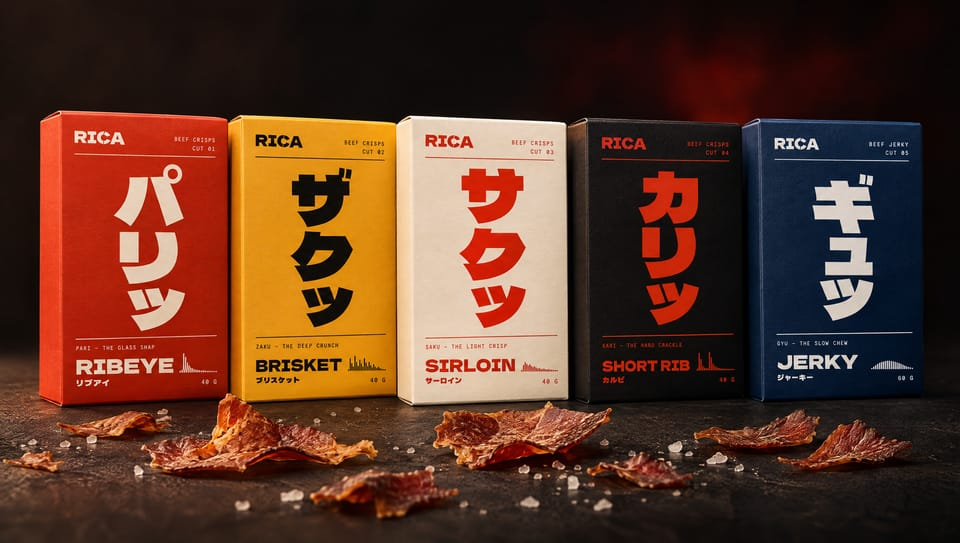

| | |
|---|---|
| Purpose | The whole range in one frame. Opens the collection and closes the film. |
| What the picture is | All five cartons in a row on black stone — red, mustard, white, black, indigo — with crisps and salt scattered at their feet. |
| Composition and negative space | All five fronts readable. The row sits in the upper two-thirds; the lower third is darker and emptier for a heading. |
| Aspect ratio | 16:9 |
| Model and settings | GPT Image 2.6 (`gpt_image_2_6`) · resolution 2k, quality high |
| Reference images | [`pack-sheet.png`](../production/refs/pack-sheet.png) |
| Source file | `production/renders/stills/pack-lineup.png` |
| On the site | `src/assets/images/pack-lineup-640.webp`, `src/assets/images/pack-lineup-1024.webp`, `src/assets/images/pack-lineup-1600.webp`, `src/assets/images/pack-lineup-2048.webp` |
| Also the film start frame for | S08 |

```text
Photoreal premium food commercial cinematography, shot on ARRI Alexa 35, fine 35mm film grain, shallow depth of field. Low-key lighting: one warm tungsten key light from camera-left at 45 degrees with soft falloff, deep neutral-black shadows, a faint vermilion-red glow in the far background. Palette: ink black #0F0E0D, warm bone white #F2ECE1, vermilion #E4381C, amber #D58A2A. Rich, natural, appetising colour. No bloom, no haze, no lens flare. Five slim upright rectangular cartons in matte uncoated paperboard (each about 10 cm wide, 15 cm tall, 3 cm deep) standing side by side in a slightly staggered row on a matte black stone surface against a black background, fronts turned a little toward camera. Each carton's front reproduces exactly the corresponding flat artwork from the reference sheet, left to right: vermilion red RIBEYE with white パリッ, mustard yellow BRISKET with black ザクッ, off-white SIRLOIN with red サクッ, black SHORT RIB with red カリッ, indigo blue JERKY with white ギュッ. Keep every artwork faithful: RICA wordmark top-left, one huge vertical katakana word, cut name bottom-left, small waveform bars bottom-right. Do not redesign or add to the artwork. In front of the cartons, scattered paper-thin beef crisps and coarse white salt flakes. 50mm lens. No extra text beyond the pack artwork, no other brands, no watermark.
```

```bash
node production/scripts/generate.mjs pack-lineup --force   # re-roll; the current take is kept as _v1
```

### 07 · `cut-ribeye` — 03 Collection

Generated and on the site.

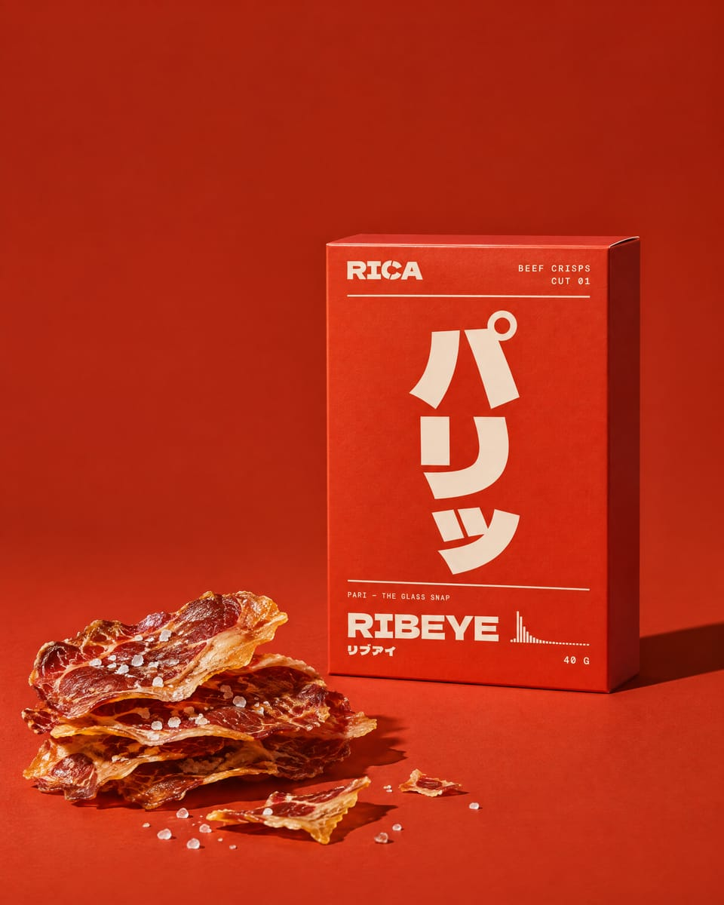

| | |
|---|---|
| Purpose | Individual flavour image for Ribeye (パリッ). Pack right of centre, beef in front; top quarter empty. |
| What the picture is | The Ribeye carton (パリッ) standing on a seamless deep vermilion red backdrop, with a loose stack of the crisps in front and scattered salt. Hard light from the left, one clean shadow. |
| Composition and negative space | Pack right of centre, beef front-left, top quarter empty backdrop. The backdrop is a shade deeper than the carton so the pack reads against it. |
| Aspect ratio | 4:5 |
| Model and settings | GPT Image 2.6 (`gpt_image_2_6`) · resolution 2k, quality medium |
| Reference images | [`pack-ribeye.png`](../production/refs/pack-ribeye.png) |
| Source file | `production/renders/stills/cut-ribeye.png` |
| On the site | `src/assets/images/cut-ribeye-640.webp`, `src/assets/images/cut-ribeye-1024.webp`, `src/assets/images/cut-ribeye-1600.webp`, `src/assets/images/cut-ribeye-1792.webp` |

```text
Photoreal premium product photography, medium-format camera, 90mm lens, f/8, crisp focus, fine film grain. One hard key light from camera-left at 45 degrees casting a single clean, defined shadow to the right. Seamless matte paper backdrop and floor in one flat colour. Brand palette: ink black #0F0E0D, warm bone white #F2ECE1, vermilion #E4381C. Rich, natural, appetising colour. The RICA Ribeye box standing upright, turned slightly, right of centre: a slim upright rectangular carton in matte uncoated paperboard (about 10 cm wide, 15 cm tall, 3 cm deep) whose front panel reproduces the flat artwork in the reference image exactly — same flat colour, the RICA wordmark top-left, one huge katakana sound word set vertically down the centre, the cut name bottom-left and a small row of waveform bars bottom-right. Do not redesign, restyle or add to the artwork. In front of it and to the left, a loose stack of paper-thin ribeye crisps: mahogany-red with a generous translucent amber lace of rendered marbling, glassy and brittle, dusted with coarse white salt flakes, with a few broken pieces and scattered salt flakes. The backdrop and floor are deep vermilion red (#C92F16). The top quarter of the frame is empty backdrop. No extra text beyond the pack artwork, no other brands, no watermark.
```

```bash
node production/scripts/generate.mjs cut-ribeye --force   # re-roll; the current take is kept as _v1
```

### 08 · `cut-brisket` — 03 Collection

Generated and on the site.

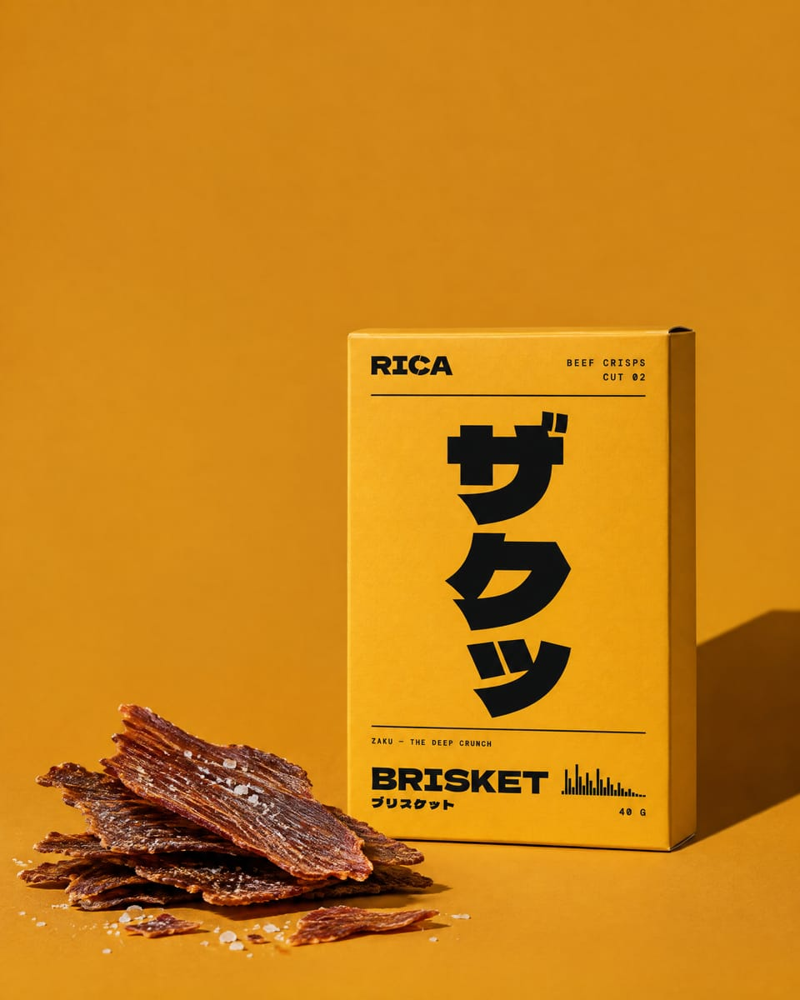

| | |
|---|---|
| Purpose | Individual flavour image for Brisket (ザクッ). Pack right of centre, beef in front; top quarter empty. |
| What the picture is | The Brisket carton (ザクッ) standing on a seamless warm mustard yellow backdrop, with a loose stack of the crisps in front and scattered salt. Hard light from the left, one clean shadow. |
| Composition and negative space | Pack right of centre, beef front-left, top quarter empty backdrop. The backdrop is a shade deeper than the carton so the pack reads against it. |
| Aspect ratio | 4:5 |
| Model and settings | GPT Image 2.6 (`gpt_image_2_6`) · resolution 2k, quality medium |
| Reference images | [`pack-brisket.png`](../production/refs/pack-brisket.png) |
| Source file | `production/renders/stills/cut-brisket.png` |
| On the site | `src/assets/images/cut-brisket-640.webp`, `src/assets/images/cut-brisket-1024.webp`, `src/assets/images/cut-brisket-1600.webp`, `src/assets/images/cut-brisket-1792.webp` |

```text
Photoreal premium product photography, medium-format camera, 90mm lens, f/8, crisp focus, fine film grain. One hard key light from camera-left at 45 degrees casting a single clean, defined shadow to the right. Seamless matte paper backdrop and floor in one flat colour. Brand palette: ink black #0F0E0D, warm bone white #F2ECE1, vermilion #E4381C. Rich, natural, appetising colour. The RICA Brisket box standing upright, turned slightly, right of centre: a slim upright rectangular carton in matte uncoated paperboard (about 10 cm wide, 15 cm tall, 3 cm deep) whose front panel reproduces the flat artwork in the reference image exactly — same flat colour, the RICA wordmark top-left, one huge katakana sound word set vertically down the centre, the cut name bottom-left and a small row of waveform bars bottom-right. Do not redesign, restyle or add to the artwork. In front of it and to the left, a loose stack of paper-thin brisket crisps: darker brown-red with long visible grain lines running the length of each shard, a little more rugged, dusted with coarse white salt flakes, with a few broken pieces and scattered salt flakes. The backdrop and floor are warm mustard yellow (#D2931A). The top quarter of the frame is empty backdrop. No extra text beyond the pack artwork, no other brands, no watermark.
```

```bash
node production/scripts/generate.mjs cut-brisket --force   # re-roll; the current take is kept as _v1
```

### 09 · `cut-sirloin` — 03 Collection

Generated and on the site.

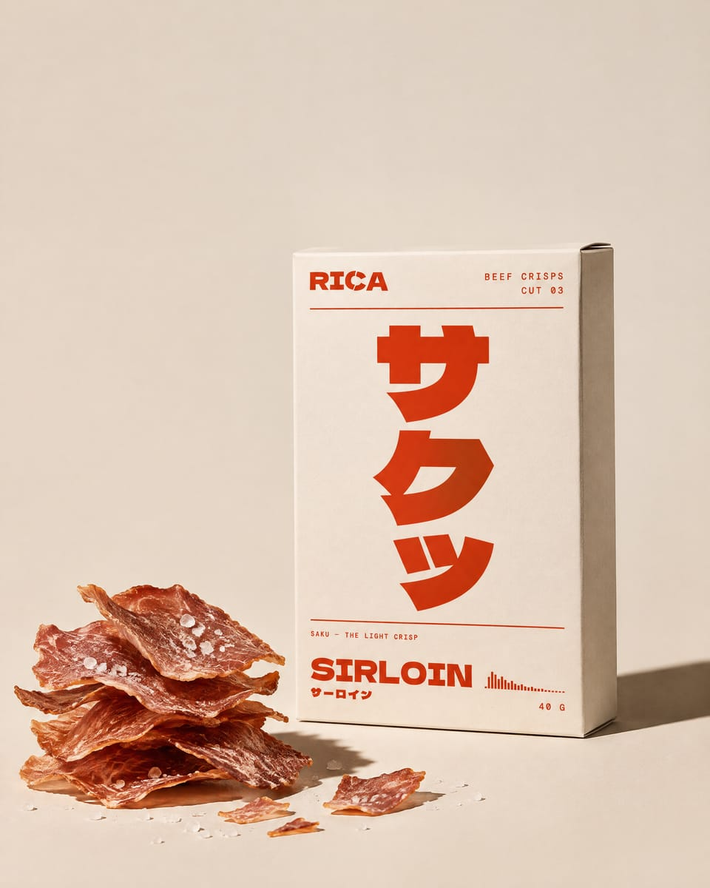

| | |
|---|---|
| Purpose | Individual flavour image for Sirloin (サクッ). Pack right of centre, beef in front; top quarter empty. |
| What the picture is | The Sirloin carton (サクッ) standing on a seamless warm off-white bone backdrop, with a loose stack of the crisps in front and scattered salt. Hard light from the left, one clean shadow. |
| Composition and negative space | Pack right of centre, beef front-left, top quarter empty backdrop. The backdrop is a shade deeper than the carton so the pack reads against it. |
| Aspect ratio | 4:5 |
| Model and settings | GPT Image 2.6 (`gpt_image_2_6`) · resolution 2k, quality medium |
| Reference images | [`pack-sirloin.png`](../production/refs/pack-sirloin.png) |
| Source file | `production/renders/stills/cut-sirloin.png` |
| On the site | `src/assets/images/cut-sirloin-640.webp`, `src/assets/images/cut-sirloin-1024.webp`, `src/assets/images/cut-sirloin-1600.webp`, `src/assets/images/cut-sirloin-1792.webp` |

```text
Photoreal premium product photography, medium-format camera, 90mm lens, f/8, crisp focus, fine film grain. One hard key light from camera-left at 45 degrees casting a single clean, defined shadow to the right. Seamless matte paper backdrop and floor in one flat colour. Brand palette: ink black #0F0E0D, warm bone white #F2ECE1, vermilion #E4381C. Rich, natural, appetising colour. The RICA Sirloin box standing upright, turned slightly, right of centre: a slim upright rectangular carton in matte uncoated paperboard (about 10 cm wide, 15 cm tall, 3 cm deep) whose front panel reproduces the flat artwork in the reference image exactly — same flat colour, the RICA wordmark top-left, one huge katakana sound word set vertically down the centre, the cut name bottom-left and a small row of waveform bars bottom-right. Do not redesign, restyle or add to the artwork. In front of it and to the left, a loose stack of paper-thin sirloin crisps: lean, even rosy-brown, very fine and airy, almost translucent at the edges, dusted with coarse white salt flakes, with a few broken pieces and scattered salt flakes. The backdrop and floor are warm off-white bone (#EDE6D8). The top quarter of the frame is empty backdrop. No extra text beyond the pack artwork, no other brands, no watermark.
```

```bash
node production/scripts/generate.mjs cut-sirloin --force   # re-roll; the current take is kept as _v1
```

### 10 · `cut-shortrib` — 03 Collection

Generated and on the site.

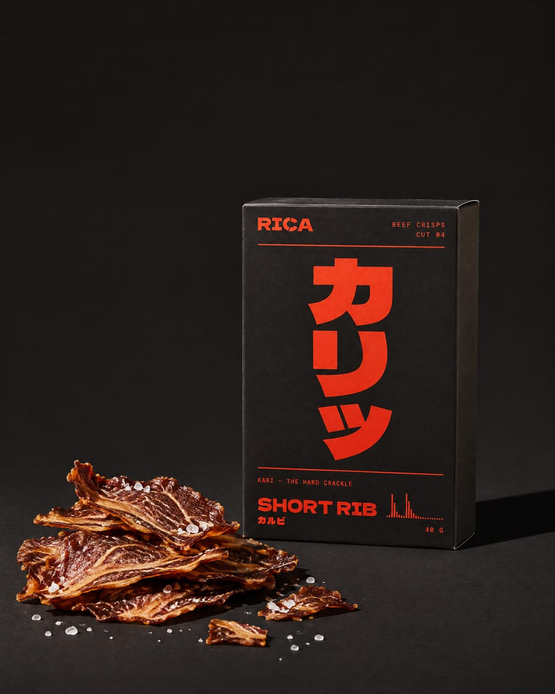

| | |
|---|---|
| Purpose | Individual flavour image for Short Rib (カリッ). Pack right of centre, beef in front; top quarter empty. |
| What the picture is | The Short Rib carton (カリッ) standing on a seamless charcoal black backdrop, with a loose stack of the crisps in front and scattered salt. Hard light from the left, one clean shadow. |
| Composition and negative space | Pack right of centre, beef front-left, top quarter empty backdrop. The backdrop is a shade deeper than the carton so the pack reads against it. |
| Aspect ratio | 4:5 |
| Model and settings | GPT Image 2.6 (`gpt_image_2_6`) · resolution 2k, quality medium |
| Reference images | [`pack-shortrib.png`](../production/refs/pack-shortrib.png) |
| Source file | `production/renders/stills/cut-shortrib.png` |
| On the site | `src/assets/images/cut-shortrib-640.webp`, `src/assets/images/cut-shortrib-1024.webp`, `src/assets/images/cut-shortrib-1600.webp`, `src/assets/images/cut-shortrib-1792.webp` |

```text
Photoreal premium product photography, medium-format camera, 90mm lens, f/8, crisp focus, fine film grain. One hard key light from camera-left at 45 degrees casting a single clean, defined shadow to the right. Seamless matte paper backdrop and floor in one flat colour. Brand palette: ink black #0F0E0D, warm bone white #F2ECE1, vermilion #E4381C. Rich, natural, appetising colour. The RICA Short Rib box standing upright, turned slightly, right of centre: a slim upright rectangular carton in matte uncoated paperboard (about 10 cm wide, 15 cm tall, 3 cm deep) whose front panel reproduces the flat artwork in the reference image exactly — same flat colour, the RICA wordmark top-left, one huge katakana sound word set vertically down the centre, the cut name bottom-left and a small row of waveform bars bottom-right. Do not redesign, restyle or add to the artwork. In front of it and to the left, a loose stack of paper-thin short-rib crisps: deep dark caramel-brown with glossy caramelised edges and fine striped marbling, dusted with coarse white salt flakes, with a few broken pieces and scattered salt flakes. The backdrop and floor are charcoal black (#171614). The top quarter of the frame is empty backdrop. No extra text beyond the pack artwork, no other brands, no watermark.
```

```bash
node production/scripts/generate.mjs cut-shortrib --force   # re-roll; the current take is kept as _v1
```

### 11 · `cut-jerky` — 03 Collection

Generated and on the site.

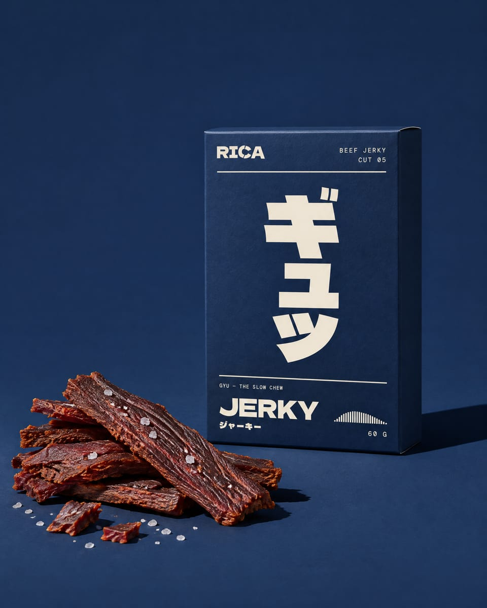

| | |
|---|---|
| Purpose | Individual flavour image for Jerky (ギュッ). Pack right of centre, beef in front; top quarter empty. |
| What the picture is | The Jerky carton (ギュッ) standing on a seamless deep indigo blue backdrop, with a loose stack of the jerky in front and scattered salt. Hard light from the left, one clean shadow. |
| Composition and negative space | Pack right of centre, beef front-left, top quarter empty backdrop. The backdrop is a shade deeper than the carton so the pack reads against it. |
| Aspect ratio | 4:5 |
| Model and settings | GPT Image 2.6 (`gpt_image_2_6`) · resolution 2k, quality medium |
| Reference images | [`pack-jerky.png`](../production/refs/pack-jerky.png) |
| Source file | `production/renders/stills/cut-jerky.png` |
| On the site | `src/assets/images/cut-jerky-640.webp`, `src/assets/images/cut-jerky-1024.webp`, `src/assets/images/cut-jerky-1600.webp`, `src/assets/images/cut-jerky-1792.webp` |

```text
Photoreal premium product photography, medium-format camera, 90mm lens, f/8, crisp focus, fine film grain. One hard key light from camera-left at 45 degrees casting a single clean, defined shadow to the right. Seamless matte paper backdrop and floor in one flat colour. Brand palette: ink black #0F0E0D, warm bone white #F2ECE1, vermilion #E4381C. Rich, natural, appetising colour. The RICA Jerky box standing upright, turned slightly, right of centre: a slim upright rectangular carton in matte uncoated paperboard (about 10 cm wide, 15 cm tall, 3 cm deep) whose front panel reproduces the flat artwork in the reference image exactly — same flat colour, the RICA wordmark top-left, one huge katakana sound word set vertically down the centre, the cut name bottom-left and a small row of waveform bars bottom-right. Do not redesign, restyle or add to the artwork. In front of it and to the left, a loose stack of thick-cut strips of beef jerky: dense, dark mahogany, matte, with visible long fibres, dusted with coarse white salt flakes, with a few broken pieces and scattered salt flakes. The backdrop and floor are deep indigo blue (#172A47). The top quarter of the frame is empty backdrop. No extra text beyond the pack artwork, no other brands, no watermark.
```

```bash
node production/scripts/generate.mjs cut-jerky --force   # re-roll; the current take is kept as _v1
```

### 12 · `life-listening-bar` — 04 Lifestyle

Generated and on the site.

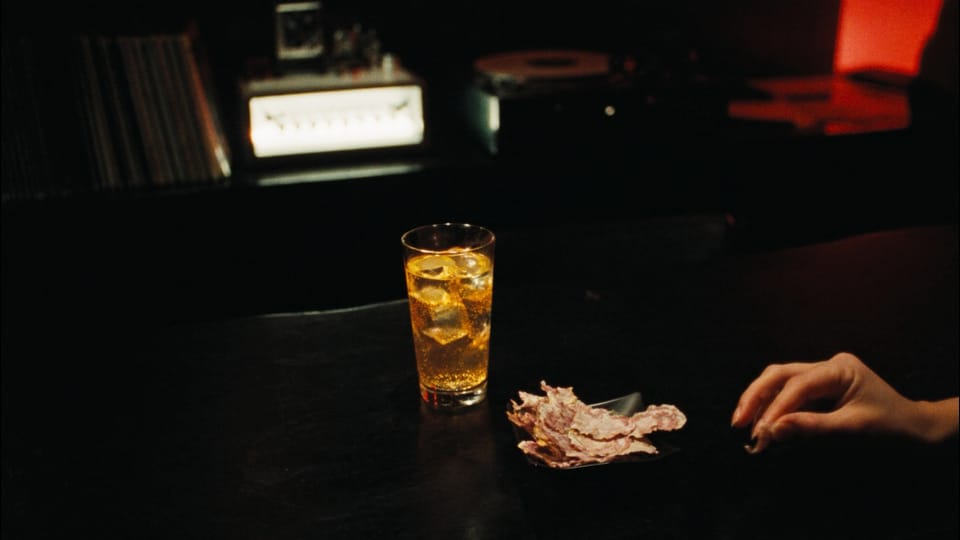

| | |
|---|---|
| Purpose | Establishes the world: the listening bar. Wide, atmospheric; top-left stays dark for a caption. |
| What the picture is | A dim Tokyo listening bar: a highball and a small dish of crisps on the counter, a hand reaching in, turntable and amplifier glowing out of focus. |
| Composition and negative space | Glass and dish in the lower centre. The top-left stays dark and uncluttered for a caption. |
| Aspect ratio | 16:9 |
| Model and settings | Soul Cinematic (`soul_cinematic`) · quality 2k |
| Reference images | none |
| Source file | `production/renders/stills/life-listening-bar.png` |
| On the site | `src/assets/images/life-listening-bar-640.webp`, `src/assets/images/life-listening-bar-1024.webp`, `src/assets/images/life-listening-bar-1600.webp`, `src/assets/images/life-listening-bar-2048.webp` |

```text
Photoreal premium food commercial cinematography, shot on ARRI Alexa 35, fine 35mm film grain, shallow depth of field. Low-key lighting: one warm tungsten key light from camera-left at 45 degrees with soft falloff, deep neutral-black shadows, a faint vermilion-red glow in the far background. Palette: ink black #0F0E0D, warm bone white #F2ECE1, vermilion #E4381C, amber #D58A2A. Rich, natural, appetising colour. No bloom, no haze, no lens flare. A dim Tokyo listening bar at night: a long dark wooden counter; softly out of focus in the background a vintage turntable spinning a record, a glowing tube amplifier and shelves of vinyl sleeves. In the foreground on the counter, a tall whisky highball with clear block ice and fine bubbles, and a small black ceramic dish piled with paper-thin beef crisps. A hand reaches in from the right to take one crisp. 35mm lens. The top-left of the frame is dark and uncluttered. No text, no lettering, no logos, no packaging, no watermark. No readable signs.
```

```bash
node production/scripts/generate.mjs life-listening-bar --force   # re-roll; the current take is kept as _v1
```

### 13 · `life-bite` — 04 Lifestyle

Generated and on the site.

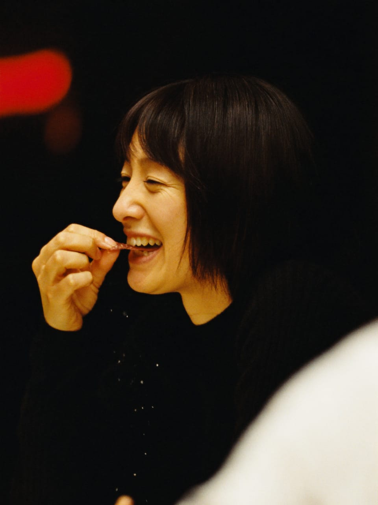

| | |
|---|---|
| Purpose | The human moment: the snap itself. Portrait. |
| What the picture is | A close portrait of a woman at the bar, caught mid-laugh as she snaps a crisp between her teeth; shards and salt in the warm light. |
| Composition and negative space | Portrait, face centre-right. The frame is dark around the head so the image dissolves into the night background of the section. |
| Aspect ratio | 3:4 |
| Model and settings | Soul Cinematic (`soul_cinematic`) · quality 2k |
| Reference images | none |
| Source file | `production/renders/stills/life-bite.png` |
| On the site | `src/assets/images/life-bite-640.webp`, `src/assets/images/life-bite-1024.webp`, `src/assets/images/life-bite-1536.webp` |

```text
Photoreal premium food commercial cinematography, shot on ARRI Alexa 35, fine 35mm film grain, shallow depth of field. Low-key lighting: one warm tungsten key light from camera-left at 45 degrees with soft falloff, deep neutral-black shadows, a faint vermilion-red glow in the far background. Palette: ink black #0F0E0D, warm bone white #F2ECE1, vermilion #E4381C, amber #D58A2A. Rich, natural, appetising colour. No bloom, no haze, no lens flare. Candid close-up portrait of a Japanese woman in her late twenties with a dark bob haircut and a black knit top, sitting at a dim listening-bar counter, caught mid-laugh as she snaps a paper-thin beef crisp between her teeth, tiny shards and salt crystals flying in the warm light. She is looking at someone off-camera. Natural skin texture, 85mm lens, turntable glow softly out of focus behind her. No text, no lettering, no logos, no packaging, no watermark.
```

```bash
node production/scripts/generate.mjs life-bite --force   # re-roll; the current take is kept as _v1
```

### 14 · `life-train` — 04 Lifestyle

Generated and on the site.

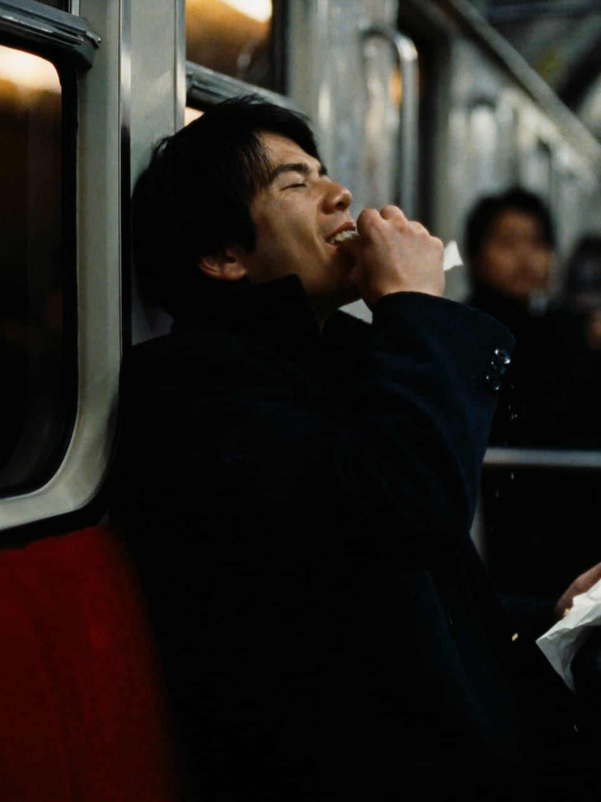

| | |
|---|---|
| Purpose | The quiet place, broken: last train home. Adds humour and a second location. |
| What the picture is | A nearly empty last train: a man in a dark coat, eyes closed in bliss, biting a crisp, while one other passenger glances over from the background. |
| Composition and negative space | Portrait. Subject in the lower two-thirds, the carriage leading away behind him; the ceiling area is quiet for a caption. |
| Aspect ratio | 3:4 |
| Model and settings | Soul Cinematic (`soul_cinematic`) · quality 2k |
| Reference images | none |
| Source file | `production/renders/stills/life-train.png` |
| On the site | `src/assets/images/life-train-640.webp`, `src/assets/images/life-train-1024.webp`, `src/assets/images/life-train-1536.webp` |

```text
Photoreal cinematic photography, shot on ARRI Alexa 35, fine 35mm film grain, shallow depth of field. A nearly empty late-night commuter train carriage in Tokyo: a Japanese man in his late twenties in a dark overcoat sits alone on the bench seat, eyes closed in bliss as he bites a paper-thin beef crisp, a few crumbs falling; further down the carriage, out of focus, one other passenger glances over. Cool overhead carriage light mixed with warm amber light from the windows at camera-left, deep shadows, a vermilion-red seat fabric. Palette: ink black, bone white, vermilion, amber. 35mm lens. No text, no lettering, no logos, no packaging, no watermark. No readable signs or advertisements.
```

```bash
node production/scripts/generate.mjs life-train --force   # re-roll; the current take is kept as _v1
```

### 15 · `life-highball` — 04 Lifestyle

Generated and on the site.

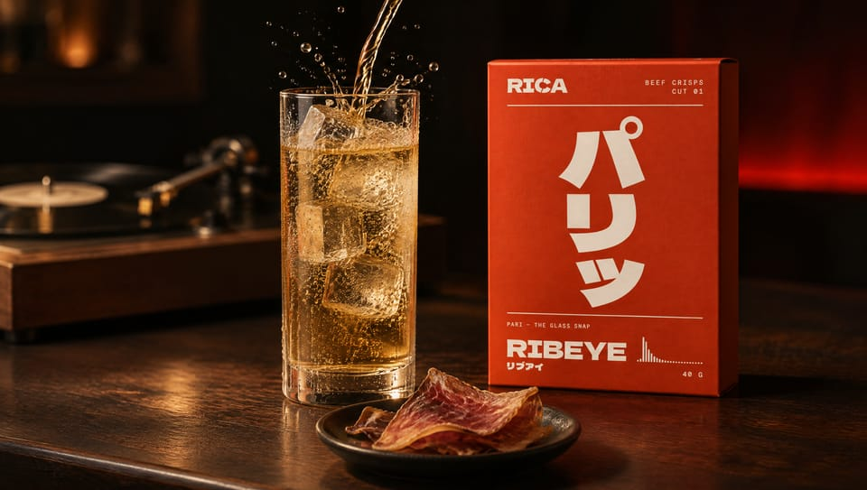

| | |
|---|---|
| Purpose | The pairing, with the pack in the world. Glass centre-left, pack right of centre; crops to portrait. |
| What the picture is | Whisky soda being poured over clear block ice at the bar, with the red Ribeye pack standing beside the glass and a few crisps on a dish. |
| Composition and negative space | Glass centre-left, pack right of centre, both inside the central third so the frame also crops cleanly to portrait. |
| Aspect ratio | 16:9 |
| Model and settings | GPT Image 2.6 (`gpt_image_2_6`) · resolution 2k, quality medium |
| Reference images | [`pack-ribeye.png`](../production/refs/pack-ribeye.png) |
| Source file | `production/renders/stills/life-highball.png` |
| On the site | `src/assets/images/life-highball-640.webp`, `src/assets/images/life-highball-1024.webp`, `src/assets/images/life-highball-1600.webp`, `src/assets/images/life-highball-2048.webp` |
| Also the film start frame for | S05 |

```text
Photoreal premium food commercial cinematography, shot on ARRI Alexa 35, fine 35mm film grain, shallow depth of field. Low-key lighting: one warm tungsten key light from camera-left at 45 degrees with soft falloff, deep neutral-black shadows, a faint vermilion-red glow in the far background. Palette: ink black #0F0E0D, warm bone white #F2ECE1, vermilion #E4381C, amber #D58A2A. Rich, natural, appetising colour. No bloom, no haze, no lens flare. On the dark wooden counter of a dim listening bar: whisky soda being poured from above into a tall thin highball glass packed with clear block ice, the liquid splashing, fine bubbles rising, frozen in motion, condensation on the glass. Beside it, standing upright, the RICA Ribeye beef crisps box: a slim upright rectangular carton in matte uncoated paperboard (about 10 cm wide, 15 cm tall, 3 cm deep) whose front panel reproduces the flat artwork in the reference image exactly — same flat colour, the RICA wordmark top-left, one huge katakana sound word set vertically down the centre, the cut name bottom-left and a small row of waveform bars bottom-right. Do not redesign, restyle or add to the artwork. A few paper-thin beef crisps sit on a small black dish in front. A turntable is softly out of focus in the background. Glass centre-left, pack right of centre. 50mm lens. No extra text beyond the pack artwork, no other brands, no watermark.
```

```bash
node production/scripts/generate.mjs life-highball --force   # re-roll; the current take is kept as _v1
```

### 16 · `campaign-key` — 05 Campaign

Generated and on the site.

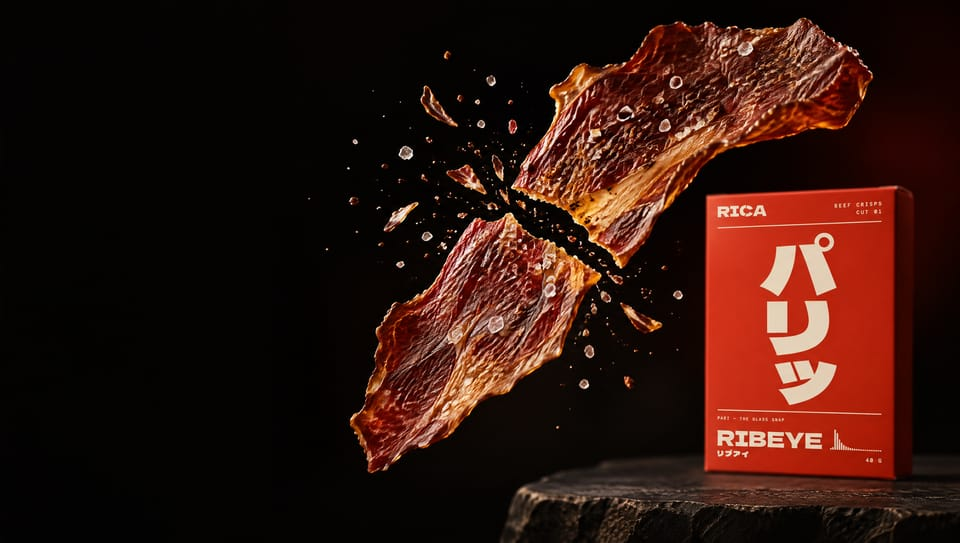

| | |
|---|---|
| Purpose | Key visual and film poster. The snap, with the pack as emblem. Left 40% is black for the title. |
| What the picture is | One large ribeye crisp snapping in half in mid-air with a burst of shards and salt; the Ribeye pack stands below it, slightly soft. The left 40% of the frame is black. |
| Composition and negative space | The snap centre-right with the pack beneath it. The left 40% is clean black for the film title and the play control. |
| Aspect ratio | 16:9 |
| Model and settings | GPT Image 2.6 (`gpt_image_2_6`) · resolution 2k, quality medium |
| Reference images | [`pack-ribeye.png`](../production/refs/pack-ribeye.png) |
| Source file | `production/renders/stills/campaign-key.png` |
| On the site | `src/assets/images/campaign-key-640.webp`, `src/assets/images/campaign-key-1024.webp`, `src/assets/images/campaign-key-1600.webp`, `src/assets/images/campaign-key-2048.webp` |

```text
Photoreal premium food commercial cinematography, shot on ARRI Alexa 35, fine 35mm film grain, shallow depth of field. Low-key lighting: one warm tungsten key light from camera-left at 45 degrees with soft falloff, deep neutral-black shadows, a faint vermilion-red glow in the far background. Palette: ink black #0F0E0D, warm bone white #F2ECE1, vermilion #E4381C, amber #D58A2A. Rich, natural, appetising colour. No bloom, no haze, no lens flare. Campaign key visual: one large paper-thin ribeye crisp snapping cleanly in half in mid-air, centre-right of the frame, a burst of shards and white salt crystals radiating from the break, frozen tack-sharp. Below and behind it, slightly out of focus, standing on black stone, the RICA Ribeye box: a slim upright rectangular carton in matte uncoated paperboard (about 10 cm wide, 15 cm tall, 3 cm deep) whose front panel reproduces the flat artwork in the reference image exactly — same flat colour, the RICA wordmark top-left, one huge katakana sound word set vertically down the centre, the cut name bottom-left and a small row of waveform bars bottom-right. Do not redesign, restyle or add to the artwork. Pure black background, thin vermilion rim light from behind right. The left 40% of the frame is clean black negative space. RICA beef crisps are paper-thin, irregular palm-sized shards of dried beef: deep mahogany-red with a lighter translucent amber lace where the marbling was, brittle and glassy like a very thin cracker, dusted with coarse white salt flakes and tiny dark specks of toasted spice. 100mm macro lens. No extra text beyond the pack artwork, no other brands, no watermark.
```

```bash
node production/scripts/generate.mjs campaign-key --force   # re-roll; the current take is kept as _v1
```

### 17 · `texture-macro` — 06 Why Rica

Generated and on the site.

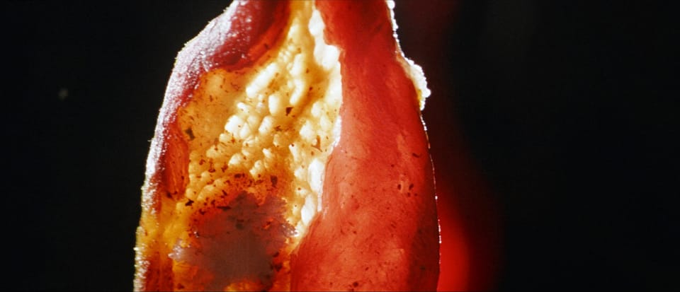

| | |
|---|---|
| Purpose | Edge-to-edge texture band: translucency, marbling lace, salt. Proof without words. |
| What the picture is | An edge-to-edge extreme macro of one crisp held to the light: translucent red, an amber lace of marbling, a broken edge, salt crystals. |
| Composition and negative space | A 21:9 band with no negative space, on purpose: it is a texture, not a scene. Type never sits on it. |
| Aspect ratio | 21:9 |
| Model and settings | Soul Cinematic (`soul_cinematic`) · quality 2k |
| Reference images | none |
| Source file | `production/renders/stills/texture-macro.png` |
| On the site | `src/assets/images/texture-macro-640.webp`, `src/assets/images/texture-macro-1024.webp`, `src/assets/images/texture-macro-1600.webp`, `src/assets/images/texture-macro-2048.webp` |

```text
Photoreal premium food commercial cinematography, shot on ARRI Alexa 35, fine 35mm film grain, shallow depth of field. Low-key lighting: one warm tungsten key light from camera-left at 45 degrees with soft falloff, deep neutral-black shadows, a faint vermilion-red glow in the far background. Palette: ink black #0F0E0D, warm bone white #F2ECE1, vermilion #E4381C, amber #D58A2A. Rich, natural, appetising colour. No bloom, no haze, no lens flare. Extreme macro filling the whole frame edge to edge: a single beef crisp held against a warm backlight so it glows translucent — mahogany-red lean, amber lace of rendered marbling, a rough broken edge, coarse white salt crystals and specks of toasted spice clinging to the surface. Razor-thin focal plane, 100mm macro lens. No text, no lettering, no logos, no packaging, no watermark. No hands.
```

```bash
node production/scripts/generate.mjs texture-macro --force   # re-roll; the current take is kept as _v1
```

### 18 · `closing-gone` — 07 Final moment

Generated and on the site.

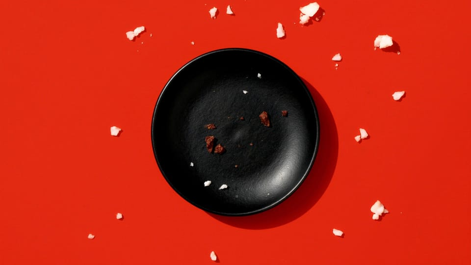

| | |
|---|---|
| Purpose | The last image: an empty dish. "It never lasts." Dish lower-right; the rest is vermilion for the statement. |
| What the picture is | Seen from above: an empty black dish with only crumbs and salt left in it, on a flat vermilion surface. The dish sits lower-right; the rest is empty red. |
| Composition and negative space | Dish in the lower-right third. Everything else is flat vermilion for the closing statement and the call to action. |
| Aspect ratio | 16:9 |
| Model and settings | Soul Cinematic (`soul_cinematic`) · quality 2k |
| Reference images | none |
| Source file | `production/renders/stills/closing-gone.png` |
| On the site | `src/assets/images/closing-gone-640.webp`, `src/assets/images/closing-gone-1024.webp`, `src/assets/images/closing-gone-1600.webp`, `src/assets/images/closing-gone-2048.webp` |

```text
Photoreal premium product photography, medium-format camera, 90mm lens, f/8, crisp focus, fine film grain. One hard key light from camera-left at 45 degrees casting a single clean, defined shadow to the right. Seamless matte paper backdrop and floor in one flat colour. Brand palette: ink black #0F0E0D, warm bone white #F2ECE1, vermilion #E4381C. Rich, natural, appetising colour. Top-down view of a small matte black ceramic dish, completely empty except for a few tiny beef crisp crumbs and scattered coarse white salt flakes; a few more crumbs and salt flakes lie on the surface around it. The surface is seamless matte vermilion red (#E4381C) filling the whole frame. The dish sits in the lower-right third; the rest of the frame is empty vermilion negative space. No text, no lettering, no logos, no packaging, no watermark. No hands.
```

```bash
node production/scripts/generate.mjs closing-gone --force   # re-roll; the current take is kept as _v1
```

## Film-only start frames

8 further stills exist only to start film shots. They follow the same look and are documented, with their prompts, in [02-film-storyboard.md](02-film-storyboard.md).

| Image | Film shot | Aspect | Status |
|---|---|---|---|
| `kf-salt-crystal` | S01 | 16:9 | Generated |
| `kf-slice` | S02 | 16:9 | Generated |
| `kf-salt-rain` | S04 | 16:9 | Generated |
| `kf-bite` | S06 | 16:9 | Generated |
| `kf-snap-ribeye` | S07 | 16:9 | Generated |
| `kf-snap-brisket` | S07 | 16:9 | Generated |
| `kf-snap-sirloin` | S07 | 16:9 | Generated |
| `kf-snap-shortrib` | S07 | 16:9 | Generated |

## Generate the rest

0 stills are pending (0 for the website, 0 film-only). At the settings in `production/stills.mjs` they cost 0 credits; allow 0 with re-rolls.

```bash
node production/scripts/generate.mjs all     # generates every still that is not done yet, records it in production/manifest.json
npm run images                                  # optimises to src/assets/images/<id>-<width>.webp; the site picks them up
npm run docs                                    # refreshes status and thumbnails in these documents
```

To generate only the website images: `node production/scripts/generate.mjs `

To re-roll one: `node production/scripts/generate.mjs <id> --force`. To raise the 15 pack shots to the top tier (105 credits): `node production/scripts/generate.mjs story-salt story-dry life-highball pack-lineup cut-ribeye cut-brisket cut-sirloin cut-shortrib cut-jerky campaign-key kf-salt-crystal kf-snap-ribeye kf-snap-brisket kf-snap-sirloin kf-snap-shortrib --force --quality xhigh --resolution 4k`. The quality and resolution flags only apply to GPT Image 2.6 jobs.

If the Higgsfield CLI is not on the PATH, set `HF_BIN` to its location first.
